# DDD

Bounded contexts as finitely presented categories, context maps as diagrams of
such categories, and the integration of contexts into larger systems.
Composability properties are stated either as theorems or as decidable checks.

[`docs/approach.md`](docs/approach.md) describes the approach in depth, with
figures. This note holds the plan, the status, the next steps and the
decisions.

## Two kinds of guarantee

- **General theorems** hold for all systems and are proved once, through
  universal properties. Noncomputable Mathlib constructions (`colimit`, `lan`)
  are acceptable here.
- **Per-model checks** run on one concrete system and must be decidable. Each
  check is a function returning `Bool`, with a soundness lemma
  `check x = true → P x` for the semantic property `P`.

## Structures

### Value types

A set of value types, `ValueType`: the built-ins `int`, `decimal`, `string`,
`date`, `uuid`, `bool`, `datetime` (a date and a time of day, without time
zone), `timestamp` (an instant), `time` (a time of day) and `duration` (an exact
length of time, without months or years); project-defined types `named n`; and
`optional v`, whose values are absent or a value of `v`. Schemas refer to value
types only, and translations leave them unchanged.

A model declares its project-defined types in one list, shared by all its
contexts (`TypeList`, `Literals.lean`): enumerations with their values, named
types over a built-in, records with their fields, and tables between finite
types (enumerations and `bool`), one row for each value of the source. A name
in the list means the same type in every context. The list is sound when names
are declared once and differ from the built-ins, enumerations have values and
none twice, bases are built-ins, records have fields, none twice and none named
`some` or `string`, of admitted types that are not records, and tables are
declared once, have a name that is not a built-in, a declared name or `some`,
finite source and target, and one row for each value of the source, to a value
of the target; it admits the built-ins, its names, and `optional v` for an
admitted `v` that is not optional.

The value types form a category whose arrows are conversions
(`ValueCat.lean`), each named and determined by its name at its source
(`TypeList.conv?`): the tables; coercions between a named type and its base,
both ways; the built-ins `timestamp → datetime`, `timestamp → date`,
`timestamp → time` (in UTC), `datetime → date`, `datetime → time` and
`int → decimal`; `string`, the normal form as text, out of every other type;
`some : v → optional v`; the lift of each conversion to the optional types;
and the fields of a record. Users write no functions. The category is
presented by these generators and a fixed list of equations
(`TypeList.Basic`): a coercion followed by its inverse is the identity, a path
of tables is the table it computes, `some` commutes with the lifts, the date
and the time of a timestamp go through its date and time or not, a coercion
followed by `string` is `string`, and each equation holds lifted. No other
equation is derived. A schema with conversions, `S.vcat L`, adds the
conversions out of its value types to its generators; it contains `S.cat` and
the category of value types `L.cat`, and translations extend to it as the
identity on value types (`Translation.vfunctor`).

Values are written as literals in the exchange format, and each value type has
one normal form per value: decimals without trailing zeros, timestamps in UTC
with `Z`, durations in days, hours, minutes and seconds, UUIDs in lower case,
records as JSON objects with their fields sorted by name and each in normal
form, and so on (`TypeList.normalize`). `TypeList.applyLit` applies a path of
conversions to a literal in normal form. The readers of certificates and of context map
documents put literals in normal form, so that equality of literals is equality
of values; a literal that does not parse as its type is a problem. Their
interpretation
`K : ValueType → Type` is a parameter of the state layer, fixed for an
integration, so all contexts share it; the general theorems hold for every `K`.
Per-model checks compare values, so they require decidable equality on every
`K v` that is equality of values. `Float` does not qualify: its equality is
IEEE equality, which is not reflexive on NaN. The examples use the
interpretation in `Examples/Values.lean`.

With conversions, an interpretation is a functor `I : L.cat ⥤ Type`
(`Interp`, `VStates.lean`): it gives each value type a set `I.K v` and each
conversion a function, and satisfies the equations. `Interp.RecordsAreProducts`
is the condition that it sends records to the products of their fields; the
theorems hold without it. A state with conversions is a functor out of
`S.vcat L` that agrees with `I` on the value types. In a well-formed schema,
restriction to `S.cat` is an equivalence between these states and the
attributed states with values in `I.K` (`VState.equivalence`): a conversion of
an attribute value is determined by the value. The results on attributed states
hold for states with conversions through it: limits and colimits, `Δ_T`, `Σ_T`
and its condition, and data gluing.

Path equality in `S.vcat L` (`ConvNF.lean`) splits a path at the first value
type: the part in `S` goes to `Schema.pathEq`, and the conversions to a normal
form computed by rewriting with the equations of `Basic`, left to right
(`TypeList.nf`). Two paths with the same normal form are equal
(`pathEqV_sound`). For a sound list of value types, two equal paths of
conversions have the same normal form (`convEq_iff`, `ConvComplete.lean`), so
`pathEqV` decides path equality in `S.vcat L` out of a value type, and in free
and in acyclic schemas (`pathEqV_iff_of_free`, `pathEqV_iff_of_acyclic`).
Finite states evaluate paths with conversions through an interpretation
(`FinState.evalV`, `VData.lean`).

The literals with `TypeList.convLit` form an interpretation of a sound list
(`litInterp`, `LitInterp.lean`): the values of a type are the literals that fit
it (`Fits`), which include its literals in normal form (`fits_of_normalize`),
and the literals satisfy the equations of `Basic` (`applyLit_basic`). `applyLit`
computes this interpretation on paths (`applyLit_litInterp`), so paths that are
equal in `S.vcat L` give the same literal (`applyLit_eq_of_vPathEq`).

### Schemas

A schema (one per bounded context) is a presentation:

- entity types;
- references `r : e ⟶ e'` between entity types, named, with parallel references
  allowed;
- attributes `a : e ⟶ v` from an entity type to a value type;
- equations between parallel paths, possibly ending in an attribute;
- aggregate annotations: root entity types, and an ownership reference from
  each member to its root or to another member of its aggregate, so that the
  ownership references form a tree;
- value-object annotations: entity types identified by all their fields,
  attributes and references (an address is its street, its city and the
  customer it belongs to);
- keys: an entity type and some of its fields, which together identify its
  entities;
- subtypes: an entity type with an is-a reference to its supertype; the fields
  of the supertype are reached through it.

The schema category is the free category on the underlying quiver (`Paths`),
quotiented by the congruence generated by the equations (`Quotient`).

A state of a schema is a functor from the schema category to types that gives
each value type `v` a set with a specified bijection to `K v`. A morphism of
states is a natural transformation that commutes with these bijections, so it
is the identity on values. Morphisms can relabel entities but not values:
entities have an identity independent of their attributes, values do not.

Keys are conditions on states: two entities that agree on every field of a key
are equal, so a key is a family of fields that is jointly monic in every state.
A value object has the key of all its fields, and a subtype the key of its
is-a reference, which makes the subtype a subobject of its supertype
(`Schema.allKeys`). Optional and many-valued references are intermediate
entity types with keys: `{owner}` for at most one target, `{owner, item}` for a
set of targets. `Schema.State.Keys` is the condition, `FinState.checkKeys`
decides it on finite states (`toState_keys`), and `keyViolations` lists the
pairs of entities that break it.

Checks:

- well-formedness: unique names, equations between parallel paths,
  references from outside an aggregate target its root only, ownership
  references reach the root without a cycle, value objects have a field, keys
  name generators of their entity type, and subtypes have their is-a
  reference;
- path equality, decidable for free schemas (no equations) and for acyclic
  schemas (finitely many paths). Other schemas need a rewriting system,
  supplied as a certificate.

### Translations

A translation `T : S ⟶ S'` maps entity types to entity types, value types to
themselves, references to paths, attributes to paths ending at the same value
type, and each equation of `S` to an equation that holds in `S'`. It induces a
functor between the schema categories. States move along `T` by restriction
`Δ_T` (precomposition) and by its adjoints `Σ_T` and `Π_T` (Kan extensions).

Inclusions send generators to generators injectively and are used for gluing.
General translations model anti-corruption layers.

| DDD relationship      | Structure                              |
|-----------------------|----------------------------------------|
| Conformist            | inclusion of the upstream schema       |
| Anti-corruption layer | translation                            |
| Shared kernel         | an inclusion of a common schema into each context that shares it |
| Published language    | a context, included in its owner and translated into each consumer |
| Separate ways         | coproduct                              |

Check: translation validity.

### Context map

A functor `D : J ⥤ Cat`, with each context sent to its schema category and
each arrow to the functor of its translation. `J` is presented like a schema:
the free category on the arrows of the context map, quotiented by declared
equations between routes, which `D` must respect. A diamond whose two routes
deliver the same upstream concept is declared; one whose routes carry
different roles (a sold item and a search hit of the same variant) stays free,
with one reference per route. The example context map refines the map of
`Showcase/ContextMapNotifications.lean`: each context lies in one of its
domains, and each arrow refines one of its routes. `Reaches` is the order of
its domains, along which events are routed.

A downstream context sees only what its upstream publishes: a published
language is a context of `J`, included in its owner and translated into each
consumer. Published languages contain aggregate roots only.

Check: declared composite translations agree.

### Integration

Lax integration is the default. It is the contravariant Grothendieck
construction of `D`, obtained in Mathlib as
`(Grothendieck (D ⋙ Cat.opFunctor))ᵒᵖ`. A reference from an entity type `x` in
a context `d` to an entity type `y` in an upstream context `u` is a morphism
`x ⟶ T y` in the schema of `d`, where `T` is the translation from `u` to `d`.
The projection to `Jᵒᵖ` is the dependency graph of the contexts.

- Theorem (lax non-interference): if no object of `J` has a non-identity
  endomorphism, every context embeds fully faithfully and injectively on
  objects. This covers every poset, so every context map without cycles.

The integration has a transport morphism `(d, T y) ⟶ (u, y)` for every object
`y` that a translation maps, so a rule on cross-context references is a rule on
translations. Since published languages contain roots only, every
cross-context reference targets a root: the aggregate rule holds in the
integration.

Strict integration is an explicit merge along the inclusions out of contexts
marked as kernels: the colimit of `D` restricted to those inclusions.
Anti-corruption layers, conformists and published languages stay lax. A shared
kernel is a context with an inclusion into each context that shares it.

- Theorem (bridge): the pushout of presentations along inclusions that keep
  names (union of the generators, identified along the kernel, and union of
  the equations) is a pushout in `Cat`. It is proved from the universal
  property: functors out of the glued schema category into any category
  correspond to pairs of functors that agree on the kernel.
- Check (strict non-interference): each leg into the merged schema is fully
  faithful. A merge can impose an equation of one context on another, so this
  check can fail. Names that clash outside the kernel are an error.
- Theorem (merge): the contexts linked by kernels form a component, and the
  union of their schemas is the colimit of `D` restricted to the component,
  when the members share names only through kernels (a decidable check along
  the list of members). The merged map has the component as one context, with
  each arrow into a member composed with the leg of the member.

### States across contexts

- Theorem (data gluing): the states of `B₁ ⊔_K B₂` correspond to pairs of
  states of `B₁` and `B₂` with equal restrictions to `K`.

Attributed states (values pinned to `K`) do not form a plain functor category,
which has three consequences:

- Mathlib's pointwise limits and colimits in `C ⥤ Type` do not apply directly.
  The pointwise coproduct of two states has `K v ⊔ K v` at a value type `v`, so
  it is not a state. Limits and colimits are constructed with values fixed, and
  their universal properties are proved (`StateLimits.lean`): colimits are
  pointwise at entity types, limits are compatible families with one profile,
  and connected limits and colimits are pointwise.
- `Σ_T` is not a plain left Kan extension. If the target schema has an
  attribute path from a translated entity type that the source schema lacks,
  the Kan extension adds formal values instead of taking them from `K`. `Δ_T`
  is unaffected. On attributed states, `Σ_T` exists exactly when `T` neither
  adds nor identifies such paths (`StateSigma.lean`).
- The data gluing theorem is proved for entity-only states from the universal
  property in `Cat`, and again for attributed states.

The library gives each value type a set with a specified bijection to `K v`,
and morphisms commute with the bijections, so reading an attribute value is a
function application. The alternative, states over a fixed object built from
`K`, gets colimits from Mathlib's `Over`, but a state then carries value slots
that may repeat a value.

### Open systems

Structured cospans `I ⟶ S ⟵ O` of schemas, with interface schemas as published
languages and composition by pushout (`Open.lean`). `Production/Wiring.lean`
composes machines by wiring; a machine on an open schema has a finite state of
its schema and the interfaces as its box, and the serial wiring of two such
machines is a machine on the composite (`OpenMachine.lean`). Events carry routes
of `J` and project to the `Svc` events of the Showcase map (`Events.lean`).

### Aggregates

The aggregate is the unit of consistency of a step (`Aggregates.lean`). The
schema of an aggregate has its entity types with their generators, and the
entity types its references reach outside it as identities with no generators.
An equation is internal to an aggregate when its two sides are paths of the
aggregate schema; the others are the rules across aggregates. A state of a
context is a family of aggregate states that agree on the identities and the
values and satisfy the rules across aggregates. A machine per aggregate checks
a step against its own schema; the context runs them side by side and reports
the rules across aggregates that the glued state breaks
(`AggregateMachine.lean`).

## Two embeddings

- Deep embedding: schemas, translations and gluing data as finite structures
  with decidable equality. Computable, serialisable with `Lean.Json`, and
  checked with `decide`. This is the exchange format with the Julia side.
- Shallow embedding: `Schema.cat`, built from `Paths` and `Quotient`, with
  Mathlib's `Grothendieck`, `HasColimits Cat` and Kan extensions. General
  theorems are stated here.
- The soundness lemmas of the checkers connect the two.

`decide` is checked by the kernel and is used for the examples; `decide +kernel`
leaves out the evaluation by the elaborator and is used for the larger checks.
`native_decide` and `csd-check` (`cli/CsdCheck.lean`, compiled to native code)
trust the compiler; they are used for large certificates, and each use is
marked.

## Julia

The Julia code lives in `julia/` in this repository (phase 4). Catlab
computes; Lean checks.

- A schema is stored as an acset on a schema of schemas (entity types,
  references, attributes, with their names) together with its equations,
  aggregates, value objects, keys and subtypes. Gluing schemas is an acset
  pushout and a union of equations, keys and subtypes. Names that two sides share outside a kernel are qualified with
  the context name first.
- Finite states are columns per generator, as in `DDD/Data.lean`. Homomorphism
  search comes from Catlab, on the acsets of the states. Restriction follows
  the image path of each generator, as `FinState.restrict` does; Catlab's data
  migration does not accept acsets whose schema is built at run time.
- Output is JSON: schemas, states, and certificates of claims about them. The
  list of value types of the map is passed on to the certificate as it is, and
  literals as they are written; Lean puts them in normal form when it reads the
  certificate.
- Conversions act on literals in normal form as `TypeList.applyLit` does
  (`conv`, `apply_lit`): the certificate claims the result of each conversion
  listed in the workspace, and Lean checks it. Equal paths with conversions are
  passed on as claims; Lean decides them.
- Catlab is pinned to 0.16.20: the pushout of acsets fails in 0.17.6.

The JSON format is versioned and covered by round-trip tests. Julia output is
untrusted; correctness rests on the Lean checkers and their soundness lemmas.

## Layout

```
DDD/
  Values.lean        value types
  Literals.lean      literals, the list of value types, normal forms
  Schema.lean        presentations, well-formedness
  Semantics.lean     quiver, Paths, Quotient, Schema.cat
  PathEq.lean        path equality for free and acyclic schemas
  Translation.lean   translations, validity, induced functor, Δ
  Compose.lean       composite translations, equality of induced functors
  Glue.lean          pushouts of presentations, bridge theorem, strict
                     non-interference
  ContextMap.lean    J, D : J ⥤ Cat to the categories with conversions, lax
                     integration, strict integration along kernels
  Union.lean         unions of schemas, the covering theorem
  Merge.lean         components, their colimit, the merged map
  States.lean        states, migrations, gluing
  StateLimits.lean   limits and colimits of attributed states
  StateSigma.lean    Σ on attributed states, the condition for it
  Open.lean          open schemas, their composition and its laws
  Rename.lean        qualified names, isomorphisms of open schemas
  NormalForm.lean    the normal form of a translation: an inclusion into a
                     definitional extension of its target
  OpenMachine.lean   machines on open schemas, serial wiring
  Events.lean        services and events along the routes of J
  Aggregates.lean    aggregate schemas, the rules across aggregates,
                     consistency as gluing
  AggregateMachine.lean
                     violations, a machine per aggregate, the report of the
                     context
  Data.lean          finite states, keys, homomorphisms and restriction as
                     data
  Keys.lean          keys through restriction and gluing
  ValueCat.lean      conversions, their equations, the category of value
                     types, schemas with conversions, translations valid with
                     conversions
  VStates.lean       interpretations, states with conversions, the
                     equivalence with attributed states and what it carries
  ConvNF.lean        normal forms of conversions, path equality with
                     conversions
  ConvComplete.lean  completeness of the normal forms; pathEqV decides path
                     equality with conversions
  LitInterp.lean     the literals as an interpretation of the value types
  VCompose.lean      composite translations with conversions, equality of
                     their functors
  VData.lean         finite states evaluated through conversions, restriction
                     along translations that convert
  LitData.lean       finite states of literals in the literal interpretation,
                     restriction on literals
  Json.lean          the exchange format csd-ddd/1
  Certificate.lean   certificates, their checks and soundness
  Problems.lean      the failures of the checks of schemas and translations
  Report.lean        reports of certificates and context map documents
  Examples/          Values, Literals, Catalog, Orders, Payments, Shipping,
                     Integration, Gluing, Routes, Structure, Conversions,
                     Exchange, Merge, Sigma, Open, NormalForm, Problems
  docs/              approach.md, its figures, and figures.py, which draws them
cli/                 csd-check, a native executable (lake exe csd-check), and
                     csd-export, run with lake env lean --run;
                     android-test.md and measure_check.py, a test run of
                     csd-check on Android under Termux; test/, the broken map
                     and the check of the reports of csd-check
julia/               Catlab side: src/CsdDDD.jl, run.jl, test/, data/, out/
```

The core modules share the namespace `DDD`, with the operations on schemas in
`DDD.Schema`; each example module has its own namespace. `sorry` is allowed in
this library.

## Relation to existing modules

- `wip/DDD.lean`: `System` is the state category of the schema with one
  reference `Entity ⟶ Domain`, once morphisms carry the commuting condition.
- `Sketches/Domains.lean`: `System.domainGraph` is the projection of the lax
  integration onto `J`, with fields as unnamed references.
- `Showcase/ContextMapNotifications.lean`: the domains and routes that the
  example context map refines.
- `Production/Wiring.lean`: machines and their wiring. A machine on an open
  schema is one of its machines, and composing open schemas is its serial
  wiring. The aggregate machines of a context are its machines too, run one
  command at a time (`dispatch`) and wired into the context by a box morphism
  that shows the report.
- `Showcase/ContextMapNotifications.lean`: also the services and events that
  `Events.lean` refines to contexts.

## Roadmap

| Phase           | Content                                    | Exit criterion |
|-----------------|--------------------------------------------|----------------|
| 0. Setup        | library entry in `lakefile.toml`, this note | CI green |
| 1. Schemas      | Values, Schema, Semantics, PathEq          | Catalog and Orders schemas checked with `decide` |
| 2. Context map  | Translation, ContextMap                    | the four-context map as a functor; lax non-interference proved |
| 3. Gluing       | Glue, States, then attributed states       | Orders and Shipping glued along a Customer/Address kernel and checked; a failing kernel; bridge and data gluing proved, data gluing also for attributed states |
| 4. Julia        | JSON, Certificate, `csd-check`, `julia/`   | Julia reproduces phase 3 and Lean accepts its certificate |
| 5. Open systems | structured cospans, wiring, behaviour      | link to `Production` machines and `Svc` events |

## Status

Phase 0 is complete: library entry in `lakefile.toml` and this note, on branch
`claude/ddd-design`, CI green.

Phase 1 is complete, with no `sorry`:

1. `Values.lean`: `ValueType` (`int`, `decimal`, `string`, `date`, `uuid`).
   `Examples/Values.lean`: the interpretation `K` of the examples, with
   `DecidableEq` for every `K v`. `Decimal` replaces `Float`: finite decimals
   in lowest terms. `Date` is the number of days since 1970-01-01 in the
   proleptic Gregorian calendar, `Uuid` is `BitVec 128`.
2. `Schema.lean`: the deep presentation and `Schema.WellFormed`, decided by
   `checkWellFormed` (`checkWellFormed_iff`), so `decide` proves and refutes
   well-formedness.
3. `Semantics.lean`: `Schema.cat`, the quotient of `Paths` on the quiver of
   generators by the congruence of the equations. Every equation of a
   well-formed schema holds in it (`pathEq_of_mem_eqns`).
4. `PathEq.lean`: `Schema.PathEq`, decided by `pathEqFree` in free schemas and
   by `pathEqAcyclic` in acyclic ones (`pathEqFree_iff`, `pathEqAcyclic_iff`).
   Both are sound in every well-formed schema. `Acyclic` is decided by
   `checkAcyclic`.
5. `Examples/Catalog.lean` (free, with a cycle) and `Examples/Orders.lean`
   (acyclic, two equations, one ending in an attribute): well-formedness, path
   equalities and inequalities, and a schema that violates an aggregate
   boundary in each, checked with `decide`.

Phase 2 is complete, with no `sorry`:

1. `Translation.lean`: deep translations (images of entity types and of
   generators; unlisted ones keep their names, so an inclusion between
   schemas with the same names is the empty translation), `Translation.Valid`,
   decided by `checkValid` given a procedure for path equality in the target
   (`checkValid_iff`), the induced functor `S.cat ⥤ S'.cat`, which maps a path
   to the path of the images of its generators (`names_functorPath`) and value
   types to themselves, and restriction `Δ_T`.
2. `ContextMap.lean`: `ContextMap` (a schema per context, a valid translation
   per arrow), the diagram `D : Paths J ⥤ Cat`, the lax integration
   `(Grothendieck (D ⋙ Cat.opFunctor))ᵒᵖ` with the embedding of each context,
   references across contexts (`ref`) and the projection to `Jᵒᵖ`. Lax
   non-interference (`nonInterference`), with `endo_eq_id_of_rank` for maps
   without cycles.
3. `Examples/Payments.lean` (acyclic, one equation) and
   `Examples/Shipping.lean` (free, acyclic), checked with `decide`.
4. `Examples/Integration.lean`: the translations Catalog → Orders,
   Orders → Payments and Orders → Shipping, checked with `decide`, and one that
   breaks an equation and fails; the four-context map as a functor;
   non-interference for it; a refund in Payments referring to its order in
   Orders.

The check that declared composite translations agree is vacuous for this map,
which is a tree; the decision review settles how `J` treats diamonds.

Phase 3 is complete, with no `sorry`:

1. `Glue.lean`: `Schema.glue`, the pushout of presentations along inclusions
   that keep names (the union of the generators, identified along the kernel,
   and the union of the equations); `Gluable` with `checkGluable`; a `Gluing`
   with its legs `inl`, `inr` and the commuting square. The bridge theorem:
   `Gluing.glueEquiv` (functors out of the glued schema category into any
   category correspond to pairs of functors that agree on the kernel) and
   `Gluing.isPushout` (the square is a pushout in `Cat`). The strict
   non-interference check `Translation.checkFullyFaithful`, for acyclic
   schemas, with `checkFullyFaithful_sound` (the functor is full and faithful).
2. `States.lean`: entity-only states with `Σ_T` and `Π_T` (Kan extensions) and
   their adjunctions with `Δ_T`; attributed states in the strict formulation,
   their morphisms, and `Δ_T` on them. Data gluing for entity-only states
   (`entityStateEquiv`) and for attributed states (`stateEquiv`).
3. `Examples/Gluing.lean`: Orders and Shipping glued along a Customer/Address
   kernel; the gluing conditions, the glued schema and both legs checked with
   `decide`. A failing kernel: with a delivery address that Shipping equates
   with the address and Orders does not, the check fails and the leg from
   Orders is not faithful (`delivery_not_faithful`).

Not yet done: limits and colimits of attributed states, `Σ_T` for attributed
states, the check that declared composite translations agree, and strict
integration along a kernel with more than two inclusions. See Next steps.

Revision after the decision review of phases 1 to 3 (see Decisions), in order:

1. `CLAUDE.md`: the namespace rule. Done.
2. `Values.lean`: `bool` and `named n`; the strict non-interference check
   considers the value type a path reaches instead of all value types. Done.
3. `Schema.lean`: value-object annotations and their check; the gluing check
   reports the names that clash (`gluingClashes`). Done.
4. `States.lean`: attributed states with specified bijections to `K v`;
   `restrictState` and data gluing follow (`State.ext'`, `State.values_eq`).
   Done.
5. `PathEq.lean`, `Glue.lean`: classes of equal paths computed once per
   source; `decide +kernel` in the examples. Done.
6. `ContextMap.lean`: `J` presented by declared equations between routes
   (`routeEqns`), `D` on the quotient, which the translations respect
   (`coherent`, a proof obligation); lax integration and non-interference over
   `J`, with `endo_eq_id` carrying the rank argument to the quotient; kernel
   contexts, out of which every arrow is the empty translation; two arrows out
   of a kernel glue (`kernelGluing`), and the glued schema category is the
   pushout in `Cat` of their images under `D` (`isPushout_kernel`). Done.
7. Published languages: the check that a published language contains roots
   only (`Schema.RootsOnly`, decided by `checkRootsOnly`, and
   `ContextMap.Publishes` for the arrow from a published language to its
   owner). Done.
8. Examples: `Examples/Integration.lean` has seven contexts, the four of the
   Showcase module, the published languages CatalogPL and OrdersPL, and the
   Customers kernel, with a projection onto the Showcase map (`toDomains`,
   `reaches`). Variant is an aggregate root in Catalog; translations start at
   published languages, which contain roots only; Orders → Shipping is
   removed; the schemas lose what only Orders fed them and use `bool`,
   `named` and value objects. `Examples/Gluing.lean` takes the gluing of
   Orders and Shipping from the two arrows out of the kernel, with the pushout
   of their images under `D`. Done.

The revision is complete, with no `sorry`. Where it changes a module, it
supersedes the description under phases 1 to 3.

Next step 1, coherence by check, is complete, with no `sorry` (see Next steps).

Next step 2, phase 4, is complete, with no `sorry`: Julia reproduces the
phase 3 results on the example map, and `csd-check` accepts its certificate of
32 claims, in CI.

Next step 3, strict integration along several inclusions, is complete, with no
`sorry`: the example map with a second kernel, shared by Orders, Shipping and
Payments, is merged, and its merged map is checked (`Examples/Merge.lean`).

Next step 4, attributed states, is complete, with no `sorry`: attributed states
have all small limits and colimits, and `Δ_T` on them has a left adjoint exactly
when `T` is bijective on paths into value types; along the arrows of the example
map, `Σ_T` exists or is refuted (`Examples/Sigma.lean`).

Next step 5, phase 5, is complete, with no `sorry`: open schemas compose by
gluing along their interfaces, associatively and with identities up to
isomorphism of schema categories; machines of `Production` on them compose by
serial wiring; events follow the routes of `J` and project to the `Svc` events
of the Showcase map (`Examples/Open.lean`).

Revision after phase 5, in order:

1. `OpenMachine.lean`: the normal form of a checked state, its restriction along
   the identity (`CheckedState.normalize`, `normalizeIso`); the conformist
   machine keeps its state in normal form. Done.
2. `Rename.lean`: qualified names (`Schema.qualify`), isomorphisms of open
   schemas (`OpenSchema.Iso`), and the qualification of an open schema with its
   isomorphism to the original (`OpenSchema.qualify`, `qualifyIso`), given
   `checkQualify`. Two ordering contexts that share customers compose after the
   second is qualified (`Examples/Open.lean`). Done.
3. Aggregates as the unit of behaviour: option B, done as next step 6.

Next step 6, aggregates as the unit of behaviour, is complete, with no `sorry`:
a state of a context is a compatible family of aggregate states that satisfies
the equations across aggregates; a machine per aggregate checks a step against
its own schema, and the context reports the rules across aggregates that the
glued state breaks (`Examples/Open.lean`).

Next step 7, the native checker, is complete: `csd-check` is an executable
compiled to native code, a default target of `lake build`, and checks the
certificate of 32 claims in 0.3 s instead of 205 s; a second workflow builds it
on aarch64 Linux, and that executable checks the certificate on an Android
phone under Termux in 0.19 s.

`docs/approach.md`, section 14, relates the schemas to the double theories of
CatColab: a schema presents a model of the walking proarrow, a translation a
morphism of models, and the section lists what the correspondence leaves out.

Next step 8, problems and reports, is complete, with no `sorry`: the checks of
schemas and translations list their failures one by one, none exactly when the
check passes, and `csd-check --json` reports them for certificates and context
map documents (`Examples/Problems.lean`).

Next step 9, the model editor, is complete: `csd-editor` runs on the A52 since
2026-11-02, reached over Tailscale, and checks each document with the aarch64
`csd-check` through glibc-runner (the example map: 13 claims in 0.17 s).

Next step 10, value types, is complete, with no `sorry`: the built-ins
`datetime`, `timestamp`, `time` and `duration` and the type `optional v`
(`Values.lean`); one list of value types per document, its soundness with a
check and its problems, the admitted types, and normal forms of literals
(`Literals.lean`); the claims `valueTypes` and `declared`, the normalization of
the literals of certificates on reading, and their problems in reports. A map
document with each new type, an enumeration and optional attributes passes
`csd-check` (`Examples/Exchange.lean`); the Julia certificate carries the sample
of the workspace, whose literals are written in other forms, and its 43 claims
hold; literals that do not parse are problems (`Examples/Literals.lean`). The
editor edits the list of value types and the new types (csd-editor 09af7b5).

Next step 11, schema structure, is complete, with no `sorry`: value objects are
identified by all their fields, ownership references form a tree that reaches the
root (`Schema.ownerIter`), and schemas declare keys and subtypes
(`Schema.lean`); `Schema.State.Keys` is the condition on states, decided on
finite states by `FinState.checkKeys` (`toState_keys`), with value-object
identity and injective is-a references as consequences; gluing, qualification
and aggregate schemas carry keys and subtypes, and the claim `state` checks the
keys. `Examples/Structure.lean` has a value object with references, a nested
aggregate, intermediate entity types with the keys `{owner}` and
`{owner, item}`, a subtype, states that break each key, and the problems of a
broken variant, checked by `decide`. The Julia side reads, writes, glues and
qualifies keys and subtypes; its certificate of 46 claims holds. The editor
edits keys, members owned by members and subtypes (csd-editor 95aa7fb).

Next step 12, the first version of the Context Mapper import, is complete:
`cml_import.py` in csd-editor (bfc05c9), Python with the standard library, reads
a `.cml` file into a context map document and a report of what it did not
import, what it guessed, and notes, with their lines; the editor imports a file
into a new model through `POST /api/import` and shows the report. The 54 example
models of Context Mapper (`context-mapper-examples` at 3c28b41) import, and
`csd-check` holds 213 of the 218 claims of their documents; the 5 that fail are
aggregate-boundary problems in two models, where an entity type refers to a
member of another aggregate. The editor's CI imports the examples, and its tests
cover each rule of the import.

Next step 13, the category of value types, is complete, with no `sorry`: the
list of value types declares records and tables (`Literals.lean`); conversions,
their equations and the category with conversions of each schema, which
contains the schema category and the category of value types, and the
extension of translations to it (`ValueCat.lean`); interpretations as functors,
states with conversions and their equivalence with attributed states, through
which limits and colimits, `Δ_T`, `Σ_T` and its condition, and data gluing hold
(`VStates.lean`); path equality with conversions by normal forms, proved sound
(`ConvNF.lean`); the evaluation of finite states through conversions
(`VData.lean`); and the claims `pathEquality` and `conversion`.
`Examples/Conversions.lean` uses each kind of conversion and a record, proves two
path equalities as theorems and checks eight with `pathEqV`, and its certificate
passes. The Julia side evaluates the conversions of the workspace on literals in
normal form; its certificate of 70 claims holds. The editor edits records and
tables (csd-editor 65e95f0). Step 13 left two facts unproved, which step 14
proves: that equal morphisms have equal normal forms, and that the literals with
`TypeList.applyLit` form an interpretation.

Next step 14, translations that convert and keys through restriction and gluing,
is complete, with no `sorry`. It proves the two facts step 13 left open:
completeness of the normal forms of
conversions (`ConvComplete.lean`): for a sound list of value types, `convEq`
decides path equality of conversions (`convEq_iff`), and `pathEqV` decides path
equality in `S.vcat L` out of a value type and in free and acyclic schemas
(`pathEqV_iff_of_free`, `pathEqV_iff_of_acyclic`); and the literal
interpretation (`LitInterp.lean`): the literals that fit a type, with
`convLit`, form an interpretation `litInterp`, the literals in normal form fit
their type, `applyLit` computes the interpretation on paths, and equal paths of
conversions give the same literal. `Examples/Conversions.lean` refutes an
equality of tables with `pathEqV` (`status_active_ne`) and proves an equation
on all literals of a named type over `timestamp` (`instant_date`). The
conversions of `datetime`, `date` and `time` out of timestamps are computed on
the characters of the text (`List.take`, `List.drop`, `List.dropLast`).
Translations that convert: `Translation.VValid L T S S'` lets an attribute go to a
path that ends in conversions, with equations checked in `S'.vcat L`
(`checkVValid`, by `Schema.pathEqV`); a valid translation is valid with
conversions (`Valid.vvalid`), and for a sound list an inclusion valid with
conversions is valid (`VValid.valid_empty`, from the faithfulness of
`Schema.vinc`, `Schema.pathEq_of_vPathEq`). Such a translation induces a functor
between the categories with conversions (`Translation.vfunctor`), `Δ_T` on states
with conversions (`vrestrictState`), and `Δ_T` on finite states
(`FinState.vrestrict`, isomorphic to it, `vrestrictIso`) and on literals
(`FinState.vrestrictLit`, `isVRestriction_vrestrictLit`). Composites
(`Translation.vcomp`) and the check of equal functors carry over (`VCompose.lean`).
A context map has a sound list of value types, its arrows are valid with
conversions, and `D` goes to the categories with conversions; a published language
is a translation that keeps entity types apart and goes to roots
(`Translation.RootsOnly`); strict integration and merges stay with the inclusions
out of kernels. In the example map, OrdersPL publishes the date an order was
placed and Orders records its instant: `placedOn ↦ placedAt.date`
(`Integration.ordersPublish`). The claims `translation` and `restriction` accept
translations that convert, `Translation.vproblems` explains their failures, and
the Julia side restricts the state of Orders to OrdersPL through the conversion;
`Exchange.publishCertificate` checks the restriction in Lean.
The normal form (`NormalForm.lean`): `Translation.ext T S S'` is `S'` with the
image of each entity type of `S` renamed after it and a derived generator with the
equation `g = T g` for each generator of `S` whose image is another path;
`checkNormalForm` checks that `T` keeps entity types apart, that the extension is
well formed and includes `S`, and, by `checkSameFunctor`, that the translations
between the extension and `S'` are inverse and that the inclusion followed by the
one to `S'` is `T`. When it passes, the extension presents a category isomorphic
to that of `S'` and the functor of `T` factors through it (`normalForm`).
`Examples/NormalForm.lean`: OrdersPL → Payments factors through Payments with
payers named `Customer`, invoices named `Order` and four derived generators; the
published language contains roots only of the extension, which is an open schema
with it as input. CatalogPL → Orders, which sends two entity types to one, fails
the check.
Keys through restriction (`Keys.lean`): `Translation.KeysKept T S S'`, decided,
holds when each key of `S` has a field that goes to the empty path, or `S'` has a
key on `T e` whose fields are images of fields of the key. `Δ_T` then sends states
that satisfy the keys of `S'` to states that satisfy the keys of `S`
(`restrictState_keys`), and the checks on data agree (`restrict_checkKeys`, and
`vrestrict_checkKeys` along a translation that converts). The claim `keysKept`
states it; a map document checks it for each arrow, and an arrow that fails it has
the problem `keyNotKept`. Every arrow of the example map keeps keys
(`Integration.keysKept`); the broken map has an arrow that sends the street of an
address to its city, which loses the key of the value object `Address`.
Keys through gluing: `Schema.State.KeysOf Y B` states that `Y` satisfies the keys
of `B`; along an inclusion the restriction satisfies the keys of the included
schema exactly when the state does (`Translation.keys_restrict_empty_iff`). A
state of a glued schema satisfies the keys of the two schemas exactly when its
restrictions satisfy their keys (`Gluing.keysOf_iff`), and it then satisfies the
keys of the glued schema (`Gluing.keys_of_keysOf`); `Gluing.keyedStateEquiv` and
`Schema.keyedFamilyEquiv` restrict data gluing and the family equivalence of the
aggregates to such states. `Examples/Gluing.lean` states keyed data gluing for
Orders and Shipping.

## Next steps

In order. Each item states what it defines and proves, and when it is done.



### 1. Coherence by check

Done. The obligation `coherent` of a context map can be discharged by a check
(`Compose.lean`, `ContextMap.lean`):

- `Translation.comp T S S' U`: the composite of deep translations, entity images
  composed and each generator sent to the image under `U` of its image path
  under `T`; `comp_valid`, and `functor_comp`: the functor of the composite is
  the composite of the functors. The empty translation from a schema to itself
  has the identity functor (`functor_empty_self`).
- `Translation.checkSameFunctor`: two translations between the same schemas
  have the same entity images and, for each generator, image paths equal in the
  target; `checkSameFunctor_sound`, and `checkSameFunctor_iff` when path
  equality in the target is decided.
- `routeTranslation p`, the composite along a route, with
  `routeDiagram_map`: the functor of a route is the functor of its composite.
  `RouteEqn` lists declared equations, `checkRouteEqn` checks one, and
  `coherent_of_check` gives `coherent` from the checks; `routeDiagram_map_ne`
  refutes an equation whose check fails.
- `Examples/Routes.lean`: a diamond whose declaration the check accepts by
  `decide`, and a variant whose composites differ, with different functors.

### 2. Phase 4: Julia and certificates

Done. Julia reproduces the phase 3 results on the example map, and Lean accepts
its certificate (`DDD/docs/approach.md`, section 10).

1. `Json.lean`: the exchange format `csd-ddd/1` for value types, schemas
   (generators named `Entity.name`), translations, context maps (`MapDoc`:
   contexts, arrows, translations, route equations, kernel flags), finite states
   with literal values (`Lit`) and homomorphisms. `Examples/Exchange.lean` tests
   the round trips through JSON text.
2. `Data.lean`: finite states (`FinState`), with `check` and its soundness into
   `Schema.State K S` (`toState`); the value-object condition
   (`checkValueObjects`, `toState_valueObjects`); homomorphisms (`FinHom.check`,
   `toHom`); and restriction on data (`FinState.restrict`), whose state is
   isomorphic to `restrictState` (`restrictIso`).
3. `Certificate.lean`: claims of well-formedness, acyclicity, validity of a
   translation, a gluing up to the order of lists (`checkSameUpToOrder`,
   `Schema.isoOfPerm`, `Gluing.isPushout_of_perm`), a state, a restriction and a
   homomorphism, each with a check and `checkClaim_sound`.
4. `csd-check` (`cli/CsdCheck.lean`) checks a certificate and reports each
   claim; `csd-export` (`cli/CsdExport.lean`) writes the example workspace. Both
   run with `lake env lean --run`: a compiled executable would compile Mathlib
   to native code. The evaluation trusts the compiler, and the output says so.
   Step 7 builds `csd-check` as a native executable instead.
5. `julia/`: Catlab 0.16.20 and JSON3. Schemas as acsets on a schema of
   schemas, gluing as an acset pushout with the union of equations, names that
   clash outside a kernel qualified with the context name, homomorphism search
   on the acsets of states, and restriction along image paths. `run.jl` writes
   a certificate of 32 claims; `test/` tests the round trips.
6. CI: the exported workspace matches the committed one, the Julia side runs
   and passes its tests, and `csd-check` accepts the certificate.

### 3. Strict integration along several inclusions

Done. A component of kernels and the contexts they link merges into one
context (`DDD/docs/approach.md`, section 8).

1. `Union.lean`: the union of a list of schemas, `Schema.glueAll`. The covering
   theorem: a schema covered by parts (`Schema.Cover`) receives a unique functor
   glued from functors out of the parts that agree where the parts overlap
   (`Cover.desc`, `leg_desc`, `desc_unique`). The parts of a union cover it when
   they give shared generators the same target (`Cover.glueAll`).
2. `Merge.lean`: a component (`ContextMap.Component`) is a list of members
   closed under the arrows out of them, with every kernel that has an arrow into
   a member among them. The condition, decided by `checkComponent`: along the
   list, each member shares entity types and generators with earlier members
   through a kernel that has them and includes into both, and each member after
   the first shares the value types with an earlier one through a kernel.
   Agreement then extends to all pairs (`pairwise_of_checkSpanning`).
3. The colimit: the glued schema category with the legs of the members is the
   colimit of `D` restricted to the members (`Component.isColimit`); for one
   kernel with two arrows it is the pushout of `isPushout_kernel`.
4. The merged map (`Component.map` on `Merged`): the component one context with
   its glued schema, each arrow into a member composed with the leg of the
   member (`Translation.comp`, `diagram_into`), the other arrows kept. Lax
   non-interference from a rank of the map (`Component.nonInterference`);
   strict non-interference for each leg by `checkFullyFaithful`
   (`leg_fullyFaithful`).
5. `Examples/Merge.lean`: the example map with the kernel Addresses, included
   into Orders, Shipping and Payments. The component of the two kernels and the
   three contexts passes the check with `decide`; its glued schema has 13 entity
   types; all five legs are fully faithful (`decide +kernel`); the merged map has
   four contexts and lax non-interference.

### 4. Attributed states

Done. Attributed states have all small limits and colimits with the values
fixed, and `Σ_T` on them exists under a condition on `T` that is also necessary
(`DDD/docs/approach.md`, section 9).

1. `StateLimits.lean`: morphisms out of a value type are identities
   (`Schema.eq_value_of_hom`); profiles, the values of an element along the
   morphisms to value types, preserved by morphisms of states
   (`State.Hom.profile_app`). The terminal state (all profiles) and the initial
   state (no entity, the values).
2. Limits of every small shape (`limitCone`, `limitConeIsLimit`): at an object,
   a profile and a compatible family of elements with that profile. Colimits of
   every small shape (`colimitCocone`, `colimitCoconeIsColimit`): the quotient of
   the elements of the members and the values, by the arrows of the diagram and
   the values of the members. `HasLimits` and `HasColimits`.
3. Shapes computed pointwise: the functor to entity-only states
   (`State.toEntity`) preserves connected limits and colimits, so pullbacks,
   pushouts, equalizers and coequalizers are pointwise; at an entity type,
   colimits of every shape are pointwise (`preservesColimitsOfShape_entity`). A
   pushout along a shared sub-state merges two states.
4. `StateSigma.lean`: the condition `Translation.AttrBijective` (for each object
   `a` and value type `v`, the functor of `T` is a bijection from `a ⟶ v` onto
   `T a ⟶ v`). Under it, `sigmaState` and `sigmaStateAdjunction`. Conversely,
   when every `K v` has two elements, a left adjoint gives the condition
   (`attrBijective_of_isRightAdjoint`): `Δ_T` then preserves the terminal state,
   and restriction of profiles along `T` is a bijection. The equivalence is
   `isRightAdjoint_restrictStateFunctor_iff`. A fully faithful translation
   satisfies the condition (`attrBijective_of_fullyFaithful`); a path to a value
   type that the source lacks refutes it (`not_attrBijective`).
5. `Examples/Sigma.lean`: `Σ_T` along Customers → Orders, Customers → Shipping
   and OrdersPL → Payments, from `checkFullyFaithful` by `decide +kernel`; none
   along OrdersPL → Orders (an order's status) or CatalogPL → Orders (a
   product's list price).

### 5. Phase 5: open systems

Done. Open schemas, machines on them and events along `J`
(`DDD/docs/approach.md`, section 11).

1. `Open.lean`: `OpenSchema I O`, a schema with interfaces `I` and `O` included
   by the empty translation and containing roots only. `X : I → M` and
   `Y : M → O` compose when they share only the names of `M` and the glued
   schema is well-formed (`Composable`); the composite glues their schemas along
   `M`, its legs are those of `X` and `Y` followed by the legs of the gluing, and
   its schema category is the pushout in `Cat` over `M` (`isPushout_comp`).
   Identities on interfaces (`OpenSchema.id`). Associativity (`assocIso`) and
   the identity laws (`compIdIso`, `idCompIso`) up to isomorphism of schema
   categories commuting with the legs, by pasting pushout squares in `Cat`.
2. `OpenMachine.lean`: a machine on `X : I → O` is a `Production.Machine` on the
   box of checked states of `I` and `O`, whose state is a checked finite state
   of the schema of `X` and whose view is its restriction to `O`. The serial
   wiring of machines on `X` and `Y` is a machine on the box of `X ∘ Y`
   (`OpenMachine.comp`); the machine on `Y` receives what the machine on `X`
   showed one step before (`comp_update`, `comp_run`). A state of the glued
   schema splits into parts that agree on `M` up to isomorphism (`split_agree`),
   and the composite shows what the glued state shows on `O`
   (`comp_view_split`). The conformist machine (`conformist`) refuses updates
   that fail the check. Serial composition is associative up to relabelling
   (`serialAssoc`).
3. `Events.lean`: `CSvc M c`, computations in the context `c` whose events each
   have a route of `J` to `c`; `emit`, `callAlong`, `call`. A `Projection` to
   the Showcase map turns them into `Svc` computations (`toSvc`, commuting with
   `pure`, `bind`, `emit`), and refutes routes between contexts whose domains
   no event reaches (`Projection.isEmpty_hom`).
4. `Examples/Open.lean`: Orders, Shipping and Payments as open schemas along
   Customers and Addresses; both composites of the three, checked with `decide`,
   and their isomorphism; the identity on Customers. The conformist machines on
   Orders and Shipping in series, with Shipping one step behind
   (`line_addresses`) and an update refused (`refused`). Events of the example
   map through `toDomains` (`invoice_domains`); no route from OrdersPL to
   Customers, and none from Payments to Catalog.

### 6. Aggregates as the unit of behaviour

Done. Option B, decided after phase 5 (see Decisions): the aggregate is the unit
of consistency of a step, and the rules across aggregates are found from the
schema and kept between steps (`DDD/docs/approach.md`, section 12).

1. `Aggregates.lean`: `Schema.allAggregates`, the aggregates of a schema and
   each entity type outside every aggregate as an aggregate of its own; every
   entity type belongs to exactly one (`exists_aggregate`,
   `eq_of_mem_entities`). The aggregate schema (`aggregateSchema`): the entity
   types of the aggregate with their generators, the entity types its
   references reach as identities, and the equations whose two sides are paths
   of it; it is well-formed (`aggregateSchema_wellFormed`). The equations
   across aggregates (`crossAggregateEqns`), and the internal schema, the
   schema without them (`internalSchema`), which the aggregate schemas cover
   (`aggregateCover`).
2. Consistency for attributed states: a state of the internal schema is a
   compatible family of aggregate states, by the covering theorem
   (`familyEquiv`); a state of the schema is a state of the internal schema that
   satisfies the equations across aggregates (`crossEquiv`); together,
   `contextEquiv`.
3. `AggregateMachine.lean`: the violations of a finite state, none exactly when
   the check passes (`violations_eq_nil_iff`). The state glued from a finite
   state of each aggregate (`glueFamily`): when each passes its own check,
   every violation is a reference that leaves its aggregate and finds no
   entity, or an equation across aggregates that fails (`violations_glue`).
   The parts of a checked state glue back to its normal form (`glue_parts`).
4. Machines: `aggregateMachine` takes a proposed state of its aggregate when it
   passes the check of the aggregate schema; `dispatch` runs machines side by
   side, one input at a time; `contextMachine` shows the violations of the
   glued state, all of them across aggregates (`contextMachine_across`).
5. `Examples/Open.lean`: Orders has four aggregates, and both of its equations
   cross them; the equation of Payments is internal to the payment aggregate.
   Removing Ada is a step of the customer aggregate that passes
   (`remove_ada`); the context reports the open reference of her order and the
   equation `billTo = customer.address` at it (`remove_ada_report`). A step
   that breaks a rule of its own aggregate is refused (`bad_address_refused`).

### 7. Native checker

Done. `csd-check` runs as native code (`DDD/docs/approach.md`, section 10).

1. `lakefile.toml`: the executable `csd-check`, with root `cli/CsdCheck.lean`,
   a default target. Its build compiles the C code of the 816 modules it
   imports, which Mathlib's cache provides, in about three minutes on four
   cores; the stripped executable is 171 MB.
2. On the example certificate, on four x86-64 cores: 0.3 s and 90 to 120 MB
   of memory across runs, against 205 s and 1.8 GB in the interpreter, with the
   same results;
   a false claim gives exit code 1, an unreadable file exit code 2.
3. CI: `lake exe csd-check` checks the certificate that the Julia side writes.
   `csd_check_arm.yml` builds the executable on `ubuntu-24.04-arm`, checks the
   committed certificate with it, and uploads the stripped executable with the
   certificate and their SHA-256 sums. On that runner (two cores) the build
   with Mathlib's cache takes about four minutes, and the stripped executable
   is 175 MB; it checks the certificate in 0.09 s with 110 MB.
4. `cli/android-test.md`: the test run of the aarch64 executable on an Android
   phone under Termux, through glibc-runner, with `cli/measure_check.py`, which
   checks the certificate and a copy with a false claim and reports time and
   memory. CI runs the same script on aarch64 and ships it in the artifact.
   Run on 2026-11-02 on an aarch64 phone with Android 14 and glibc-runner
   2.0-3, from the artifact of commit 20a91aa: the certificate in 0.19 s
   (0.13 s user) and 42 MB, exit code 0; the copy with a false claim refused
   with exit code 1; `RESULT: PASS`. The 42 MB are from the first line of
   that version of `measure_check.py`, which read the maximum resident memory
   over all child processes so far; its second line gave the larger of the two
   runs. The script now reads time and memory per run (`os.wait4`), and CI
   measures the stripped executable of the artifact, run directly: 110 MB on
   the runner against 42 MB on the phone, so the difference comes from neither
   stripping nor the measurement.

### 8. Problems and reports

Done. Failures one by one, for reports and editors (`DDD/docs/approach.md`,
section 10).

1. `Problems.lean`: `Schema.problems`, the failures of the conditions of
   `WellFormed`, thirteen kinds, each with the names it concerns; none exactly
   when `checkWellFormed` passes (`problems_eq_nil_iff`, one lemma per group of
   conditions). `Translation.problems`, the failures of `checkValid`: entity
   images outside the target, generators sent to paths that end elsewhere or are
   not paths, source images of equations, and equations whose images path
   equality does not show equal; none exactly when the check passes. A sentence
   (`describe`) and a `kind` for each problem.
2. `Report.lean`: problems as JSON objects with their kind, names and message;
   `Certificate.explain`, the problems of a failing claim, and
   `Certificate.result`, whether it holds by `checkClaim` and why not;
   `Certificate.report`. `MapDoc.certificate`, the claims of a context map
   document, and `MapDoc.report`, the results by context and by arrow.
3. `csd-check [--json] file.json` reads a certificate or a context map
   document; the text output lists the problems of each failing claim, `--json`
   prints the report. An unreadable file gives exit code 2.
4. `Examples/Problems.lean`: the problems of a schema that breaks every
   condition, of the two variants that break the aggregate rule, and of two
   translations into Payments, by `decide`; the report of `brokenMap` by
   `#guard`. `csd-export` writes `brokenMap` to `cli/test/broken-map.json`; CI
   checks that it is up to date and runs `cli/test/check_report.py` on the
   output of `csd-check --json`.

### 9. Model editor

Done, in the repository `csd-editor`. An editor of context map documents for
desktops and phones, served from the A52 over Tailscale.

1. A Python standard-library server stores each model as a context map document
   in a git repository, refuses a save on top of a newer version, and checks a
   document by running `csd-check --json` on it, through glibc-runner on the A52.
2. The editor edits contexts (entity types, references, attributes, equations,
   aggregates, value objects) and arrows (entity and generator images), carries
   renames through the model, and shows the problems of the report at the rows
   they name, in a problem list and in a diagram of each schema and of the map.
3. Its `deploy/deploy.sh`, run from the Pixel, takes the aarch64 `csd-check` from
   the artifact of `csd_check_arm.yml`.

Done when the editor runs on the A52: deployed on 2026-11-02 with the checker
of commit 2204184; the deploy's check of the example map passes (13 claims,
0.17 s). git is not installed on the A52, so models are stored without history
there until it is.

Items 10 to 17 follow the design review of 2026-11-04 (see Decisions). Their
order is 10, 11, 12, then 13 to 16, then 17: the import of Context Mapper
models comes early in a first version, so that real models exist for the larger
items, and again in full at the end.

### 10. Value types

1. `Values.lean`: the built-ins `datetime` (a date and a time of day, without
   time zone), `timestamp` (an instant, written in UTC), `time` (a time of
   day) and `duration` (days, hours, minutes and seconds, without months or
   years), and `optional v`, whose values are absent or a value of `v`. Two
   absent values are equal; `optional (optional v)` is refused.
2. One list of value types per context map document, shared by all contexts:
   enumerations with their values, and named types over a built-in. A named
   type is a type of its own. An undeclared `named n`, an enumeration value the
   list lacks, and a literal that does not parse as its type are problems.
3. Normal forms: each value type has a function that parses a literal and
   prints its normal form: decimals without trailing zeros or a leading `+`,
   timestamps in UTC with `Z`, seconds always written, fractions of a second
   without trailing zeros, UUIDs in lower case, durations with hours below 24
   and minutes and seconds below 60. `FinState.fromJson`, the editor and the
   import normalize what they read and refuse only literals that do not parse,
   so equality of literals is equality of values. The normalizers belong to the
   reader, as the JSON parser does, and are tested on examples.
4. `Lit` gains `null`; `Examples/Values.lean` interprets the new types, with
   `DecidableEq`.
5. The editor edits the list of value types and the new types; the Julia side
   reads and writes them.

Done when a map document with each new type, an enumeration and optional
attributes passes `csd-check` and the Julia certificate covers it; a literal
written in another form is normalized, and one that does not parse is a
problem.

### 11. Schema structure

1. Value objects: identified by all their fields, attributes and references
   (`State.ValueObjects`, `checkValueObjects`, `toState_valueObjects`). A value
   object needs one field; the problem `valueObjectAttrs` becomes
   `valueObjectFields`.
2. Ownership as a tree: the ownership reference of a member targets the root or
   another member of the same aggregate, and following ownership references
   from any member reaches the root without a cycle (`agg_owner`, a new
   condition, the problem `ownerCycle`). The boundary rule is unchanged.
3. Keys: a schema lists keys, each an entity type and a set of its own
   attributes and references. `State.Keys`: two entities that agree on a key
   are equal; `checkKeys` decides it on finite states and is sound for it.
   Value-object identity is the key of all fields. A key that names an unknown
   field is a schema problem. `glue`, `glueAll`, `qualify`, `aggregateBase` and
   `checkSameUpToOrder` carry keys as they carry value objects.
4. Subtypes: an entity type with an is-a reference to its supertype that is a
   key on its own. Inherited fields are reached through it.
5. The editor edits keys and the new ownership; the Julia side carries keys.

Done when an example with a value object with references, a nested aggregate,
an intermediate entity type with the key {owner}, one with the key
{owner, item}, and a subtype passes, and the problems of a broken variant are
checked by `decide`.

### 12. Context Mapper import, first version

In `csd-editor`: a parser, in Python with the standard library only, for the
part of the Context Mapper language that csd reads. It produces a context map
document and a report of what it dropped or guessed; the editor checks the
document with `csd-check` as any other model.

- Bounded contexts, aggregates and entities become contexts, aggregates and
  entity types. `Date`, `DateTime` and `Timestamp` become `date`, `datetime`
  and `timestamp`; the report notes that a Java `Date` holds an instant.
  `nullable` attributes become `optional v`; enums become enumerations of the
  list of value types; `key` attributes become keys.
- References stay references. A containment list inside an aggregate becomes
  the reversed ownership reference; any other collection becomes an
  intermediate entity type with the key {owner, item}, and a `nullable`
  reference one with the key {owner}.
- `extends` becomes an is-a reference with its key; abstract and disjoint
  hierarchies are reported.
- Value objects become owned members; records come with item 17.
- A shared kernel becomes a kernel context `A_B_Kernel` holding what both
  contexts declare alike: entity types with the same name, their fields with
  the same name and type, and the references whose targets enter. A name
  present in both with another type stays out and is reported.
- An upstream-downstream relationship becomes a published language per
  distinct set of exposed aggregates, with their roots, included in the owner
  and translated name for name into each consumer. Without
  `exposedAggregates`, the published roots are the upstream roots that the
  downstream declares by name; when there are none, the relationship is a
  label. Conformists and anti-corruption layers start alike; open host
  services and partnerships are labels.
- Domain events, services, operations and use cases are reported.

Done when the example models of Context Mapper import into documents whose
remaining problems are listed in the report, with tests in the editor's CI.

### 13. Category of value types

1. The value types form a category, presented by conversions: tables between
   finite types (enumerations and `bool`) that cover every source value;
   coercions between a named type and its base, both ways; the built-ins
   `timestamp → datetime`, `timestamp → date`, `timestamp → time` (in UTC),
   `datetime → date`, `datetime → time`, `int → decimal`, and every type to
   `string` (its normal form); `some : v → optional v`, and the lift
   `optional c` of each conversion `c`; record types, products of value types,
   with their projections. No user-written functions.
2. Equations: coercions are inverse; a path of tables equals the table it
   computes; lifts preserve composition and `some` commutes with them;
   `timestamp → datetime → date = timestamp → date`, and the same for `time`;
   a coercion followed by `string` is `string`. Path equality rewrites to a
   normal form; an equation outside the list is not derived.
3. Every schema category contains the category of value types, and
   translations are the identity on it. The interpretation `K` is a functor
   that satisfies the equations and sends records to products; the general
   theorems hold for every such `K`. Attributed states are the states that
   agree with `K` on the value types.
4. The results that use `Schema.eq_value_of_hom` (morphisms out of a value type
   are identities) are proved again: limits and colimits of states
   (`StateLimits.lean`), `Σ_T` (`StateSigma.lean`), path equality
   (`PathEq.lean`), and the evaluation of finite states (`Data.lean`).
5. The list of value types declares conversions and records; record literals
   are JSON objects with normalized fields. The Julia side evaluates
   conversions on normal forms.

Done when the existing results hold over the category of value types, an
example uses each kind of conversion and a record, and the Julia certificate
covers it.

### 14. Translations that convert, keys through restriction and gluing

1. A translation may send an attribute to a path that ends in conversions,
   including a translation out of a published language into its owner.
2. Normal form: a translation that is injective on entity types factors as an
   inclusion into a definitional extension of its target, one derived
   generator `g` with the equation `g = T g` per generator of the source; the
   extension presents an isomorphic category. Gluing, open schemas and the
   roots-only check apply to the normal form. A translation that sends two
   entity types to one has no such normal form and is not glued along, nor
   does a translation that sends an attribute to a path ending in conversions:
   its extension would need an equation that ends in conversions, which schemas
   do not have (Conditional). States and data restrict along it.
3. `KeysKept T`: for each key `(e, F)` of the source, the target has a key on
   `T e` whose fields are images `T f` of fields in `F`, or a field of `F` goes
   to the empty path. The restriction of a keyed state is keyed
   (`restrictState_keys`, `restrict_checkKeys`); an arrow that fails the
   condition has the problem `keyNotKept`.
4. A glued state satisfies the keys of the parts exactly when its restrictions
   do; `Gluing.stateEquiv` and `familyEquiv` restrict to keyed states.

Done when the example map publishes a converted field through the translation
of its published language into the owner, the normal form is proved to present
an isomorphic category, and restriction and gluing keep keys.

### 15. Closure: Σ and merges that respect keys

1. The closure of a finite state identifies the entities that agree on a key,
   then what they reference, until nothing changes. It fails when it identifies
   two distinct values. A state is consistent when its closure does not fail.
2. Keyed states are reflective in the consistent states, with the closure as
   the reflection.
3. Merges: the pushout of states along a shared sub-state, then the closure;
   when it is consistent, it is the pushout among keyed states, and otherwise
   no keyed state receives both sides. `Σ_T` on keyed states: the closure of
   `Σ_T X`, left adjoint of `Δ_T` on the states whose `Σ_T X` is consistent,
   under `AttrBijective`.
4. Limits of non-empty diagrams preserve keys; the terminal state does not
   satisfy them in general, so `isRightAdjoint_restrictStateFunctor_iff` has no
   counterpart for keyed states.

Done when an example merges two states by a natural key, another merge fails
on two distinct values, and the universal properties are proved.

### 16. Event types

An event type is a schema with one entity type, identified by all its fields,
with references to roots of the published language; it is published and
translated with the published language. An occurrence is a one-entity state of
the event schema whose references resolve in the current state of its context.
Machines emit occurrences, `Events.lean` routes them along `J`, and states do
not store them.

Done when an example context publishes an event type, a consumer receives an
occurrence through a translation, and an occurrence with a dangling reference
is refused.

### 17. Context Mapper import, full version

Value objects without references become record types; domain events become
event types of their context, published when their aggregate is exposed, and
references from an event to anything but a root are reported. Models imported
with item 12 are imported again.

Done when the example models of Context Mapper import with records and event
types.

### Conditional

- Names as indices instead of strings in the checkers, with a lemma relating
  the two, if a check on a larger model exceeds the time CI allows. The strict
  non-interference checks of the examples take 14 to 22 seconds of kernel time
  each.
- Path equality for schemas with both cycles and equations, from a rewriting
  system supplied as a certificate, if a model needs it. It is not part of
  phase 4.
- Equations whose sides end in conversions, if a model needs an equation on a
  field of a record (`currency = total.currency`) or a merge or an open schema
  along a translation that converts. `Schema.vrel` takes them as they are. The
  results proved on `Schema.cat` then hold for the attributed states that
  satisfy them, a full subcategory, through which limits, `Δ_T` and data gluing
  carry over; colimits need a proof, and `Σ_T` a new condition. Path equality is
  decided by substitution when each such equation defines one attribute, and is
  only sound in general: using `p ; c = q` from right to left asks whether a
  path of conversions factors through `c`, which for tables depends on the
  tables of the list. Gluing leaves the defining form: an equation of the other
  part on the defined attribute becomes a general one. Before item 15 if it is
  taken, so that the closure is proved once.
- Checking functions in modules apart from their soundness proofs, so that
  `csd-check` imports neither the proofs nor Mathlib's category theory, if the
  size of the executable or the time of its first build matters, for example on
  a device with little storage.
- Keys in the check of a machine step (`CheckedState`, the aggregate machines),
  when the machines are next worked on.
- The closure on the Julia side, with a certificate claim for merges, if merging
  data across contexts happens in Julia or states grow large.

Dependencies: item 3 uses the composite translations of item 1; phase 5 uses
the gluing along a kernel and the finite states of phase 4; item 6 uses the
covering theorem of item 3 and the machines of phase 5; item 7 uses the
certificates of phase 4, and item 8 the certificates and the executable of
item 7. Items 1 to 9 are done. Item 12 uses items 10 and 11; item 13 uses the list of value types of item 10; item 14 uses
the keys of item 11 and the conversions of item 13; item 15 uses items 13 and
14, so that the closure is proved once, over the category of value types;
item 16 uses value-object identity and records; item 17 uses items 12, 13
and 16.

## Decisions

Phases 0 to 3:

- Julia code: this repository, in `julia/`.
- Library: a separate `lean_lib`, `DDD`. The core modules share the namespace
  `DDD`; each example module has its own.
- Attributes: in schemas from phase 1; attributed states in phase 3.
- Interpretation of value types: a parameter `K` of the state layer, not part
  of the core. Representations matter only for checks on concrete values and
  for the exchange format, so they live with the examples and with the
  exchange format (`Lit` in `Json.lean`).
- Amounts: `Decimal`, not `ℚ`. Every value has a finite decimal notation, as
  amounts do; `ℚ` would admit `1/3`.
- Entity-only and attributed states are separate types; data gluing for
  attributed states is derived from the entity-only case, since the legs send
  value types to themselves.
- Acyclic: no path has more generators than there are entity types. This is
  the finiteness `pathEqAcyclic` needs, and it is decided by enumerating paths.

Decision review after phase 3:

- Integration: lax by default. Strict integration merges only along the
  inclusions out of contexts marked as kernels; anti-corruption layers,
  conformists and published languages stay lax. Merging along every inclusion
  would chain merges through shared contexts, and merging along
  anti-corruption arrows would collapse entity types.
- Kernels: a shared kernel is a context of `J` with an inclusion into each
  context that shares it. In the example, Orders and Shipping share the
  Customer/Address kernel, and the Orders → Shipping translation is removed.
- Published languages: a downstream context sees only what its upstream
  publishes. A published language is a context of `J`, included in its owner
  and translated into each consumer; translations stay total on what they
  translate, and unlisted names keep their names. Published languages contain
  aggregate roots only, so cross-context references target roots.
- `J`: the free category on the arrows, quotiented by declared equations
  between routes. Diamonds whose routes deliver the same upstream concept are
  declared; diamonds whose routes carry different roles stay free; cycles are
  not declared. `D` must respect the declarations: a proof obligation now, a
  decidable check on composite translations later.
- Attributed states: a specified bijection between the set at each value type
  and `K v`, instead of an equality of types.
- Scale: tens of entity types per context. `decide` and `decide +kernel` for
  the examples, with classes of equal paths computed once per source; beyond
  that, `native_decide` or `csd-check`, each use marked. No rewriting-system
  certificates in phase 4.
- Gluing: along a kernel that both schemas include with the same names, and
  that is all they share. Names that clash outside the kernel are an error
  that the check reports; Julia qualifies them with the context name before
  gluing (phase 4). Inclusions that rename are not covered.
- Value types: `int`, `decimal`, `string`, `date`, `uuid`, `bool`, and
  project-defined `named n`, interpreted by `K`. No operations on values.
- Value objects: an entity type can be marked as a value object, identified by
  its attributes; the condition is checked on finite states
  (`checkValueObjects`, phase 4).
- Generators: identified by source entity type and name. In the phase 4 JSON a
  generator is named `Entity.name`; a qualified clash becomes, for
  example, `Customer.Orders.createdAt`.

Next step 3:

- Components: a component is given as an ordered list of members with the
  arrows out of its kernels, and is merged as a whole. Several components are
  merged one after the other.
- Sharing: along the list, each member shares a name with an earlier member
  through a kernel that has it, instead of every pair through a common kernel.
  Chains of kernels pass; kernels that overlap, as Customers and Addresses do,
  need not include into each other.
- Arrows out of a component: none. A translation out of a member is not a
  translation out of the glued schema; a merged context serves others through
  its published languages, which stay outside.
- The merged map declares no equation between routes.
- The binary gluing of `Glue.lean` keeps its own proof, on which data gluing
  rests; the covering theorem of `Union.lean` covers any number of parts.
- Julia: the Julia side glues the two targets of each kernel of the exchanged
  map; `Examples/Merge.lean` extends that map in Lean only.

Next step 4:

- Limits and colimits are constructed, not taken from an equivalence with a
  slice or coslice of `S.cat ⥤ Type`; the constructions give the entities at
  each object directly.
- The value-object condition stays a separate predicate on states
  (`State.ValueObjects`); limits and colimits are of states without it.
- The condition for `Σ_T` quantifies over all objects of `S`, value types
  included, where it always holds. It is necessary when every `K v` has two
  elements, which holds for the `K` of the examples (`Examples/Sigma.lean`).
- No check decides the condition. It is proved from `checkFullyFaithful`, which
  is stronger, and refuted from a path to a value type that the source lacks.

Phase 5:

- Composition of open schemas uses the binary gluing of `Glue.lean` with the
  shared interface as kernel; components and the covering theorem of item 3 are
  not needed for it.
- Associativity and identities are isomorphisms of schema categories, derived
  from the pushouts, not equalities of presentations: the glued presentations
  list names in different orders.
- Machines: the state of a machine is a checked finite state of the schema of
  a context, not an attributed state of an aggregate schema as planned.
  Production's machines have states in `Type`, attributed states live in
  `Type 1`; `FinState.toState` connects the two. Statements about the glued
  schema are up to isomorphism of attributed states.
- Machines compose by the serial wiring of `Production`, in which the downstream
  machine sees the upstream one step late. Machines on open schemas therefore
  have no identity for this composition; associativity holds up to relabelling
  the states.
- Events: a context-level service type in `DDD`, with a projection to the
  domain-level `Svc` of the Showcase module, which stays unchanged.

Revision after phase 5:

- Normal form: a finite state is normalized by restriction along the identity,
  which lists the names of the schema in its order; machines that keep their
  state in normal form compare states as data.
- Qualified names: entity types and generators outside the interfaces get the
  prefix `p.`, as the Julia side does for clashing generators; the Julia side
  still reports clashing entity types instead of qualifying them. The checks
  of a qualification (well-formedness, validity both ways, composites, legs)
  run per use with `decide` (`checkQualify`); no general lemma shows that
  qualification is always an isomorphism.
- Aggregates (option B of three): a step of a machine changes one aggregate and
  is checked against the schema of that aggregate; the rules across aggregates
  are found from the schema and reported between steps, for policies to
  restore. The context as the transaction (A) is stricter than DDD and makes
  every rule between aggregates transactional. Rules declared in the schema (C)
  would change the schema, the exchange format and the Julia side, and move the
  equations across aggregates to policies; it can follow if declared policies
  prove useful.

Next step 6:

- Entity types in no aggregate are aggregates of their own, so the aggregates
  cover every entity type.
- An aggregate schema holds the entity types its references reach as
  identities, with no generators. An equation is internal when its two sides
  are paths of an aggregate schema, so an equation whose sides end at an
  identity is internal: `invoice = payment.invoice` of Payments compares two
  invoice identities that the payment aggregate holds. The plan and the
  decision counted it as an equation across aggregates; only the two
  equations of Orders are.
- Identities: in a finite aggregate state, the number of entities of an
  identity bounds the references to it. The glued state takes the entities of
  each entity type from the aggregate it belongs to, so a reference beyond
  that number is dangling. For attributed states, `Compatible` asks the
  stricter condition that the aggregate states agree on the identities.
- Entities are numbered: removing an entity renumbers the later ones of its
  aggregate, and the references of other aggregates are not renumbered.
- The context machine takes one command at a time, addressed to one aggregate
  (`dispatch`), not the product of inputs of the side by side wiring of
  `Production`.
- The equations across aggregates are not checked inside a step, and the
  context does not refuse a step that breaks one; the policies that restore
  them are not modelled.

Next step 7:

- The executable links every module the checker imports, Mathlib's included.
  Speed does not require separating the checking functions from their proofs:
  the interpreter's 205 s were evaluation, not the size of the import closure.
  The separation stays a conditional item.
- `csd-check` is a default target, so `lean-action` builds it and caches its
  compiled modules; `csd-export` stays interpreted.
- The aarch64 build runs on pushes that change `cli/`, the Lean files of `DDD/`,
  the committed certificate or the build configuration.

Next step 8:

- Whether a claim holds is decided by `checkClaim` alone; problems explain a
  failure. For well-formedness and translations the problems are complete: none
  exactly when the check passes. For the other claims the report lists the
  parts of the check that fail.
- The problem lists follow the conditions of the checks, group by group, so each
  lemma is proved per group against the conjunct of the check.
- A context map document is checked through a certificate derived in Lean, so
  the claims of a map are defined next to the checks, not by the tools that call
  `csd-check`.
- Problems carry names (entity types, generators as `Entity.name`, equations as
  data), not positions in lists, so an editor can locate them in its own
  document.
- `Report.lean` does not explain a failing state violation by violation:
  `FinState.violations` is defined with the aggregate machines, which import
  `Production`.

Design review after step 9 (2026-11-04), for items 10 to 17:

- Context Mapper: `csd-editor` is where models live. A `.cml` file is imported
  once per model, and the import reports what it drops or guesses; there is no
  export to Context Mapper. Each adaptation of csd is judged by what csd needs,
  not by parity with Context Mapper.
- References: total functions. Optional and many-valued references are
  intermediate entity types; keys give "at most one" and "no duplicates". An
  optional flag on references can follow as notation over a link with the key
  {owner}. Partial functions as the target of states would change the whole
  state layer.
- Value objects: identified by all their fields, attributes and references. A
  value object made of attributes only becomes a record value type (below).
- Ownership: a tree that reaches the root without cycles, instead of one
  reference to the root per member; nested aggregates need no composite
  reference.
- Value types: one list per model, shared by all contexts, with enumerations
  and named types over a built-in, matching the single interpretation `K` of
  all contexts. One list per context would need conversions to relate two
  definitions of the same name.
- Built-ins: `datetime`, `timestamp`, `time` and `duration`. A duration is an
  exact length; months and years have no fixed length and go through named
  types.
- Values: normalized when read, so that equality of literals is equality of
  values; only literals that do not parse are refused. Normalization drops the
  offset of a timestamp and the scale of a decimal; when they matter, they are
  separate attributes or types.
- Optional attributes: the value type `optional v`, so that the rule that
  translations leave value types unchanged also covers optionality. Two absent
  values are equal, unlike `NULL` in SQL.
- Keys: a key is a family of fields that is jointly monic in every state, a
  condition of a finite-limit sketch. Keys are checked on states, kept by
  restriction under `KeysKept` and by gluing, and the closure gives `Σ_T` and
  merges that respect them. With free values the keyed states are reflective;
  with the fixed values of attributed states, the closure fails when it
  identifies two distinct values, so `Σ_T` and merges are defined on
  consistent states only. Machine steps do not check keys in this round.
- Subtypes: an is-a reference that is a key on its own; a subtype is a
  subobject of its supertype. Copying inherited fields would lose the identity
  shared with the supertype; one entity type per hierarchy would lose typed
  references to subtypes.
- Conversions: the value types form a category whose arrows are conversions,
  and `K` is a functor. It comes before the closure, so that the closure is
  proved once.
- Direction of arrows: a published language is the apex of a span of views,
  into its owner and into each consumer, and either leg may convert. States
  that agree on it are the states of the pushout, for any functors. Coarsening
  happens on the leg whose context is finer; a consumer that needs less than
  what is published gets its own published language. Which side is
  authoritative belongs to the dynamics, not to this structure, so the arrows
  keep their direction.
- Normal form of translations: any translation may convert, and csd computes
  with its normal form, an inclusion into a definitional extension of the
  target. Gluing and open schemas stay defined on inclusions.
- Kinds of conversion: tables, coercions, a fixed list of built-ins, `some` and
  lifts, projections of records. Expressions written by users would make
  equality of conversions undecidable.
- Equality of conversions: a fixed list of equations, each proved for the
  interpretations, decided by rewriting. Equality as functions would make the
  schema category depend on one interpretation; with the list, the theorems
  hold for every interpretation that satisfies it.
- Events: an event type is structure, a small schema published and translated
  with the published language; an occurrence is dynamics, emitted by machines
  and routed by `Events.lean`. States do not store occurrences; an
  event-sourced context models its log with ordinary entity types.
- Partnership: a label on the map, with no arrow in `J` and no check. Shared
  data between partners is a context included in both; arrows both ways would
  give `J` a cycle and the map no rank.
- Imported shared kernels: what both contexts declare alike. The merge check
  reports a wrong guess as a clash instead of merging it.
- Imported published languages: without `exposedAggregates`, the upstream roots
  that the downstream declares by name, the same rule as for kernels.
- Imported value objects: records when they have no references, owned members
  otherwise. A value object made of attributes is a set of tuples of values; an
  entity type would add identities and unused tuples.
- The importer: Python with the standard library, in the editor server. It runs
  where the editor runs, needs no install, and anything it does not read goes
  into the report. The grammar of Context Mapper through its Java tooling would
  need a JVM on the server.
- Order: value types and schema structure first, then a first import, then the
  category of value types, translations that convert, the closure and event
  types, then the full import.
- Julia: follows the format, computes restriction with conversions and gluing,
  and does not compute the closure; Lean is its only implementation.

Next step 11:

- Keys are declared on an entity type with at least one field, each a generator
  out of that entity type. `Schema.allKeys` adds the key of all fields of each
  value object and the key of the is-a reference of each subtype, so the three
  are one condition on states and one check.
- Subtypes are an annotation that names the is-a reference; its key is implied,
  not declared. A subtype may have several supertypes, and cycles of is-a
  references are not refused: with the keys, the references of a cycle are
  bijections.
- Ownership: the condition follows ownership references from each member at
  most as many times as the aggregate has members, and asks that this reaches
  the root. A cycle never reaches the root, and a chain without repetition is no
  longer than the members, so the condition says that the ownership references
  form a tree; the second fact is not proved.
- The claim `state` checks the keys in place of the value-object condition. A
  report names each pair of entities that agree on a key (the problem `key`);
  `valueObjectAttributes` is now `valueObjectFields`, and `ownerCycle`,
  `keyEntity`, `keyEmpty`, `keyField`, `subtypeEntity` and `subtypeReference`
  are new.
- Orders declares the keys `{order, product}` of its lines and `{sku}` of its
  products, so the gluing of the example map carries keys and the Julia side
  is tested on them. `Examples/Structure.lean` has the other cases of the item,
  and the workspace carries its schema and a state as a sample.

Next step 12:

- Containment: a reference to a member of the same aggregate that nothing else in
  the aggregate refers to. It becomes the ownership reference of the member,
  reversed, or the member's own reference back to the container when it has one;
  a single one gives the key `{owner}`, so "exactly one" becomes "at most one".
  A member that nothing contains is owned by the root, through its reference to
  the root when it has one.
- A value object that another aggregate refers to stays outside aggregates: it has
  no identity to keep inside one. Entities stay members, and references to them
  from outside their aggregate are the problems `csd-check` reports.
- A reference to an object of another context gives the referring context an
  entity type of that name without fields; a published language into that
  context gives the entity types the import added the published fields.
- Domain events and commands inside aggregates become entity types; item 17 makes
  them event types. Basic types become value objects. A type name that is neither
  built in nor an enum becomes a named type over `string`.
- A Java `Date` becomes `date` and `double` becomes `decimal`, each reported.
- The editor's CI fetches the examples of Context Mapper at a fixed commit rather
  than copying them into the repository.

Next step 13:

- The category with conversions of a schema is a quotient of the paths on its
  objects, value types included, by the equations of the schema and the instances
  of `Basic` at value types; the category of value types is that of the schema
  without entity types. `Schema.cat` stays as it is, with its results, and
  `vinc` includes it.
- States with conversions are not developed again: in a well-formed schema they
  are equivalent to attributed states, since every conversion of an attribute
  value is determined by the value. Limits, colimits, `Σ_T` and data gluing carry
  over through the equivalence.
- A conversion is named, and its name determines it at its source, in the order
  `some`, `string`, built-ins, coercions, tables, fields; soundness keeps the
  names apart (a table is not named after a built-in, a declared type or `some`;
  a field is not named `some` or `string`). A coercion out of a named type is
  named after its base (`decimal`), one into a named type after the named type
  (`Money`). At a named type over `string`, `string` is the coercion to the base.
- Records: a field has an admitted type that is not a record, optional or not;
  `string` gives the fields as text, `{city: Bern, street: …, zip: null}`. The
  lift of a field exists when its type is not optional.
- Tables: between `bool` and the enumerations, with a row for each value of the
  source. A named type over `bool` is not finite and has no tables.
- Path equality rewrites left to right on a stack. A run of tables is compared by
  the function it computes on the values of its source, so the table equations
  are decided without listing paths. Only soundness is proved: a claim whose
  paths are equal but whose normal forms differ fails.
- `Interp.RecordsAreProducts` is a condition on interpretations, not a field: no
  theorem needs it.
- `TypeList.applyLit` is the semantics of conversions on literals that Lean and
  the Julia side share; the claim `conversion` compares the two. It is not shown
  to be an interpretation.

Next step 14:

- Completeness holds for a sound list of value types. A reduced stack has no step
  that reduces with the stack below it; the two sides of each equation give
  equivalent reduced stacks, and at an optional type the stack is the lift of a
  stack of plain types on a stack that pushes there do not reach. Out of an
  entity type, a path is its part in `S` and conversions, and each rewrite
  changes one of the two, so `pathEqV` is complete wherever `pathEq` is.
- The literal interpretation has as values the literals that fit a type, not
  only those in normal form: the equations need the shape of a literal (text,
  an integer, the fields of a record, more than ten characters in a timestamp),
  not its normal form. That a conversion keeps normal forms is not proved.
- The date, time and date and time of a timestamp are computed on the list of
  characters of its text, where the facts the equations need hold.
- `D` of a context map goes to the categories with conversions, so that an arrow
  may convert. Strict integration and merges keep the schema categories: the
  arrows they use are inclusions out of kernels, valid without conversions by the
  faithfulness of `Schema.vinc`, and `vinc_diagram_map` relates them to `D`. That
  the glued category with conversions is the pushout of the categories with
  conversions is not proved.
- The claim `restriction` has two meanings: along a valid translation, the state
  of the result is `Δ_T` of the state; along a translation that converts, the
  states are read in the literal interpretation, which needs the literals to fit
  their types.
- The normal form is checked, like the qualification of `Rename.lean`: the
  isomorphism of the extension with the target is proved for each translation
  that passes `checkNormalForm`, not for all injective translations. Well-formedness
  of the extension depends on the target: a derived reference into a member of an
  aggregate from outside breaks it, and a derived name may clash with a generator
  of the target.
- `KeysKept` is decided on the names of the images: a key goes to a key whose
  fields are images of single generators. A key kept only through an equation of
  the target is not recognized.
- A glued state is asked to satisfy the keys of the two parts, not those of the
  glued schema: a value object of the glued schema has the fields of both parts,
  so its key is weaker, and the keys of the parts imply it (`keys_of_keysOf`).
- `Σ_T` on attributed states stays with translations without conversions; the
  example of a translation without `Σ_T` along OrdersPL → Orders is dropped since
  that arrow now converts.
- Schemas keep equations without conversions. A translation that converts is
  valid, induces a functor between the categories with conversions and
  restricts states and data; gluing, merges and open schemas stay with
  translations whose images of attributes have no conversions. Equations that
  end in conversions are a conditional item: the category with conversions takes
  them as they are, but the results on attributed states would hold only on a
  subcategory, `Σ_T` would need a new condition, and path equality with them is
  sound but not complete once two parts are glued.
