# DDD

Bounded contexts as finitely presented categories, context maps as diagrams of
such categories, and the integration of contexts into larger systems.
Composability properties are stated either as theorems or as decidable checks.

[`docs/approach.md`](docs/approach.md) describes the approach in depth, with
figures. This note holds the plan, the status, the next steps and the
decisions.

## Two kinds of guarantee

- **General theorems** hold for all systems and are proved once, through
  universal properties. Noncomputable Mathlib constructions (`colimit`, `lan`)
  are acceptable here.
- **Per-model checks** run on one concrete system and must be decidable. Each
  check is a function returning `Bool`, with a soundness lemma
  `check x = true → P x` for the semantic property `P`.

## Structures

### Value types

A set of value types, `ValueType`: `int`, `decimal`, `string`, `date`,
`uuid`, `bool`, and project-defined types `named n` (an enumeration such as
`OrderStatus`). Schemas refer to value types only, and translations leave them
unchanged. There are no operations on values: translations cannot convert
values, and there are no composite values. Their interpretation
`K : ValueType → Type` is a parameter of the state layer, fixed for an
integration, so all contexts share it; the general theorems hold for every `K`.
Per-model checks compare values, so they require decidable equality on every
`K v` that is equality of values. `Float` does not qualify: its equality is
IEEE equality, which is not reflexive on NaN. The examples use the
interpretation in `Examples/Values.lean`.

### Schemas

A schema (one per bounded context) is a presentation:

- entity types;
- references `r : e ⟶ e'` between entity types, named, with parallel references
  allowed;
- attributes `a : e ⟶ v` from an entity type to a value type;
- equations between parallel paths, possibly ending in an attribute;
- aggregate annotations: root entity types, and an ownership reference from
  each member to its root;
- value-object annotations: entity types identified by their attributes (an
  address is its street and city).

The schema category is the free category on the underlying quiver (`Paths`),
quotiented by the congruence generated by the equations (`Quotient`).

A state of a schema is a functor from the schema category to types that gives
each value type `v` a set with a specified bijection to `K v`. A morphism of
states is a natural transformation that commutes with these bijections, so it
is the identity on values. Morphisms can relabel entities but not values:
entities have an identity independent of their attributes, values do not. The
entities of a value object are the exception: two with equal attributes are
equal.

Checks:

- well-formedness: unique names, equations between parallel paths,
  references from outside an aggregate target its root only, and value
  objects have attributes;
- path equality, decidable for free schemas (no equations) and for acyclic
  schemas (finitely many paths). Other schemas need a rewriting system,
  supplied as a certificate.

### Translations

A translation `T : S ⟶ S'` maps entity types to entity types, value types to
themselves, references to paths, attributes to paths ending at the same value
type, and each equation of `S` to an equation that holds in `S'`. It induces a
functor between the schema categories. States move along `T` by restriction
`Δ_T` (precomposition) and by its adjoints `Σ_T` and `Π_T` (Kan extensions).

Inclusions send generators to generators injectively and are used for gluing.
General translations model anti-corruption layers.

| DDD relationship      | Structure                              |
|-----------------------|----------------------------------------|
| Conformist            | inclusion of the upstream schema       |
| Anti-corruption layer | translation                            |
| Shared kernel         | an inclusion of a common schema into each context that shares it |
| Published language    | a context, included in its owner and translated into each consumer |
| Separate ways         | coproduct                              |

Check: translation validity.

### Context map

A functor `D : J ⥤ Cat`, with each context sent to its schema category and
each arrow to the functor of its translation. `J` is presented like a schema:
the free category on the arrows of the context map, quotiented by declared
equations between routes, which `D` must respect. A diamond whose two routes
deliver the same upstream concept is declared; one whose routes carry
different roles (a sold item and a search hit of the same variant) stays free,
with one reference per route. The example context map refines the map of
`Showcase/ContextMapNotifications.lean`: each context lies in one of its
domains, and each arrow refines one of its routes. `Reaches` is the order of
its domains, along which events are routed.

A downstream context sees only what its upstream publishes: a published
language is a context of `J`, included in its owner and translated into each
consumer. Published languages contain aggregate roots only.

Check: declared composite translations agree.

### Integration

Lax integration is the default. It is the contravariant Grothendieck
construction of `D`, obtained in Mathlib as
`(Grothendieck (D ⋙ Cat.opFunctor))ᵒᵖ`. A reference from an entity type `x` in
a context `d` to an entity type `y` in an upstream context `u` is a morphism
`x ⟶ T y` in the schema of `d`, where `T` is the translation from `u` to `d`.
The projection to `Jᵒᵖ` is the dependency graph of the contexts.

- Theorem (lax non-interference): if no object of `J` has a non-identity
  endomorphism, every context embeds fully faithfully and injectively on
  objects. This covers every poset, so every context map without cycles.

The integration has a transport morphism `(d, T y) ⟶ (u, y)` for every object
`y` that a translation maps, so a rule on cross-context references is a rule on
translations. Since published languages contain roots only, every
cross-context reference targets a root: the aggregate rule holds in the
integration.

Strict integration is an explicit merge along the inclusions out of contexts
marked as kernels: the colimit of `D` restricted to those inclusions.
Anti-corruption layers, conformists and published languages stay lax. A shared
kernel is a context with an inclusion into each context that shares it.

- Theorem (bridge): the pushout of presentations along inclusions that keep
  names (union of the generators, identified along the kernel, and union of
  the equations) is a pushout in `Cat`. It is proved from the universal
  property: functors out of the glued schema category into any category
  correspond to pairs of functors that agree on the kernel.
- Check (strict non-interference): each leg into the merged schema is fully
  faithful. A merge can impose an equation of one context on another, so this
  check can fail. Names that clash outside the kernel are an error.
- Theorem (merge): the contexts linked by kernels form a component, and the
  union of their schemas is the colimit of `D` restricted to the component,
  when the members share names only through kernels (a decidable check along
  the list of members). The merged map has the component as one context, with
  each arrow into a member composed with the leg of the member.

### States across contexts

- Theorem (data gluing): the states of `B₁ ⊔_K B₂` correspond to pairs of
  states of `B₁` and `B₂` with equal restrictions to `K`.

Attributed states (values pinned to `K`) do not form a plain functor category,
which has three consequences:

- Mathlib's pointwise limits and colimits in `C ⥤ Type` do not apply directly.
  The pointwise coproduct of two states has `K v ⊔ K v` at a value type `v`, so
  it is not a state. Limits and colimits are constructed with entities computed
  pointwise and values fixed, and their universal properties are proved.
- `Σ_T` is not a plain left Kan extension. If the target schema has an
  attribute path from a translated entity type that the source schema lacks,
  the Kan extension adds formal values instead of taking them from `K`. `Δ_T`
  is unaffected.
- The data gluing theorem is proved for entity-only states from the universal
  property in `Cat`, and again for attributed states.

The library gives each value type a set with a specified bijection to `K v`,
and morphisms commute with the bijections, so reading an attribute value is a
function application. The alternative, states over a fixed object built from
`K`, gets colimits from Mathlib's `Over`, but a state then carries value slots
that may repeat a value.

### Open systems

Structured cospans `I ⟶ S ⟵ O` of schemas, with interface schemas as published
languages and composition by pushout. `Production/Wiring.lean` composes
machines by wiring; this layer composes schemas. Planned connection: machines
whose state types are the states of an aggregate schema, and `Svc` events
routed along `J`.

## Two embeddings

- Deep embedding: schemas, translations and gluing data as finite structures
  with decidable equality. Computable, serialisable with `Lean.Json`, and
  checked with `decide`. This is the exchange format with the Julia side.
- Shallow embedding: `Schema.cat`, built from `Paths` and `Quotient`, with
  Mathlib's `Grothendieck`, `HasColimits Cat` and Kan extensions. General
  theorems are stated here.
- The soundness lemmas of the checkers connect the two.

`decide` is checked by the kernel and is used for the examples; `decide +kernel`
leaves out the evaluation by the elaborator and is used for the larger checks.
`native_decide` and `csd-check` (`cli/CsdCheck.lean`, run by the Lean
interpreter) trust the compiler; they are used for large certificates, and each
use is marked.

## Julia

The Julia code lives in `julia/` in this repository (phase 4). Catlab
computes; Lean checks.

- A schema is stored as an acset on a schema of schemas (entity types,
  references, attributes, with their names) together with its equations,
  aggregates and value objects. Gluing schemas is an acset pushout and a union
  of equations. Names that two sides share outside a kernel are qualified with
  the context name first.
- Finite states are columns per generator, as in `DDD/Data.lean`. Homomorphism
  search comes from Catlab, on the acsets of the states. Restriction follows
  the image path of each generator, as `FinState.restrict` does; Catlab's data
  migration does not accept acsets whose schema is built at run time.
- Output is JSON: schemas, states, and certificates of claims about them.
- Catlab is pinned to 0.16.20: the pushout of acsets fails in 0.17.6.

The JSON format is versioned and covered by round-trip tests. Julia output is
untrusted; correctness rests on the Lean checkers and their soundness lemmas.

## Layout

```
DDD/
  Values.lean        value types
  Schema.lean        presentations, well-formedness
  Semantics.lean     quiver, Paths, Quotient, Schema.cat
  PathEq.lean        path equality for free and acyclic schemas
  Translation.lean   translations, validity, induced functor, Δ
  Compose.lean       composite translations, equality of induced functors
  Glue.lean          pushouts of presentations, bridge theorem, strict
                     non-interference
  ContextMap.lean    J, D : J ⥤ Cat, lax integration, strict integration
                     along kernels
  Union.lean         unions of schemas, the covering theorem
  Merge.lean         components, their colimit, the merged map
  States.lean        states, migrations, gluing
  Data.lean          finite states, homomorphisms and restriction as data
  Json.lean          the exchange format csd-ddd/1
  Certificate.lean   certificates, their checks and soundness
  Examples/          Values, Catalog, Orders, Payments, Shipping, Integration,
                     Gluing, Routes, Exchange, Merge
  docs/              approach.md, its figures, and figures.py, which draws them
cli/                 csd-check and csd-export, run with lake env lean --run
julia/               Catlab side: src/CsdDDD.jl, run.jl, test/, data/, out/
```

The core modules share the namespace `DDD`, with the operations on schemas in
`DDD.Schema`; each example module has its own namespace. `sorry` is allowed in
this library.

## Relation to existing modules

- `wip/DDD.lean`: `System` is the state category of the schema with one
  reference `Entity ⟶ Domain`, once morphisms carry the commuting condition.
- `Sketches/Domains.lean`: `System.domainGraph` is the projection of the lax
  integration onto `J`, with fields as unnamed references.
- `Showcase/ContextMapNotifications.lean`: the domains and routes that the
  example context map refines.
- `Production/Wiring.lean`: composition of behaviour, connected in phase 5.

## Roadmap

| Phase           | Content                                    | Exit criterion |
|-----------------|--------------------------------------------|----------------|
| 0. Setup        | library entry in `lakefile.toml`, this note | CI green |
| 1. Schemas      | Values, Schema, Semantics, PathEq          | Catalog and Orders schemas checked with `decide` |
| 2. Context map  | Translation, ContextMap                    | the four-context map as a functor; lax non-interference proved |
| 3. Gluing       | Glue, States, then attributed states       | Orders and Shipping glued along a Customer/Address kernel and checked; a failing kernel; bridge and data gluing proved, data gluing also for attributed states |
| 4. Julia        | JSON, Certificate, `csd-check`, `julia/`   | Julia reproduces phase 3 and Lean accepts its certificate |
| 5. Open systems | structured cospans, wiring, behaviour      | link to `Production` machines and `Svc` events |

## Status

Phase 0 is complete: library entry in `lakefile.toml` and this note, on branch
`claude/ddd-design`, CI green.

Phase 1 is complete, with no `sorry`:

1. `Values.lean`: `ValueType` (`int`, `decimal`, `string`, `date`, `uuid`).
   `Examples/Values.lean`: the interpretation `K` of the examples, with
   `DecidableEq` for every `K v`. `Decimal` replaces `Float`: finite decimals
   in lowest terms. `Date` is the number of days since 1970-01-01 in the
   proleptic Gregorian calendar, `Uuid` is `BitVec 128`.
2. `Schema.lean`: the deep presentation and `Schema.WellFormed`, decided by
   `checkWellFormed` (`checkWellFormed_iff`), so `decide` proves and refutes
   well-formedness.
3. `Semantics.lean`: `Schema.cat`, the quotient of `Paths` on the quiver of
   generators by the congruence of the equations. Every equation of a
   well-formed schema holds in it (`pathEq_of_mem_eqns`).
4. `PathEq.lean`: `Schema.PathEq`, decided by `pathEqFree` in free schemas and
   by `pathEqAcyclic` in acyclic ones (`pathEqFree_iff`, `pathEqAcyclic_iff`).
   Both are sound in every well-formed schema. `Acyclic` is decided by
   `checkAcyclic`.
5. `Examples/Catalog.lean` (free, with a cycle) and `Examples/Orders.lean`
   (acyclic, two equations, one ending in an attribute): well-formedness, path
   equalities and inequalities, and a schema that violates an aggregate
   boundary in each, checked with `decide`.

Phase 2 is complete, with no `sorry`:

1. `Translation.lean`: deep translations (images of entity types and of
   generators; unlisted ones keep their names, so an inclusion between
   schemas with the same names is the empty translation), `Translation.Valid`,
   decided by `checkValid` given a procedure for path equality in the target
   (`checkValid_iff`), the induced functor `S.cat ⥤ S'.cat`, which maps a path
   to the path of the images of its generators (`names_functorPath`) and value
   types to themselves, and restriction `Δ_T`.
2. `ContextMap.lean`: `ContextMap` (a schema per context, a valid translation
   per arrow), the diagram `D : Paths J ⥤ Cat`, the lax integration
   `(Grothendieck (D ⋙ Cat.opFunctor))ᵒᵖ` with the embedding of each context,
   references across contexts (`ref`) and the projection to `Jᵒᵖ`. Lax
   non-interference (`nonInterference`), with `endo_eq_id_of_rank` for maps
   without cycles.
3. `Examples/Payments.lean` (acyclic, one equation) and
   `Examples/Shipping.lean` (free, acyclic), checked with `decide`.
4. `Examples/Integration.lean`: the translations Catalog → Orders,
   Orders → Payments and Orders → Shipping, checked with `decide`, and one that
   breaks an equation and fails; the four-context map as a functor;
   non-interference for it; a refund in Payments referring to its order in
   Orders.

The check that declared composite translations agree is vacuous for this map,
which is a tree; the decision review settles how `J` treats diamonds.

Phase 3 is complete, with no `sorry`:

1. `Glue.lean`: `Schema.glue`, the pushout of presentations along inclusions
   that keep names (the union of the generators, identified along the kernel,
   and the union of the equations); `Gluable` with `checkGluable`; a `Gluing`
   with its legs `inl`, `inr` and the commuting square. The bridge theorem:
   `Gluing.glueEquiv` (functors out of the glued schema category into any
   category correspond to pairs of functors that agree on the kernel) and
   `Gluing.isPushout` (the square is a pushout in `Cat`). The strict
   non-interference check `Translation.checkFullyFaithful`, for acyclic
   schemas, with `checkFullyFaithful_sound` (the functor is full and faithful).
2. `States.lean`: entity-only states with `Σ_T` and `Π_T` (Kan extensions) and
   their adjunctions with `Δ_T`; attributed states in the strict formulation,
   their morphisms, and `Δ_T` on them. Data gluing for entity-only states
   (`entityStateEquiv`) and for attributed states (`stateEquiv`).
3. `Examples/Gluing.lean`: Orders and Shipping glued along a Customer/Address
   kernel; the gluing conditions, the glued schema and both legs checked with
   `decide`. A failing kernel: with a delivery address that Shipping equates
   with the address and Orders does not, the check fails and the leg from
   Orders is not faithful (`delivery_not_faithful`).

Not yet done: limits and colimits of attributed states, `Σ_T` for attributed
states, the check that declared composite translations agree, and strict
integration along a kernel with more than two inclusions. See Next steps.

Revision after the decision review of phases 1 to 3 (see Decisions), in order:

1. `CLAUDE.md`: the namespace rule. Done.
2. `Values.lean`: `bool` and `named n`; the strict non-interference check
   considers the value type a path reaches instead of all value types. Done.
3. `Schema.lean`: value-object annotations and their check; the gluing check
   reports the names that clash (`gluingClashes`). Done.
4. `States.lean`: attributed states with specified bijections to `K v`;
   `restrictState` and data gluing follow (`State.ext'`, `State.values_eq`).
   Done.
5. `PathEq.lean`, `Glue.lean`: classes of equal paths computed once per
   source; `decide +kernel` in the examples. Done.
6. `ContextMap.lean`: `J` presented by declared equations between routes
   (`routeEqns`), `D` on the quotient, which the translations respect
   (`coherent`, a proof obligation); lax integration and non-interference over
   `J`, with `endo_eq_id` carrying the rank argument to the quotient; kernel
   contexts, out of which every arrow is the empty translation; two arrows out
   of a kernel glue (`kernelGluing`), and the glued schema category is the
   pushout in `Cat` of their images under `D` (`isPushout_kernel`). Done.
7. Published languages: the check that a published language contains roots
   only (`Schema.RootsOnly`, decided by `checkRootsOnly`, and
   `ContextMap.Publishes` for the arrow from a published language to its
   owner). Done.
8. Examples: `Examples/Integration.lean` has seven contexts, the four of the
   Showcase module, the published languages CatalogPL and OrdersPL, and the
   Customers kernel, with a projection onto the Showcase map (`toDomains`,
   `reaches`). Variant is an aggregate root in Catalog; translations start at
   published languages, which contain roots only; Orders → Shipping is
   removed; the schemas lose what only Orders fed them and use `bool`,
   `named` and value objects. `Examples/Gluing.lean` takes the gluing of
   Orders and Shipping from the two arrows out of the kernel, with the pushout
   of their images under `D`. Done.

The revision is complete, with no `sorry`. Where it changes a module, it
supersedes the description under phases 1 to 3.

Next step 1, coherence by check, is complete, with no `sorry` (see Next steps).

Next step 2, phase 4, is complete, with no `sorry`: Julia reproduces the
phase 3 results on the example map, and `csd-check` accepts its certificate of
32 claims, in CI.

Next step 3, strict integration along several inclusions, is complete, with no
`sorry`: the example map with a second kernel, shared by Orders, Shipping and
Payments, is merged, and its merged map is checked (`Examples/Merge.lean`).

## Next steps

In order. Each item states what it defines and proves, and when it is done.



### 1. Coherence by check

Done. The obligation `coherent` of a context map can be discharged by a check
(`Compose.lean`, `ContextMap.lean`):

- `Translation.comp T S S' U`: the composite of deep translations, entity images
  composed and each generator sent to the image under `U` of its image path
  under `T`; `comp_valid`, and `functor_comp`: the functor of the composite is
  the composite of the functors. The empty translation from a schema to itself
  has the identity functor (`functor_empty_self`).
- `Translation.checkSameFunctor`: two translations between the same schemas
  have the same entity images and, for each generator, image paths equal in the
  target; `checkSameFunctor_sound`, and `checkSameFunctor_iff` when path
  equality in the target is decided.
- `routeTranslation p`, the composite along a route, with
  `routeDiagram_map`: the functor of a route is the functor of its composite.
  `RouteEqn` lists declared equations, `checkRouteEqn` checks one, and
  `coherent_of_check` gives `coherent` from the checks; `routeDiagram_map_ne`
  refutes an equation whose check fails.
- `Examples/Routes.lean`: a diamond whose declaration the check accepts by
  `decide`, and a variant whose composites differ, with different functors.

### 2. Phase 4: Julia and certificates

Done. Julia reproduces the phase 3 results on the example map, and Lean accepts
its certificate (`DDD/docs/approach.md`, section 10).

1. `Json.lean`: the exchange format `csd-ddd/1` for value types, schemas
   (generators named `Entity.name`), translations, context maps (`MapDoc`:
   contexts, arrows, translations, route equations, kernel flags), finite states
   with literal values (`Lit`) and homomorphisms. `Examples/Exchange.lean` tests
   the round trips through JSON text.
2. `Data.lean`: finite states (`FinState`), with `check` and its soundness into
   `Schema.State K S` (`toState`); the value-object condition
   (`checkValueObjects`, `toState_valueObjects`); homomorphisms (`FinHom.check`,
   `toHom`); and restriction on data (`FinState.restrict`), whose state is
   isomorphic to `restrictState` (`restrictIso`).
3. `Certificate.lean`: claims of well-formedness, acyclicity, validity of a
   translation, a gluing up to the order of lists (`checkSameUpToOrder`,
   `Schema.isoOfPerm`, `Gluing.isPushout_of_perm`), a state, a restriction and a
   homomorphism, each with a check and `checkClaim_sound`.
4. `csd-check` (`cli/CsdCheck.lean`) checks a certificate and reports each
   claim; `csd-export` (`cli/CsdExport.lean`) writes the example workspace. Both
   run with `lake env lean --run`: a compiled executable would compile Mathlib
   to native code. The evaluation trusts the compiler, and the output says so.
5. `julia/`: Catlab 0.16.20 and JSON3. Schemas as acsets on a schema of
   schemas, gluing as an acset pushout with the union of equations, names that
   clash outside a kernel qualified with the context name, homomorphism search
   on the acsets of states, and restriction along image paths. `run.jl` writes
   a certificate of 32 claims; `test/` tests the round trips.
6. CI: the exported workspace matches the committed one, the Julia side runs
   and passes its tests, and `csd-check` accepts the certificate.

### 3. Strict integration along several inclusions

Done. A component of kernels and the contexts they link merges into one
context (`DDD/docs/approach.md`, section 8).

1. `Union.lean`: the union of a list of schemas, `Schema.glueAll`. The covering
   theorem: a schema covered by parts (`Schema.Cover`) receives a unique functor
   glued from functors out of the parts that agree where the parts overlap
   (`Cover.desc`, `leg_desc`, `desc_unique`). The parts of a union cover it when
   they give shared generators the same target (`Cover.glueAll`).
2. `Merge.lean`: a component (`ContextMap.Component`) is a list of members
   closed under the arrows out of them, with every kernel that has an arrow into
   a member among them. The condition, decided by `checkComponent`: along the
   list, each member shares entity types and generators with earlier members
   through a kernel that has them and includes into both, and each member after
   the first shares the value types with an earlier one through a kernel.
   Agreement then extends to all pairs (`pairwise_of_checkSpanning`).
3. The colimit: the glued schema category with the legs of the members is the
   colimit of `D` restricted to the members (`Component.isColimit`); for one
   kernel with two arrows it is the pushout of `isPushout_kernel`.
4. The merged map (`Component.map` on `Merged`): the component one context with
   its glued schema, each arrow into a member composed with the leg of the
   member (`Translation.comp`, `diagram_into`), the other arrows kept. Lax
   non-interference from a rank of the map (`Component.nonInterference`);
   strict non-interference for each leg by `checkFullyFaithful`
   (`leg_fullyFaithful`).
5. `Examples/Merge.lean`: the example map with the kernel Addresses, included
   into Orders, Shipping and Payments. The component of the two kernels and the
   three contexts passes the check with `decide`; its glued schema has 13 entity
   types; all five legs are fully faithful (`decide +kernel`); the merged map has
   four contexts and lax non-interference.

### 4. Attributed states

- Limits and colimits with values fixed: which shapes exist, their
  construction on entity types, and their universal properties. Colimits merge
  data along a shared sub-state.
- `Σ_T` on attributed states: the condition on `T` under which
  `restrictStateFunctor` has a left adjoint, and the adjoint under that
  condition.

### 5. Phase 5: open systems

- Structured cospans `I ⟶ S ⟵ O` of schemas, with interfaces that are published
  languages included by the empty translation; composition by gluing along the
  shared interface (item 3, with the interface as kernel); identities, and
  associativity up to isomorphism of schema categories.
- Behaviour: machines of `Production/Wiring.lean` whose state type is the
  attributed states of an aggregate schema, with wiring compatible with the
  composition of cospans.
- Events: the `Svc` events of `Showcase/ContextMapNotifications.lean` routed
  along `J` through `toDomains`, so that an event of a context reaches only its
  downstream contexts.

### Conditional

- Names as indices instead of strings in the checkers, with a lemma relating
  the two, if a check on a larger model exceeds the time CI allows. The strict
  non-interference checks of the examples take 14 to 22 seconds of kernel time
  each.
- Path equality for schemas with both cycles and equations, from a rewriting
  system supplied as a certificate, if a model needs it. It is not part of
  phase 4.

Dependencies: item 3 uses the composite translations of item 1; phase 5 uses
the gluing of item 3 and the states of item 4. Items 1 to 3 are done; item 4
comes next.

## Decisions

Phases 0 to 3:

- Julia code: this repository, in `julia/`.
- Library: a separate `lean_lib`, `DDD`. The core modules share the namespace
  `DDD`; each example module has its own.
- Attributes: in schemas from phase 1; attributed states in phase 3.
- Interpretation of value types: a parameter `K` of the state layer, not part
  of the core. Representations matter only for checks on concrete values and
  for the exchange format, so they live with the examples and with the
  exchange format (`Lit` in `Json.lean`).
- Amounts: `Decimal`, not `ℚ`. Every value has a finite decimal notation, as
  amounts do; `ℚ` would admit `1/3`.
- Entity-only and attributed states are separate types; data gluing for
  attributed states is derived from the entity-only case, since the legs send
  value types to themselves.
- Acyclic: no path has more generators than there are entity types. This is
  the finiteness `pathEqAcyclic` needs, and it is decided by enumerating paths.

Decision review after phase 3:

- Integration: lax by default. Strict integration merges only along the
  inclusions out of contexts marked as kernels; anti-corruption layers,
  conformists and published languages stay lax. Merging along every inclusion
  would chain merges through shared contexts, and merging along
  anti-corruption arrows would collapse entity types.
- Kernels: a shared kernel is a context of `J` with an inclusion into each
  context that shares it. In the example, Orders and Shipping share the
  Customer/Address kernel, and the Orders → Shipping translation is removed.
- Published languages: a downstream context sees only what its upstream
  publishes. A published language is a context of `J`, included in its owner
  and translated into each consumer; translations stay total on what they
  translate, and unlisted names keep their names. Published languages contain
  aggregate roots only, so cross-context references target roots.
- `J`: the free category on the arrows, quotiented by declared equations
  between routes. Diamonds whose routes deliver the same upstream concept are
  declared; diamonds whose routes carry different roles stay free; cycles are
  not declared. `D` must respect the declarations: a proof obligation now, a
  decidable check on composite translations later.
- Attributed states: a specified bijection between the set at each value type
  and `K v`, instead of an equality of types.
- Scale: tens of entity types per context. `decide` and `decide +kernel` for
  the examples, with classes of equal paths computed once per source; beyond
  that, `native_decide` or `csd-check`, each use marked. No rewriting-system
  certificates in phase 4.
- Gluing: along a kernel that both schemas include with the same names, and
  that is all they share. Names that clash outside the kernel are an error
  that the check reports; Julia qualifies them with the context name before
  gluing (phase 4). Inclusions that rename are not covered.
- Value types: `int`, `decimal`, `string`, `date`, `uuid`, `bool`, and
  project-defined `named n`, interpreted by `K`. No operations on values.
- Value objects: an entity type can be marked as a value object, identified by
  its attributes; the condition is checked on finite states
  (`checkValueObjects`, phase 4).
- Generators: identified by source entity type and name. In the phase 4 JSON a
  generator is named `Entity.name`; a qualified clash becomes, for
  example, `Customer.Orders.createdAt`.

Next step 3:

- Components: a component is given as an ordered list of members with the
  arrows out of its kernels, and is merged as a whole. Several components are
  merged one after the other.
- Sharing: along the list, each member shares a name with an earlier member
  through a kernel that has it, instead of every pair through a common kernel.
  Chains of kernels pass; kernels that overlap, as Customers and Addresses do,
  need not include into each other.
- Arrows out of a component: none. A translation out of a member is not a
  translation out of the glued schema; a merged context serves others through
  its published languages, which stay outside.
- The merged map declares no equation between routes.
- The binary gluing of `Glue.lean` keeps its own proof, on which data gluing
  rests; the covering theorem of `Union.lean` covers any number of parts.
- Julia: the Julia side glues the two targets of each kernel of the exchanged
  map; `Examples/Merge.lean` extends that map in Lean only.
