# The DDD library

The `DDD` library models the strategic patterns of domain-driven design with
category theory, in Lean 4 and Mathlib. A bounded context is a finitely
presented category, a context map is a diagram of such categories, and the
integration of contexts into one system is a construction on that diagram. A
context with published interfaces is an open system that composes with others,
and its behaviour is a machine per aggregate. Each composability property is
either a theorem, proved once for all systems, or a decidable check that runs on
one concrete system. A Julia side computes with Catlab, and Lean checks what it
computes.

Every module builds with no `sorry`. CI builds the library, exports the example
map, runs the Julia side and its tests, and checks its certificate with the
Lean checkers. This document states what the library defines and proves, how,
and why; [`../README.md`](../README.md) holds the work plan. The figures are
generated by [`figures.py`](figures.py).

Contents:

1. Two kinds of guarantee, two embeddings
2. Value types and schemas
3. Path equality
4. Translations
5. Context maps
6. Lax integration
7. Published languages and the aggregate rule
8. Strict integration
9. States
10. Data, exchange and certificates
11. Open systems
12. Aggregates
13. Modules, examples and tools
14. Schemas as models of a double theory
15. Limits

## 1. Two kinds of guarantee, two embeddings

A general theorem holds for every schema, translation or context map, and is
proved once from universal properties. It may use Mathlib constructions that do
not compute, such as colimits and Kan extensions. A per-model check holds for one
system and must be decidable: it is a function returning `Bool`, with a soundness
lemma `check x = true → P x` for a property `P`, and an iff lemma where the check
is also complete.

The two kinds meet through two embeddings of the same objects.

- The deep embedding is finite data with decidable equality: a schema is lists
  of names (`Schema`), a translation is a list of images (`Translation`), a
  gluing is three schemas, a finite state is columns of numbers and values. The
  checkers run on this data, and it is the exchange format with Julia
  (section 10).
- The shallow embedding is the mathematics: `Schema.cat`, a category built with
  Mathlib's `Paths` and `Quotient`; `Translation.functor`; the diagram
  `D : J ⥤ Cat`; the Grothendieck construction; pushouts in `Cat`; functor
  categories of states.
- The soundness lemmas connect them. A checker returns `true` on deep data, its
  lemma turns that into a proposition about the same data, and the shallow
  constructions take the proposition as an argument.


*Figure 1. The path from data to semantics. A checker evaluated to `true` by
the kernel (`decide`, `decide +kernel`) gives a kernel-checked proposition.
`csd-check` (section 10) evaluates checkers as compiled native code and trusts
the compiler and runtime.*

The checks and their lemmas:

| Property | Checker | Lemma | Complete when |
|---|---|---|---|
| `S.WellFormed` | `checkWellFormed` | `checkWellFormed_iff` | always |
| the failures of that check, one by one | `Schema.problems` | `problems_eq_nil_iff`, `problems_eq_nil_iff_wellFormed` | always |
| `S.Acyclic` | `checkAcyclic` | `checkAcyclic_iff` | always |
| `S.PathEq a l l'` | `pathEqFree`, `pathEqAcyclic`, `pathEq` | `pathEq_sound` | `S` free or acyclic (`pathEq_iff_of_free`, `pathEq_iff_of_acyclic`) |
| `T.Valid S S'` | `checkValid` with a path-equality checker for `S'` | `checkValid_sound`, `checkValid_iff` | the path-equality checker is complete |
| the failures of `checkValid`, one by one | `Translation.problems` | `Translation.problems_eq_nil_iff` | always |
| `Schema.Gluable K B₁ B₂` | `checkGluable` | `checkGluable_sound` | not stated |
| members of a context map share names only through kernels | `checkComponent` | `Component.agree`, `Component.isColimit` | not stated; depends on the order of the members |
| functor of `T` full and faithful | `checkFullyFaithful` | `checkFullyFaithful_sound` | not stated; needs `S`, `S'` acyclic |
| `Δ_T` on attributed states has a left adjoint (`AttrBijective`) | `checkFullyFaithful` | `attrBijective_of_fullyFaithful`, `isRightAdjoint_restrictStateFunctor_iff` | no; `not_attrBijective` refutes it from a missing path |
| `P.RootsOnly S` | `checkRootsOnly` | `checkRootsOnly_iff` | always |
| two open schemas compose (`Composable`) | `checkGluable`, `checkWellFormed`, `checkRootsOnly` | `checkGluable_sound` and the iff lemmas | not stated |
| two translations induce the same functor | `checkSameFunctor` | `checkSameFunctor_sound`, `checkSameFunctor_iff` | path equality in the target is decided |
| declared route equations hold | `checkRouteEqn` | `coherent_of_check` | refuted by `routeDiagram_map_ne` when path equality in the target is decided |
| a finite state is a state of `S` | `FinState.check` | `FinState.toState` | not stated |
| the failures of that check, one by one | `FinState.violations` | `violations_eq_nil_iff` | always |
| keys on a state: declared keys, value objects, subtypes | `checkKeys` | `toState_keys` | not stated; `keyViolations` lists the pairs that break a key |
| value-object condition on a state | `checkValueObjects` | `toState_valueObjects` | not stated |
| a morphism of finite states | `FinHom.check` | `FinHom.toHom` | not stated |
| a claim of a certificate | `Certificate.checkClaim` | `checkClaim_sound` | not stated |

`WellFormed`, `Acyclic`, `RootsOnly` and `Publishes` have `Decidable`
instances, so `decide` proves them and their negations. Path equality and
validity are proved through their lemmas, as in
`(pathEqAcyclic_iff hS hA a l l').mp (by decide)`.

Evaluation: the examples use `decide`, which the kernel checks. The largest
checks, strict non-interference, use `decide +kernel`, which leaves out the
evaluation by the elaborator and lets the kernel reduce the checker directly;
each takes 14 to 22 seconds of kernel time on the example. The library does not
use `native_decide`. `csd-check` (section 10) evaluates the checkers as compiled
native code and trusts the compiler and runtime, which its output states. The
intended scale is tens of entity types per context.

## 2. Value types and schemas

### Value types

The value types are fixed for all contexts (`DDD/Values.lean`): the built-ins
`int`, `decimal`, `string`, `date`, `uuid`, `bool`, `datetime`, `timestamp`,
`time` and `duration`, `named n` for a project-defined type such as the
enumeration `OrderStatus`, and `optional v`. Schemas refer to value types only,
and translations leave value types unchanged.

A model declares its project-defined types in one list shared by its contexts
(`DDD/Literals.lean`): enumerations with their values, named types over a
built-in, records with their fields, and tables between finite types. Each
value type has one normal form per value in the exchange format (timestamps in
UTC with `Z`, decimals without trailing zeros, durations in days, hours, minutes
and seconds, records as JSON objects with sorted fields), and the readers put
literals in normal form, so that equality of literals is equality of values.

### Conversions

The value types form a category whose arrows are conversions
(`DDD/ValueCat.lean`). A conversion has a name, which determines it at its
source: a table; a coercion between a named type and its base, in either
direction; a built-in (`timestamp → datetime`, `timestamp → date`,
`timestamp → time` in UTC, `datetime → date`, `datetime → time`,
`int → decimal`); `string`, the normal form as text; `some : v → optional v`; the
lift of a conversion to the optional types, which keeps an absent value absent;
and a field of a record. Users write no functions, so equality of conversions
stays decidable. The equations are a fixed list (`TypeList.Basic`):

| Equation | Out of |
|---|---|
| a coercion followed by its inverse is the identity | a named type, a base |
| two paths of tables computing the same function are equal; the empty path is the identity table | a finite type |
| `some, c = c, some` | a plain type |
| `datetime, date = date` and `datetime, time = time` | `timestamp` |
| a coercion followed by `string` is `string` | a named type, a base |
| each of these, lifted | an optional type |

A schema with conversions, `S.vcat L`, presents the category with the
generators of `S` and the conversions out of its value types, and the equations
of both. It contains `S.cat` (`vinc`) and the category of value types `L.cat`
(`vvals`), and a valid translation extends to it as the identity on value types
(`Translation.vfunctor`).

An interpretation is a functor `I : L.cat ⥤ Type` (`DDD/VStates.lean`); it
satisfies the equations by construction. `Interp.RecordsAreProducts` asks that
it send each record to the product of its fields. A state with conversions is a
functor out of `S.vcat L` with an isomorphism between its restriction to
`L.cat` and `I`. In a well-formed schema, restriction to `S.cat` is an
equivalence between these states and the attributed states with values in
`I.K` (`VState.equivalence`), since a state has one choice for each conversion
of a value: the one of `I` through its bijections (`State.vext`). The results of
section 9 carry over through the equivalence: limits and colimits, `Δ_T` and
`Σ_T` with its condition (`Translation.vsigmaStateAdjunction`,
`isRightAdjoint_vrestrict_iff`), and data gluing (`Gluing.vstateEquiv`).

The literals form an interpretation (`TypeList.litInterp`,
`DDD/LitInterp.lean`). The values of a type are the literals that fit it: an
integer, a boolean or text as the type requires, a timestamp of more than ten
characters, a value of an enumeration, a record with each of its fields, `null`
at an optional type. Every literal in normal form fits its type
(`fits_of_normalize`). Each conversion, as `TypeList.convLit`, takes a literal
that fits its source to one that fits its target, and the literals satisfy the
equations of `Basic` (`applyLit_basic`). `applyLit` computes the interpretation
on paths (`applyLit_litInterp`): the result of a claim `conversion` is the image
of its literal, and paths that are equal in `S.vcat L` give the same literal
(`applyLit_eq_of_vPathEq`).

The interpretation `K : ValueType → Type` is a parameter of the state layer, one
for an integration, shared by all its contexts. General theorems hold for every
`K`. Per-model checks compare values, so they need decidable equality on each
`K v` that is equality of values; `Float` does not qualify, since IEEE equality
is not reflexive on NaN. The interpretation of the examples
(`Examples/Values.lean`):

| Value type | `K` | Representation |
|---|---|---|
| `int` | `Int` | |
| `decimal` | `Decimal` | a finite decimal in lowest terms; every amount has one, and `ℚ` would admit `1/3` |
| `string` | `String` | |
| `date` | `Date` | days since 1970-01-01, proleptic Gregorian calendar |
| `uuid` | `Uuid` | `BitVec 128` |
| `bool` | `Bool` | |
| `time` | `TimeOfDay` | seconds since midnight, a `Decimal` |
| `datetime` | `DateTime` | a `Date` and a time of day |
| `timestamp` | `Instant` | seconds since 1970-01-01T00:00:00Z, a `Decimal` |
| `duration` | `Duration` | seconds, a `Decimal` |
| `named n` | `String` | the names of the elements, not restricted to a declared list |
| `optional v` | `Option (K v)` | |

Representations matter only for checks on concrete values and for the exchange
format, so they live with the examples and with the literals of
`Literals.lean` and `Json.lean` (section 10).

### The presentation

A schema, one per bounded context, is a presentation (`DDD/Schema.lean`):

- entity types, by name;
- references `r : e ⟶ e'` between entity types, parallel references allowed;
- attributes `a : e ⟶ v` from an entity type to a value type;
- equations between two paths out of the same entity type, possibly ending in
  an attribute;
- aggregates: a root entity type and its members, each member with an ownership
  reference to the root or to another member, so that the ownership references
  form a tree;
- value objects: entity types identified by all their fields, attributes and
  references;
- keys: an entity type and some of its fields, which together identify its
  entities;
- subtypes: an entity type with an is-a reference to its supertype.

References and attributes are the generators. A generator is identified by its
source entity type and its name, so `Customer.name` and `Product.name` are two
generators. A path is a source object and a list of names; `Schema.tgt?`
follows the names and returns the target, if each name names a generator at
the point it is read.


*Figure 2. The Orders schema of `Examples/Orders.lean`. Each attribute line is
an arrow to a value type. The two paths drawn in colour from Order to Address,
`billTo` and `customer.address`, are equal by the first equation. The order
lines are members of the order aggregate, owned through `order`. Address is a
value object.*

### Well-formedness

`Schema.WellFormed` collects the conditions under which the presentation makes
sense:

- entity type names are distinct, and the generators out of each entity type
  have distinct names;
- references run between declared entity types and attributes start at one;
- each equation starts at a declared entity type and its two sides are
  parallel paths;
- aggregates consist of declared entity types, no entity type belongs to two
  aggregates, each member has its ownership reference to an entity type of its
  aggregate, and following ownership references from any member reaches the
  root, in at most as many steps as there are members (`Schema.ownerIter`);
- the aggregate boundary: a reference to a member of an aggregate starts inside
  that aggregate, so from outside, references target roots only;
- value objects are declared entity types with at least one field;
- keys are on declared entity types, have a field, and name generators out of
  their entity type; subtypes are declared entity types with their is-a
  reference.

`checkWellFormed` decides it (`checkWellFormed_iff`). In the examples,
`Catalog.withFeatured` (a category referring to a product image, a member of
the product aggregate) and `Orders.withCustomerAddress` (addresses made members
of the customer aggregate) fail the boundary condition.

### The schema category

`Schema.cat` is the category the schema presents (`DDD/Semantics.lean`):

- objects: the declared entity types and every value type (`Schema.Obj`);
- the quiver on the objects whose arrows `a ⟶ b` are the names of the
  generators from `a` to `b`;
- the free category on the quiver, `Paths`, quotiented by the congruence
  generated by the equations, `Quotient S.rel`.

A deep path and a path of the quiver correspond through `Schema.names`: a path
is determined by its source and its names (`names_injective`), and in a
well-formed schema every list of names with a target is the list of names of a
path (`exists_path`). `S.PathEq a l l'` says that the paths named `l` and `l'`
out of `a` exist, are parallel, and present the same morphism of `Schema.cat`.
Every equation of a well-formed schema holds in this sense
(`pathEq_of_mem_eqns`).

## 3. Path equality

Validity of translations, gluing and strict non-interference all ask whether
two paths present the same morphism. `DDD/PathEq.lean` decides it in two cases.

Free schemas, without equations: two paths present the same morphism only if
they are equal (`eq_of_mor_eq`), so `pathEqFree` compares the names
(`pathEqFree_iff`).

Acyclic schemas: `Acyclic` states that no path has more generators than there
are entity types, so there are finitely many paths, listed by `paths`. Two
paths present the same morphism exactly when one turns into the other by a
sequence of rewrites (`reflTransGen_of_mor_eq` and `Rewrite.exists_mor_eq`),
where a rewrite replaces one side of an equation by the other at a position
where the path has reached the equation's source entity type.


*Figure 3. A rewrite out of OrderLine. The prefix `u = [order]` reaches Order,
the source of `billTo = customer.address`, so `[billTo]` can be replaced by
`[customer, address]` and back. `classOf` starts from one path and adds, in
each round, the candidate paths one rewrite away from the class; a round that
adds nothing ends the computation.*

`classOf o l` computes the class of `l` among the candidate paths out of `o`;
`pathEqAcyclic o l l'` looks `l'` up in it (`pathEqAcyclic_iff`). Both checkers
are sound in every well-formed schema; freeness and acyclicity are needed only
for completeness. `pathEq` tries both, and is the checker that the translation
and gluing checks receive.

With conversions (`DDD/ConvNF.lean`), `pathEqV` splits a path at the first
value type it reaches. The part in `S` goes to `pathEq`; the conversions go to
a normal form computed by rewriting with the equations of `Basic` from left to
right, one name at a time, on a stack: a coercion followed by its inverse is
removed, `datetime` followed by `date` or `time` becomes `date` or `time`, a
coercion before `string` is removed, a run of tables is one block compared by
the function it computes, and `some` moves to the end, past the lifts. Every
rule is an instance of an equation and checks that both sides end at the same
type, so equal normal forms give equal morphisms (`pathEqV_sound`). For a
sound list of value types the converse holds (`DDD/ConvComplete.lean`): no step
of a reduced stack reduces with the stack below it, the two sides of each
equation give equivalent reduced stacks, and at an optional type the stack is the
lift of a stack of plain types. Out of an entity type, each rewrite changes the
part of a path in `S` or its conversions, so `pathEqV` decides path equality in
`S.vcat L` wherever `pathEq` decides it in `S` (`pathEqV_iff_of_free`,
`pathEqV_iff_of_acyclic`).

A schema with both cycles and equations has no decision procedure in the
library; it would need a rewriting system supplied as a certificate. Catalog has
a cycle (`parent`) and no equations; Orders and Payments have equations and no
cycle.

Cost: the strict non-interference check computes the class of each path once
per source entity type and reuses it. The checks run in the kernel, where the
dominant cost is the comparison of names as strings.

## 4. Translations

A translation from `S` to `S'` maps entity types to entity types, value types
to themselves, each reference to a path between the images of its endpoints,
and each attribute to a path ending at the same value type; each equation of
`S` must go to an equation that holds in `S'` (`DDD/Translation.lean`).

The deep form lists the images of entity types and the images of generators.
An entity type or generator that a translation does not list keeps its name.
An inclusion between schemas that use the same names is therefore the empty
translation `{}`, which is how conformists, published languages and kernels are
included. A general translation models an anti-corruption layer.

`Translation.Valid T S S'` has four clauses: entity types go to declared entity
types; references and attributes go to paths with the right endpoints; and the
image of each equation holds in `S'`, as `PathEq`. `checkValid` decides it
given a procedure for path equality in `S'` (`checkValid_iff`).


*Figure 4. Above: the anti-corruption layer from CatalogPL to Orders. Variant
and Product both go to the Orders product; `product` goes to the empty path,
`price` to `listPrice`; `sku` and `name` are not listed and keep their names.
Below: sending the billing address to the invoice's shipping address maps the
equation `billTo = customer.address` to `shipTo = payer.address`, which does
not hold in Payments, so the check fails
(`ordersPaymentsBillToShipTo_not_valid`).*

A valid translation induces a functor `Translation.functor : S.cat ⥤ S'.cat`.
It is built on the free category by `Paths.lift`, sending each generator to the
morphism of its image path, and descends to the quotient because the images of
the equations hold. On a path, it is the path of the images of the generators
(`names_functorPath`); it sends each value type to itself (`obj_value`).
Restriction `Δ_T` precomposes a state of `S'` with this functor.

Translations compose (`DDD/Compose.lean`). `Translation.comp T S S' U` lists, for
each entity type and generator of `S`, the image under `U` of its image under
`T`. It is valid (`comp_valid`), and its functor is the composite of the two
functors (`functor_comp`); the empty translation from a schema to itself has
the identity functor (`functor_empty_self`). `checkSameFunctor` decides whether
two translations between the same schemas induce the same functor, given a
decision procedure for path equality in the target (`checkSameFunctor_iff`).

A translation may also send an attribute to a path that ends in conversions:
`Translation.VValid L T S S'` (`DDD/ValueCat.lean`) asks the image of each
attribute to be a path of generators and conversions to its value type, and the
image of each equation to hold in `S'.vcat L`; `checkVValid` decides it with
`Schema.pathEqV`. A valid translation is valid with conversions (`Valid.vvalid`),
and for a sound list an inclusion valid with conversions is valid
(`VValid.valid_empty`), since `S.cat` is faithful in `S.vcat L`
(`Schema.pathEq_of_vPathEq`). Such a translation induces a functor
`vfunctor : S.vcat L ⥤ S'.vcat L`, `Δ_T` on states with conversions
(`vrestrictState`), and `Δ_T` on finite states (`FinState.vrestrict`,
isomorphic to it by `vrestrictIso`) and on literals (`FinState.vrestrictLit`,
which Lean and the Julia side compute the same way). Composites and the check of
equal functors carry over (`Translation.vcomp`, `vfunctor_vcomp`,
`checkSameFunctor_vsound`, `DDD/VCompose.lean`).

A translation that keeps the entity types apart and converts nothing has a
normal form (`DDD/NormalForm.lean`): the definitional extension
`Translation.ext T S S'`, which is `S'` with the image of each entity type of `S`
renamed after it and a derived generator `g` with the equation `g = T g` for
each generator of `S` whose image is another path. `S` includes into it, and
when `checkNormalForm` passes, the extension presents a category isomorphic to
that of `S'` and the functor of `T` is the inclusion followed by the isomorphism
(`normalForm`). Gluing, open schemas and the roots-only check, which take
inclusions, then apply. In `Examples/NormalForm.lean`, OrdersPL → Payments
factors through Payments with payers named `Customer`, invoices named `Order`
and four derived generators such as `billTo = payer.address`.

A translation keeps the keys of its source (`Translation.KeysKept`) when each
key has a field that goes to the empty path, or the target has a key on the image
of its entity type whose fields are images of its fields. Restriction then sends
states that satisfy the keys of the target to states that satisfy those of the
source (`restrictState_keys`, `DDD/Keys.lean`), on data as well
(`FinState.restrict_checkKeys`, `vrestrict_checkKeys`).

## 5. Context maps

### The structure

A context map on a quiver of contexts `C` (`DDD/ContextMap.lean`) has:

- a sound list of value types, `valueTypes`, empty by default;
- a well-formed schema per context and a translation per arrow `u ⟶ d`, from
  the upstream schema to the downstream one, valid with the conversions of the
  list (`Translation.VValid`);
- declared equations between routes, `routeEqns : HomRel (Paths C)`, with the
  obligation `coherent` that two routes declared equal have the same composite
  functor;
- a flag `kernel` per context, with the obligation `inclusion` that every arrow
  out of a kernel is the empty translation.

By default no route equation is declared and no context is a kernel; both
obligations then hold by a default tactic.

The category of contexts `J` is the free category on the arrows quotiented by
the declared equations, `Quotient routeEqns`. The functor of the routes,
`freeDiagram : Paths C ⥤ Cat`, sends each context to its schema category with
conversions and each arrow to the functor of its translation (`vfunctor`). It respects the declared
equations by `coherent`, so it descends to the diagram `D : J ⥤ Cat`
(`ContextMap.diagram`, by `Quotient.lift`). `ctx c`, `route p` and `arrow f`
name the objects and morphisms of `J`; `diagram_map_arrow` states that `D` sends
an arrow to the functor of its translation.

The relationships of domain-driven design map to this structure:

| Relationship | Structure |
|---|---|
| Conformist | an arrow with the empty translation: the upstream schema included |
| Anti-corruption layer | an arrow with a general translation |
| Published language | a context, translated into its owner, keeping entity types apart, and into each consumer; roots only |
| Shared kernel | a context marked as a kernel, with an inclusion into each context that shares it |
| Separate ways | no arrow |

### The example


*Figure 5. The context map of `Examples/Integration.lean`. Each context lies in
a domain of `Showcase/ContextMapNotifications.lean` (`domain`). Arrows inside a
domain refine the empty route of the Showcase map; arrows between domains
refine its arrows `catalog_orders`, `orders_payments` and `orders_shipping`
(`domainRoute`). This gives a functor `toDomains : J ⥤ Paths Domain`, and an
event from the domain of an upstream context reaches the domain of each
downstream context (`reaches`).*

Consumers read from published languages: Orders translates CatalogPL, Payments
translates OrdersPL. Orders and Shipping share the Customers kernel and have no
arrow between them; a shipment names its order by the value `orderId`.

### Declared route equations

Two routes between the same contexts can deliver the same upstream concept, or
different roles of it. The presentation of `J` lets the map say which: a diamond
whose two routes deliver the same concept is declared, and one whose routes carry
different roles stays free, with one reference per route.


*Figure 6. Left: the routes `p` and `q` are declared equal; they are one
morphism of `J`, and the map must prove that their composite translations are
the same functor. Right: without a declaration, `p` and `q` are two morphisms
of `J`, an object `y` of `U` has two images in `D`, and a reference from `D`
can go along either route, for example a sold item and a search hit of the same
product variant.*

The obligation `coherent` can be discharged by a check. `routeTranslation p`
composes the translations along a route as finite data, and its functor is the
functor of the route (`routeDiagram_map`). `checkRouteEqn` compares the two
composites of a declared equation with `checkSameFunctor`: the same entity
images, and generator images equal in the target. `coherent_of_check` turns
passing checks into `coherent`; when path equality in the target is decided, a
failing check proves that the two routes have different functors
(`routeDiagram_map_ne`). In `Examples/Routes.lean` a variant reaches Reporting
through Sales and through Search; the declaration is accepted by `decide`, and
a variant map in which Search reports the SKU as a query is refuted. Cycles are
not declared. The example map of Figure 5 declares no equation, so its `J` is
the free category on its arrows.

## 6. Lax integration

The default integration keeps every context as it is and connects them by
references across contexts. It is the contravariant Grothendieck construction
of `D`, obtained in Mathlib as

```lean
def Lax : Type := (Grothendieck (M.diagram ⋙ Cat.opFunctor))ᵒᵖ
```

An object is a pair `(c, x)` of a context and an object of its schema. A
morphism `(d, x) ⟶ (u, y)` is a morphism `f : u ⟶ d` of `J` and a morphism
`x ⟶ D f y` in the schema of `d`: a reference from `x` in the downstream
context to the image of `y` (`ContextMap.ref`). `embed c` includes the schema of
`c`; `projection` sends the integration onto `Jᵒᵖ`, and sends a reference to
its arrow (`projection_ref`).


*Figure 7. Three fibers of the integration of the example map. The translation
OrdersPL → Payments sends Order to Invoice and Customer to Payer, which gives
transport morphisms from each image to its source. `refundOfOrder` is the
reference `invoice` from a refund to the image of the order, followed by
transport. `publishedOrder` is the transport along the inclusion of OrdersPL in
Orders. Below, the projection onto `Jᵒᵖ`.*

For every object `y` that a translation `T` along `f : u ⟶ d` maps, the
integration has a transport morphism `(d, T y) ⟶ (u, y)`, so a rule on references
across contexts is a rule on translations.

Lax non-interference (`ContextMap.nonInterference`): if no context has an
endomorphism in `J` other than the identity, each context embeds fully
faithfully and injectively on objects. This covers every map without cycles. The proof uses that the inclusion of a
fiber into a Grothendieck construction is full when the base object has only
the identity as endomorphism (`Grothendieck.ι_full`). The hypothesis holds for
every map with a rank that increases along its arrows (`endo_eq_id_of_rank`, on
the free category), and passes to the quotient `J` (`ContextMap.endo_eq_id`).
The example map has rank 0 on the published languages and the kernel and 1 on
the other contexts.

So the lax integration adds references between contexts and changes nothing
inside a context: no two morphisms of a context become equal, and no new
morphism appears between two of its objects.

## 7. Published languages and the aggregate rule

Inside a context, the boundary condition of well-formedness makes references
from outside an aggregate target its root. Across contexts, a reference ends
at an object of an upstream context. When consumers read from published
languages and a published language contains roots only, every reference across
contexts ends at a root of the owner.

`Schema.RootsOnly P S` states that no entity type of `P` is a member of an
aggregate of `S`; `checkRootsOnly` decides it (`checkRootsOnly_iff`).
`ContextMap.Publishes f` states, for an arrow `f : p ⟶ o`, that the translation
of `f` keeps the entity types of `p` apart and sends them to roots of `o`
(`Translation.RootsOnly`, which is `Schema.RootsOnly` for the empty translation,
`rootsOnly_empty`); it is decidable. The translation may convert: OrdersPL
publishes the date an order was placed, which Orders computes from the instant it
records (`placedOn ↦ placedAt.date`, `Integration.ordersPublish`).


*Figure 8. OrdersPL goes to Orders by a translation that keeps every name except
`placedOn`, which goes to `placedAt.date`; Customer, Address and Order are roots
there (`Orders.published_rootsOnly`,
`orders_publishes`). `Orders.withLines` adds OrderLine, a member of the order
aggregate, and fails the check (`withLines_not_rootsOnly`). In Catalog, Variant
is an aggregate root, so CatalogPL can publish it; images stay inside the
product aggregate.*

The structure does not force consumers to read from published languages: an
anti-corruption layer from an owner directly is a valid arrow. The example map
routes every consumer through a published language, and `Publishes` checks
each one.

## 8. Strict integration

### Gluing along a kernel

Strict integration merges contexts into one schema. It applies only along the
inclusions out of contexts marked as kernels; anti-corruption layers,
conformists and published languages stay lax. Merging along every inclusion
would chain merges through shared contexts, and merging along an
anti-corruption layer would identify entity types the layer keeps apart.

`Schema.glue B₁ B₂` (`DDD/Glue.lean`) has the entity types and generators of
both schemas, each once, and the equations of both. `Schema.Gluable K B₁ B₂`
states the conditions: `K` is included in both by the empty translation, and
`B₁` and `B₂` share only entity types and generators of `K`. `gluingClashes`
lists the names they share outside `K`, so a failed check names what to
rename; `checkGluable` decides the conditions (`checkGluable_sound`). A
`Gluing` bundles the kernel, the two schemas, their well-formedness, the
well-formedness of the glued schema, and the conditions; it provides the legs
`ι₁`, `ι₂`, `inl`, `inr` and the commuting square `comm`.

### The bridge theorem

The glued presentation is a pushout of categories, not only of presentations.
`Gluing.glueEquiv` states that, for every category `X`, functors from the
glued schema category to `X` correspond to pairs of functors from the two
schema categories that agree on the kernel; `Gluing.isPushout` restates it as
`IsPushout` in `Cat`.

The functor glued from `F₁` and `F₂`, `desc`, is built generator by generator:
on an object of the first schema it is `F₁`, on the others `F₂`; on a generator
of the first schema it is `F₁`, on the others `F₂`. Where both schemas have an
object or a generator, it belongs to the kernel, and `F₁` and `F₂` agree there.
It respects the equations because the glued equations are those of the two
schemas. `inl_desc`, `inr_desc` and `desc_unique` give the universal property.

### From the context map

Two arrows `f₁ : k ⟶ d₁` and `f₂ : k ⟶ d₂` out of a kernel `k` give a gluing,
`ContextMap.kernelGluing`, once the targets share no name outside the kernel
and the glued schema is well formed; both conditions are decided. The arrows out
of a kernel are inclusions, valid without conversions (`valid_empty`), and the
glued schema category is the pushout of the span of their functors
(`isPushout_kernel`); with conversions, the inclusions are the images of the
arrows under `D` (`vinc_diagram_map`).


*Figure 9. The gluing of `Examples/Gluing.lean`, taken from the example map. Any
functors `F₁` from Orders and `F₂` from Shipping that agree on the kernel
factor uniquely through the glued schema category, by `desc`.*

### Strict non-interference

A merge can change a context: an equation of one schema holds in the glued
schema and may identify two morphisms of the other. Strict non-interference
asks that each leg into the glued schema be full and faithful.
`Translation.checkFullyFaithful` decides it for acyclic schemas
(`checkFullyFaithful_sound`):

- faithfulness at each entity type `e`: two parallel paths out of `e` whose
  images are equal in the target are equal in the source;
- fullness at `e`: every path of the target from the image of `e` to the image
  of an object `o` equals the image of a path from `e` to `o`.

Both quantify over the finitely many paths of acyclic schemas and compare
classes computed by `classOf`.


*Figure 10. The failing kernel of `Examples/Gluing.lean`. Both contexts give a
customer a delivery address besides the address; Shipping assumes the two are
equal, Orders does not. The gluing conditions hold, since the delivery address
is in the kernel, but the glued schema makes the two morphisms of Orders equal:
`delivery_check` shows the check fails, and `delivery_not_faithful` proves that
`inl` is not faithful.*

For the example gluing both legs pass (`orders_fullyFaithful`,
`shipping_fullyFaithful`), checked with `decide +kernel`.

### Several kernels

A kernel can be shared by more than two contexts, and a context can share
several kernels. The contexts to merge then form a component
(`ContextMap.Component`, `DDD/Merge.lean`): a list of contexts, its members,
closed under the arrows out of them. Every arrow out of a member is an arrow out
of a kernel into a member, so the arrows between members are inclusions, and
every kernel with an arrow into a member is a member.

The glued schema is the union of the schemas of the members, `Schema.glueAll`
(`DDD/Union.lean`), in the order of the list: each schema glued onto the union of
the ones after it, so a generator of the union is the generator of the first
member that has it. The covering theorem generalises the bridge theorem from two
parts to any number. A schema `G` is covered by parts `B i` (`Schema.Cover`)
when each part is included in `G` by the empty translation and every object,
generator and equation of `G` belongs to some part. Functors `F i` out of the
parts that agree where the parts overlap (`Schema.Agree`: on shared objects, and
on shared generators as arrows of the target) glue to a functor out of `G`
(`Cover.desc`), which restricts to each `F i` (`leg_desc`) and is the only such
functor (`desc_unique`).

Agreement comes from the kernels. `checkComponent` asks, along the list of
members, that each member sharing an entity type or a generator with earlier
members share it with one of them through a kernel that has it and includes into
both, and that each member after the first share the value types with an earlier
one through a kernel. A kernel includes into a member along a listed arrow out of
it, or is the member. Agreement between neighbours then extends to all pairs
(`pairwise_of_checkSpanning`), since agreement is an equivalence. The members
also give each shared generator the same target (`step_agree`), so they cover
the glued schema (`Component.cover`).

`Component.isColimit` states the result: the glued schema category, with the
legs of the members, is the colimit of `D` restricted to the members and the
arrows between them. For one kernel and its two targets the restricted diagram is
a span and the colimit is the pushout of `isPushout_kernel`.

A component is given as an ordered list of members and merged as a whole;
several components are merged one after the other. The binary gluing keeps its
own proof, on which data gluing (section 9) rests; the covering theorem covers
any number of parts.

The merged map (`Component.map`) has the contexts `Merged`: one glued context and
the contexts outside the component. An arrow between outside contexts is kept;
an arrow `f : u ⟶ d` into a member becomes an arrow into the glued context whose
translation is `T f` composed with the inclusion of `d` (`Translation.comp`), so
its functor is the functor of `f` followed by the leg of `d` (`diagram_into`).
No arrow leaves the component, so no arrow leaves the glued context: a merged
context serves others through its published languages, which stay outside it.
The merged map declares no equation between routes. A rank on
the map gives a rank on the merged map, the glued context taking the largest
rank of the members, and lax non-interference follows
(`Component.nonInterference`). Strict non-interference is checked leg by leg
(`leg_fullyFaithful`).


*Figure 11. The merge of `Examples/Merge.lean`. The map of
`Examples/Integration.lean` gains the kernel Addresses, included into Orders,
Shipping and Payments. With the members in the order Orders, Shipping, Payments,
Customers, Addresses, Shipping shares customers and addresses with Orders
through Customers, and Payments shares addresses with Orders through Addresses.
The merged map has four contexts; OrdersPL has two arrows into the glued
context, through Orders and through Payments.*

In the example the component check, the well-formedness and the acyclicity of
the glued schema are checked with `decide`, and the five legs are fully faithful,
checked with `decide +kernel` (`orders_fullyFaithful` to
`addresses_fullyFaithful`).

## 9. States

A state of a schema is the data of one context (`DDD/States.lean`).

- Entity-only states, `Schema.EntityState S`, are functors `S.cat ⥤ Type`, with
  no condition on value types. A translation moves them by restriction
  `Δ_T` (precomposition), and by its adjoints `Σ_T` and `Π_T`, the left and
  right Kan extensions along its functor (`sigmaAdjunction`, `piAdjunction`).
- Attributed states, `Schema.State K S`, give each value type `v` a set with a
  specified bijection to `K v`. A morphism is a natural transformation that
  commutes with the bijections, so it is the identity on values: entities have
  an identity independent of their attributes, values do not. Reading an
  attribute is applying the bijection. `restrictState` is `Δ_T` on attributed
  states; translations send value types to themselves, so it keeps the
  bijections.

Data gluing: the states of a glued schema correspond to pairs of states of the
two schemas with equal restrictions to the kernel, for entity-only states
(`entityStateEquiv`, the bridge theorem with `X = Type`) and for attributed
states (`stateEquiv`).


*Figure 12. A state is a functor out of the schema category, and restriction is
precomposition, so the pushout square of categories becomes a pullback of sets
of states. `stateEquiv` restricts a state of the glued schema to both sides;
its inverse glues a compatible pair with `desc` and takes the bijections of the
first state.*

Data gluing is proved twice: for entity-only states from the universal property
in `Cat`, and for attributed states with their bijections, which the legs keep
since they send value types to themselves.

Entity-only and attributed states are separate types. Attributed states carry a
specified bijection at each value type rather than an equality of types, so
reading an attribute is a function application. The alternative, states over a
fixed object built from `K`, gets colimits from Mathlib's `Over`, but a state then
carries value slots that may repeat a value. Keys are a separate predicate on
attributed states (`State.Keys`): two entities that agree on every field of a
key are equal, so the fields of a key are jointly monic. The keys of a schema
(`Schema.allKeys`) are its declared keys, the key of all fields of each value
object (`State.ValueObjects`, implied by `State.Keys`), and the is-a reference of
each subtype, which is then injective (`State.Keys.isA_injective`): a subtype is
a subobject of its supertype. Optional and many-valued references are
intermediate entity types with the keys `{owner}` and `{owner, item}`. The keys
are checked on finite states (section 10).

### Limits and colimits

Attributed states have all small limits and colimits (`DDD/StateLimits.lean`),
with the values fixed: at a value type `v`, a limit or a colimit has `K v`
again. They are not the limits and colimits of `S.cat ⥤ Type`, in which the
product of two states has `K v × K v` at `v` and the coproduct `K v ⊕ K v`. They
are constructed directly, not through an equivalence with a slice or coslice of
`S.cat ⥤ Type`, so the constructions give the entities at each object; they are
limits and colimits of states without the keys.

No generator leaves a value type, so the only morphisms out of a value type are
identities, and a state is determined at value types by its bijections. The
profile of an element `x` at an object `a` is the family of values of `x` along
the morphisms from `a` to value types (`State.profile`); morphisms of states
preserve profiles.

- The terminal state has, at each object, all profiles; the morphism into it
  sends an element to its profile. The initial state has no entity, and the
  values at value types.
- A limit has, at `a`, a profile and a compatible family of elements of the
  members with that profile (`limitCone`). The product of two states pairs
  entities with equal profiles. For a connected shape the profile is that of any
  member of the family, and the limit is the limit of the underlying functors:
  pullbacks and equalizers of states are computed pointwise
  (`preservesLimitsOfShape_connected`).
- A colimit has, at `a`, the quotient of the elements of the members and the
  values at `a`, by the arrows of the diagram and by the values of the members
  (`colimitCocone`). No value lies at an entity type, so at entity types
  colimits of every shape are computed pointwise
  (`preservesColimitsOfShape_entity`); for a connected shape they are computed
  pointwise everywhere (`preservesColimitsOfShape_connected`).

A pushout along a shared sub-state merges two states: its entities are those of
the two states, identified along the sub-state, and its values are `K v`
(Figure 13, left).

### Σ along a translation

`Σ_T` on attributed states is not the left Kan extension: a path of `S'` from a
translated entity type to a value type that `S` lacks would receive formal
values instead of values in `K`. `DDD/StateSigma.lean` states when `Δ_T` on
attributed states has a left adjoint, and gives the adjoint.

- `AttrBijective`: for each object `a` of `S` and value type `v`, the functor of
  `T` is a bijection from the morphisms `a ⟶ v` of `S` onto the morphisms
  `T a ⟶ v` of `S'`. `T` neither adds nor identifies paths into value types out
  of the images of its source.
- Under the condition, `Σ_T X` at an object `b` of `S'` is the quotient of the
  triples `(a, f : T a ⟶ b, x ∈ X a)` that identifies `(a, T h ≫ f, x)` with
  `(a', f, X h x)`. At a value type, a triple has the value of `x` along the
  morphism of `S` that `T` sends to `f` (`sigmaState`, `sigmaStateAdjunction`).
- Conversely, when each `K v` has two elements, a left adjoint makes `Δ_T`
  preserve the terminal state. The morphism from the restricted terminal state
  of `S'` to the terminal state of `S` is then an isomorphism; at `a` it
  restricts profiles along `T`, and that restriction is a bijection only when
  `T` is bijective on the morphisms from `a` into each value type
  (`attrBijective_of_isRightAdjoint`).

`isRightAdjoint_restrictStateFunctor_iff` states the equivalence. The condition
quantifies over all objects of `S`, value types included, where it always holds;
its necessity needs each `K v` to have two elements, as the `K` of the examples
does. No check decides it. A fully
faithful translation satisfies the condition, so a passing `checkFullyFaithful`
proves it; a path of `S'` from the image of an entity type to a value type that
no path of `S` from that entity type reaches refutes it (`not_attrBijective`).
In `Examples/Sigma.lean`, `Σ_T` exists along Customers → Orders, Customers →
Shipping and OrdersPL → Payments. It does not exist along CatalogPL → Orders, as
a product of Orders has a list price. OrdersPL → Orders converts, and `Σ_T` on
attributed states is stated for translations without conversions.


*Figure 13. Left: a pushout of states along a shared customer. The customers of
the two states are merged; the values stay `K v`. Right: along Customers →
Orders each path from a customer into a value type is the image of one path of
the kernel, and `Σ_T` exists. Along CatalogPL → Orders the list price of a product
has no source path, and `Σ_T` does not exist.*

## 10. Data, exchange and certificates

Lean exports the example map as JSON, Julia computes with Catlab and writes a
certificate of claims, and Lean checks each claim with a checker proved sound.
Julia output is untrusted: correctness rests on the Lean checkers and their
soundness lemmas.


*Figure 14. The pipeline, run in CI. `cli/CsdExport.lean` writes the
workspace; `julia/run.jl` writes the certificate; `cli/CsdCheck.lean` checks
it. A claim counts only once its check passes.*

### Finite states

`DDD/Data.lean` gives states a finite form, in the shape of an acset: a number
of entities for each entity type, a column per reference with the number of the
target of each entity, and a column per attribute with the value of each
entity. `FinState.check` asks for columns of the right length, references to
existing entities, values of the declared types, and every equation at every
entity. A finite state that passes is a state with values in `K`
(`FinState.toState`): its set at an entity type is the entities numbered below
its count, and following the names of a path through the columns is applying the
state to the path (`eval_lift`). Keys are checked on this form: no two distinct
entities agree on the fields of a key (`checkKeys`, sound by `toState_keys`), and
`keyViolations` lists the pairs that do. `FinHom.check` is sound for morphisms of states
(`FinHom.toHom`).

Restriction along a translation is computed on data: `FinState.restrict T S S' X`
keeps the entities of `T e` for each entity type `e` of `S`, and computes the
column of each generator by following its image path in `X`. It passes the
check (`restrict_check`), and its state is isomorphic to
`Translation.restrictState` applied to the state of `X` (`restrictIso`). Along
a translation that converts, the attribute columns follow the conversions of an
interpretation (`FinState.vrestrict`, `vrestrictIso`), or of the literals
(`FinState.vrestrictLit`, `DDD/LitData.lean`): when the literals of `X` fit their
types, `X` is a finite state of the literal interpretation (`FinState.fit`), and
`vrestrictLit` is its restriction (`mapVals_vrestrict`). When the translation
keeps keys, the restriction of a state that passes the key check passes it
(`restrict_checkKeys`).

### The exchange format

`DDD/Json.lean` writes the deep data as JSON with the format identifier
`csd-ddd/1`: schemas, with generators named `Entity.name`; translations;
context maps (`MapDoc`), with contexts, named arrows, kernel flags and route
equations; finite states, with literal values (`Lit`: integers, text and
booleans); and homomorphisms. Reading back what was written gives the same data
for every schema whose entity type names contain no dot, and likewise for the
other kinds. `Examples/Exchange.lean` tests the round trips through JSON text on
the examples, and `julia/test` tests them on the Julia side.

### Certificates

`DDD/Certificate.lean` reads a certificate: named schemas, named finite states,
and claims. Each kind of claim has a check and a meaning, and a claim that
passes its check holds (`checkClaim_sound`):

- a schema is well formed, or acyclic; a translation is valid with the
  conversions of the list of value types; a translation keeps the keys of its
  source (`keysKept`);
- a gluing: the schema Julia computed equals `Schema.glue` up to the order of its
  lists (`checkSameUpToOrder`). Presentations that list the same things in
  another order present isomorphic categories (`Schema.isoOfPerm`), so the
  computed schema category is the pushout of the kernel span, with the
  inclusions as legs (`Gluing.isPushout_of_perm`). Expected results of the
  strict non-interference check are compared, and a result `true` proves that
  the leg is full and faithful;
- a finite state is a state of its schema, with literals of the declared types,
  that satisfies the keys of its schema;
- a finite state is the restriction of another along a translation, so that its
  state is isomorphic to `restrictState`; along a translation that converts, the
  two are read in the literal interpretation and the restriction is
  `vrestrictState` (`FinState.IsVRestriction`);
- a homomorphism of finite states that is a morphism of their states;
- two paths out of an object of a schema present the same morphism of the
  category with conversions, checked by `pathEqV`;
- a path of conversions sends a literal in normal form to a literal, checked by
  `TypeList.applyLit`; the Julia side computes the result on its own.

`csd-check` (`cli/CsdCheck.lean`) runs these checks and reports each claim. It is
built as an executable, the program compiled to native code together with the
modules it imports (`lake build csd-check`, `lake exe csd-check`). The
evaluation trusts the Lean compiler and runtime, as `native_decide` would.

On the example certificate of 32 claims, on a four-core x86-64 machine, the
executable takes 0.3 s and 90 to 120 MB of memory across runs. The same program in the Lean
interpreter (`lake env lean --run cli/CsdCheck.lean`) took 205 s and 1.8 GB:
it loads the environment of every imported module and interprets the checkers.
The executable links the 816 modules it imports, Mathlib's category theory
among them, since the checkers share modules with their soundness proofs. Its
first build compiles their C code, about three minutes on four cores, and the
stripped executable is 171 MB.

### Reports

A check answers with a `Bool`. `Problems.lean` lists the failures one by one,
with the names they concern. `Schema.problems` has one problem per failed
condition of `WellFormed` and per element at fault, of thirteen kinds: among
them a name declared twice, a reference to an undeclared entity type, an
equation whose sides end at different objects, and a reference from outside an
aggregate to one of its members. There are none exactly when the check passes
(`problems_eq_nil_iff`). `Translation.problems` does the same for `checkValid`:
an entity type sent outside the target, a generator sent to a path that ends
elsewhere or is not a path of the target, an equation sent to paths that path
equality in the target does not show equal.

`Report.lean` explains each failing claim of a certificate:

- well-formedness and translations, by these problems;
- acyclicity, by a path with more generators than the schema has entity types;
- gluing, by the names two schemas share outside the kernel;
- every claim, by the parts of its check that fail.

Whether a claim holds is still decided by `checkClaim`. A context map document
(`MapDoc`) is checked as the certificate of its claims: each context is well
formed and each arrow a valid translation (`MapDoc.certificate`).
`csd-check --json` prints the report. It gives, for each claim of a
certificate, or each context and arrow of a map, whether it holds and its
problems: JSON objects with a `kind`, the names concerned and a `message`.
Without `--json`, each failing claim is followed by the messages of its
problems.

`Examples/Problems.lean` states the problems of:

- a schema that breaks every condition, ownership, keys and subtypes included;
- the variants of Orders and Catalog that break the aggregate rule;
- two translations into Payments;
- the report of a map with a broken context, a failing arrow, an arrow that does
  not keep the key of a value object (problem `keyNotKept`), and an arrow to a
  missing context.

`csd-export` writes that map to `cli/test/broken-map.json`, and CI checks the
output of `csd-check --json` on it with `cli/test/check_report.py`.

### The Julia side

`julia/src/CsdDDD.jl` uses Catlab 0.16.20 and JSON3 on Julia 1.10; the pushout
of acsets fails in Catlab 0.17.6. It keeps a schema as an acset on a schema of
schemas (entity types, references and attributes with their names) together with
its equations, aggregates and value objects. Gluing along a kernel is Catlab's
pushout of the two inclusions of the kernel, with the equations of both sides.
Generators that two sides share outside a kernel are first qualified with the
context name (`Customer.createdAt` in Orders becomes `Customer.Orders.createdAt`),
with a translation to the renamed schema; entity types that clash are reported.
States are the columns of `FinState`; homomorphisms are found by Catlab's search
on their acsets. Restriction follows image paths, as `FinState.restrict` does,
and after an attribute applies the conversions of the path with `conv_lit`, as
`FinState.vrestrictLit` does, because Catlab's data migration does not accept
acsets whose schema is built at run time. The Julia side glues the two targets of each kernel of the exchanged
map; components (section 8) are merged in Lean only.

On the example map, `julia/run.jl` claims: the seven contexts are well formed
and the six translations valid and keep keys; Orders and Shipping glued along Customers, with
both legs full and faithful; the failing delivery-address kernel, with the leg
from Orders failing the check; the qualified `createdAt` scenario; sample states
of Orders, Shipping, the glued schema, Payments and the kernel; the restrictions
of data gluing (the glued state restricts to the states of Orders and Shipping,
which restrict to the same kernel state), of the published language of Orders,
whose date of each order is the date of its instant, and of the anti-corruption
layer from OrdersPL into Payments; and a homomorphism between two Shipping states. The
workspace also carries three samples, each a schema and a state passed through
(Deliveries, Sales and Billing, the last with a record value), the conversions
of `Examples/Conversions.lean`, whose results `apply_lit` computes as
`TypeList.applyLit` does, and its path equalities, passed on as claims. All 78
claims pass `csd-check`.

CI checks that the exported workspace and broken map equal the committed
`julia/data/workspace.json` and `cli/test/broken-map.json`, runs `julia/run.jl`
and the Julia tests, runs `csd-check` on the certificate, and checks its
reports:

```sh
lake env lean --run cli/CsdExport.lean
julia --project=julia -e 'using Pkg; Pkg.instantiate()'
julia --project=julia julia/run.jl
julia --project=julia julia/test/runtests.jl
lake exe csd-check julia/out/certificate.json
python3 cli/test/check_report.py
```

`csd-check` is a default target of `lake build`, so CI builds it with the
library and keeps its compiled modules in the build cache. `csd-export` runs
with `lake env lean --run`. A second workflow (`csd_check_arm.yml`) builds
`csd-check` on aarch64 Linux, checks the committed certificate with it, and
keeps the stripped executable as an artifact; the executable links glibc
dynamically. The stripped executable is 175 MB; on the two-core aarch64
runner it checks the certificate in 0.09 s with 110 MB. On an Android 14 phone
under Termux, through glibc-runner, it checks it in 0.19 s with 42 MB
(`cli/android-test.md`).

## 11. Open systems

A bounded context with a published input and a published output is an open
system: it composes with the context that publishes its input and with the
context that consumes its output. `DDD/Open.lean` gives the schemas,
`DDD/OpenMachine.lean` the behaviour, `DDD/Events.lean` the events.

### Open schemas

An open schema `X : I → O` is a structured cospan `I ⟶ S ⟵ O` of schemas
(`OpenSchema`): a schema `S` with an input interface `I` and an output interface
`O`, each included in `S` by the empty translation and containing roots only, as
published languages do. Its legs are the functors of the two inclusions.

- Composition: `X : I → M` and `Y : M → O` compose when they share only the
  names of `M`, their glued schema is well-formed, and `I` and `O` contain roots
  only in it (`Composable`, checked with `decide`). The composite `X ∘ Y : I → O`
  has the schema of `X` and the schema of `Y` glued along `M`, the binary gluing
  of section 8 with `M` as kernel. Its legs are those of `X` and `Y` followed by
  the legs of the gluing (`comp_legI`, `comp_legO`), and its schema category is
  the pushout in `Cat` of the two schema categories over `M`
  (`isPushout_comp`).
- Identities: an interface that contains roots only in itself, with both legs
  the identity (`OpenSchema.id`).
- Associativity: the schema categories of `(X ∘ Y) ∘ Z` and `X ∘ (Y ∘ Z)` are
  isomorphic by an isomorphism that commutes with both legs (`assocIso`,
  `assocIso_legI`, `assocIso_legO`). The glued presentations list their names in
  different orders, so the isomorphism comes from the pushouts: `X ∘ (Y ∘ Z)` is
  shown to be a pushout of `X ∘ Y` and `Z` over `N` by pasting the pushout
  squares in `Cat` (`isPushout_assoc`), and two pushouts of one span are
  isomorphic. The identity laws are the same argument with a square whose two
  sides are identities (`compIdIso`, `idCompIso`).

### Qualified names

Two open schemas compose only when they share no name outside the shared
interface. Two ordering contexts that share customers clash on every other
name. `DDD/Rename.lean` qualifies the names of a schema that its interfaces do
not have: `Schema.qualify` prefixes them, so that `Order` becomes `Store.Order`
and `customer` becomes `Store.customer`, and the equations follow
(`Store.billTo = Store.customer.address`).

- Translations both ways whose functors compose to the identity both ways give
  an isomorphism of schema categories (`Translation.catIso`); the composites
  are checked with `checkSameFunctor`.
- `OpenSchema.Iso`: such translations between the schemas of two open schemas
  with the same interfaces, commuting with the legs. `OpenSchema.qualify` and
  `qualifyIso` give the qualified open schema and its isomorphism with the
  original, when `checkQualify` passes: well-formedness, the inclusions and
  roots of the interfaces, validity both ways, the composites and the legs.
- In `Examples/Open.lean`, the second ordering context qualified by `Store` is
  isomorphic to the first and composes with it; the composite has `Order` and
  `Store.Order`.

### Machines

A machine on an open schema `X : I → O` (`OpenMachine`) is a machine of
`Production/Wiring.lean`. Its state is a finite state of the schema of `X` that
passes the check (`CheckedState`), which `FinState.toState` sends to an
attributed state; Production's machines have states in `Type`, attributed states
live in `Type 1`. It reads checked states of `I` and shows the restriction of
its state to `O`.

- The interface of a machine on `X` is the box of checked states of `I` in and
  of `O` out (`OpenSchema.box`). The box of `X ∘ Y` is the target of the serial
  wiring of the boxes of `X` and `Y`, so the serial composite of machines on `X`
  and on `Y` is a machine on `X ∘ Y` (`OpenMachine.comp`). Serial composition is
  associative up to relabelling the states (`serialAssoc`), as composition of
  open schemas is associative up to isomorphism.
- One step: the machine on `X` takes the input, the machine on `Y` takes what
  the machine on `X` showed before the step (`comp_update`). What `X` publishes
  on `M` reaches `Y` one step late; over a run, the machine on `Y` sees every
  output of the machine on `X` but the last (`comp_run`, from `run_serial`).
- A checked state of the glued schema splits into a state of `X` and one of `Y`
  (`split`). The two agree on `M` up to isomorphism of attributed states
  (`split_agree`), and the composite started from the split shows on `O` what
  the glued state shows (`comp_view_split`). Both rest on restriction along two
  inclusions being restriction along the composite inclusion, up to isomorphism
  (`restrictRestrictIso`).
- A finite state has many representations: lists in any order, entries for
  names outside the schema. Its normal form is its restriction along the
  identity (`CheckedState.normalize`), with an isomorphic attributed state
  (`normalizeIso`).
- The conformist machine takes the data of its input interface into its state,
  keeps it in normal form, and refuses an update whose result fails the check
  (`conformist`). The check holds the equations and the references of the
  schema, so a refused update is one that would break an invariant of the
  context.

In `Examples/Open.lean`, Orders (`orders : Customers → Customers`) and Shipping
(`shipping : Customers → Addresses`) compose into the gluing of section 8, and
with Payments (`payments : Addresses → Addresses`) the two composites of the
three have isomorphic schema categories. The conformist machines on Orders and
Shipping, in series, receive the customer Ada; Shipping shows no address, no
address, then Ada's (`line_addresses`). Orders refuses to take an empty set of
customers while it holds an order of Ada (`refused`).

### Events

`Showcase/ContextMapNotifications.lean` types a service by its domain: each
event it returns comes from its domain or from one upstream of it (`Svc`).
`DDD/Events.lean` states the same for contexts, with routes of `J` in place of
arrows between domains, and projects to `Svc`, which it leaves unchanged.

- `CSvc M c α`: a computation in the context `c`; each event it returns carries
  its context and has a route of `J` from that context to `c`. `emit` tags an
  event with `c`; `callAlong` calls an endpoint of a context upstream along a
  morphism of `J`, `call` along an arrow.
- A `Projection` sends contexts to domains and routes of `J` to arrivals of
  events, as `toDomains` does for the example map. `toSvc` turns a computation
  in a context into a computation in its domain, and commutes with `pure`,
  `bind` and `emit`.
- Without an arrival between two domains there is no route between their
  contexts (`Projection.isEmpty_hom`). The context level separates more: OrdersPL
  and Customers lie in one domain, and no route of `J` leads from OrdersPL to
  Customers (`no_route_ordersPL_customers`).


*Figure 15. Top: Orders and Shipping as open schemas along Customers, and their
composite, the pushout over Customers. Bottom left: their conformist machines in
series; Shipping receives the customers of Orders one step late. Bottom right:
an invoice in Payments for an order of OrdersPL, through `toDomains`, and two
routes that do not exist.*

## 12. Aggregates

In DDD the aggregate, not the context, is the unit of consistency: one command
changes one aggregate and keeps its rules, and the rules between aggregates are
restored over time by policies. The library follows this reading. A step changes
one aggregate and is checked against the schema of that aggregate; the rules
across aggregates are found from the schema, not declared, and are reported
between steps instead of refused. The machines of section 11, which take a whole
context as one transaction, are stricter than DDD: every rule between aggregates
becomes transactional. Declaring the rules across aggregates in the schema would
change the schema, the exchange format and the Julia side.
`DDD/Aggregates.lean` gives the aggregate schemas and consistency as gluing;
`DDD/AggregateMachine.lean` gives a machine per aggregate.

### Aggregate schemas

`Schema.allAggregates` lists the aggregates of a schema, then each entity type
that belongs to no aggregate as an aggregate of its own; every entity type
belongs to exactly one (`exists_aggregate`, `eq_of_mem_entities`). The schema of
an aggregate (`aggregateSchema`) has

- the entity types of the aggregate, with their references and attributes;
- the entity types its references reach outside it, as identities: entity types
  with no generators, which the aggregate holds but does not describe;
- the equations of the schema whose two sides are paths of it.

An aggregate schema of a well-formed schema is well-formed
(`aggregateSchema_wellFormed`). An equation internal to no aggregate is a rule
across aggregates (`crossAggregateEqns`). In Orders, `billTo = customer.address`
and `sku = product.sku` both cross aggregates: `customer.address` and
`product.sku` leave the order aggregate through an identity. In Payments,
`invoice = payment.invoice` is internal to the payment aggregate: a refund and
its payment belong to it, and both sides end at the identity of the invoice.

### Consistency as gluing

The internal schema is the schema without the equations across aggregates
(`internalSchema`). The aggregate schemas cover it in the sense of section 8
(`aggregateCover`): each is included by the empty translation, and every object,
generator and internal equation lies in one of them. Two consequences for
attributed states:

- A state of the internal schema is a compatible family of states of the
  aggregate schemas: states that agree on what the schemas share, the identities
  and the value types, with the same bijections to `K` (`familyEquiv`). The
  family is the restrictions; the state is glued by the covering theorem.
- A state of the schema is a state of the internal schema in which the
  equations across aggregates hold (`crossEquiv`): the schema category is a
  quotient of the internal one (`toContext`), and a functor out of the internal
  one factors through it exactly when it identifies the two sides of each
  equation across aggregates (`liftCross`).

Together (`contextEquiv`): a consistent state of a context is a compatible
family of aggregate states whose glued state satisfies the equations across
aggregates.

### A machine per aggregate

On finite states the conditions become a report.

- `FinState.violations` lists the failures of the check one by one: a missing
  column, a reference to an entity that does not exist (`dangling`), a value of
  the wrong type, an equation that fails at an entity. There are none exactly
  when the check passes (`violations_eq_nil_iff`).
- `glueFamily` glues a finite state of each aggregate: each entity type takes
  its entities from the aggregate it belongs to, each generator its column from
  the aggregate of its source. In an aggregate state, the number of entities of
  an identity only bounds the references to it. When each aggregate state passes
  the check of its aggregate schema, every violation of the glued state is a
  rule across aggregates: a reference that leaves its aggregate and finds no
  entity, or an equation across aggregates that fails (`violations_glue`). The
  parts of a checked state of the context glue back to its normal form
  (`glue_parts`), with no violation.
- `aggregateMachine` takes a proposed state of its aggregate, in normal form,
  when it passes the check of the aggregate schema, and keeps its state
  otherwise. `dispatch` runs machines side by side, one input at a time, each
  input addressed to one machine; the others keep their state.
  `contextMachine` wires the aggregate machines so that the context shows the
  violations of the glued state, all of them across aggregates
  (`contextMachine_across`).

In `Examples/Open.lean`, Orders runs as four aggregate machines. Removing Ada,
who has an order, is a step of the customer aggregate that passes its check
(`remove_ada`). The context reported nothing before the step; after it, it
reports the open reference of the order and the equation
`billTo = customer.address`, which no longer holds at that order
(`remove_ada_report`). The same removal through the interface of Orders, with
the context as the transaction, is refused (`refused` of section 11). A step
that sets Ada's address to one the customer aggregate does not hold breaks a
rule of that aggregate and is refused (`bad_address_refused`).


*Figure 16. Top: the four aggregate schemas of Orders; dashed entity types are
identities. Both equations of Orders cross aggregates. Bottom: removing Ada is a
step of the customer aggregate; the glued state has a dangling reference and a
failing equation, reported and not refused.*

## 13. Modules, examples and tools



*Figure 17. The modules of the library and their imports. The core modules
share the namespace `DDD`; each example module has its own. `cli/` and `julia/`
are outside the library.*

| Module | Defines and proves |
|---|---|
| `Values.lean` | `ValueType` |
| `Literals.lean` | literals, `TypeList` with records and tables, `Sound`, `problems_eq_nil_iff`, `normalize` |
| `Schema.lean` | the presentation, keys and subtypes, `ownerIter`, `allKeys`, `WellFormed`, `checkWellFormed_iff`, `RootsOnly` |
| `Semantics.lean` | `Schema.cat`, `PathEq`, the correspondence of deep and quiver paths |
| `PathEq.lean` | `pathEqFree`, `Acyclic`, `Rewrite`, `classOf`, `pathEqAcyclic`, their iff lemmas |
| `Translation.lean` | `Translation`, `Valid`, `checkValid_iff`, `functor`, `restrict`, `RootsOnly`, `KeysKept` |
| `Compose.lean` | `Translation.comp`, `functor_comp`, `checkSameFunctor_iff` |
| `Glue.lean` | `glue`, `Gluable`, `Gluing`, the bridge theorem, `checkFullyFaithful_sound` |
| `Open.lean` | `OpenSchema`, `Composable`, `comp`, `isPushout_comp`, `assocIso`, `compIdIso`, `idCompIso` |
| `OpenMachine.lean` | `CheckedState`, `OpenMachine`, `OpenMachine.comp`, `split_agree`, `comp_view_split`, `conformist`, `serialAssoc` |
| `Rename.lean` | `Schema.qualify`, `Translation.catIso`, `OpenSchema.Iso`, `checkQualify`, `qualifyIso` |
| `NormalForm.lean` | `Translation.ext`, `toTarget`, `fromTarget`, `checkNormalForm`, `NormalForm`, `normalForm` |
| `Events.lean` | `CSvc`, `emit`, `callAlong`, `Projection`, `toSvc` |
| `Aggregates.lean` | `allAggregates`, `aggregateSchema`, `crossAggregateEqns`, `internalSchema`, `aggregateCover`, `Compatible`, `familyEquiv`, `crossEquiv`, `contextEquiv` |
| `AggregateMachine.lean` | `Violation`, `FinState.violations`, `glueFamily`, `violations_glue`, `glue_parts`, `aggregateMachine`, `dispatch`, `contextMachine` |
| `ContextMap.lean` | `ContextMap`, `J`, `diagram` to the categories with conversions, `coherent_of_check`, `Lax`, `nonInterference`, `Publishes`, `valid_empty`, `kernelGluing`, `isPushout_kernel` |
| `Union.lean` | `Schema.Cover`, `Agree`, `Cover.desc` with `leg_desc` and `desc_unique`, `glueAll`, `pairwise_of_checkSpanning` |
| `Merge.lean` | `Component`, `checkComponent`, `Component.isColimit`, the merged map, `diagram_into`, `Component.nonInterference` |
| `States.lean` | entity-only and attributed states, `Σ`, `Δ`, `Π`, data gluing |
| `StateLimits.lean` | profiles, the terminal and initial states, `limitCone`, `colimitCocone`, connected limits and colimits pointwise, colimits pointwise at entity types |
| `StateSigma.lean` | `AttrBijective`, `sigmaState`, `sigmaStateAdjunction`, `isRightAdjoint_restrictStateFunctor_iff`, `not_attrBijective` |
| `Data.lean` | `FinState`, `check`, `toState`, keys (`checkKeys`, `State.Keys`, `toState_keys`), `FinHom`, `restrict`, `restrictIso` |
| `Keys.lean` | `restrictState_keys`, `restrict_checkKeys`, `vrestrict_checkKeys`, `State.KeysOf`, `keys_restrict_empty_iff`, `Gluing.keysOf_iff`, `keys_of_keysOf`, `keyedStateEquiv`, `keyedFamilyEquiv` |
| `ValueCat.lean` | `conv?`, `Basic`, `applyLit`, `Schema.vcat`, `TypeList.cat`, `vinc`, `vvals`, `VPathEq`, `Translation.VValid`, `checkVValid_iff`, `Translation.vfunctor` |
| `VCompose.lean` | `Translation.vcomp`, `vcomp_vvalid`, `vfunctor_vcomp`, `vfunctor_empty_self`, `checkSameFunctor_viff` |
| `VStates.lean` | `Interp`, `RecordsAreProducts`, `VState`, `State.vext`, `VState.equivalence`, limits and colimits, `vsigmaStateAdjunction`, `isRightAdjoint_vrestrict_iff`, `Gluing.vstateEquiv` |
| `ConvNF.lean` | `TypeList.nf`, `convEq_sound`, `Schema.pathEqV`, `pathEqV_sound` |
| `ConvComplete.lean` | `TypeList.Red`, `push_congr`, `pushAll_basic`, `push_lift`, `nf_basic`, `convEq_complete`, `convEq_iff`, `pathEqV_iff_of_free`, `pathEqV_iff_of_acyclic` |
| `LitInterp.lean` | `TypeList.Fits`, `convLit_fits`, `applyLit_basic`, `litInterp`, `applyLit_litInterp`, `applyLit_eq_of_vPathEq`, `fits_of_normalize` |
| `VData.lean` | `FinState.evalV`, `evalV_vmor`, `vrestrict`, `vrestrict_check`, `vrestrictIso` |
| `LitData.lean` | `FinState.mapVals`, `fit`, `evalLit`, `vrestrictLit`, `mapVals_vrestrict`, `IsVRestriction`, `isVRestriction_vrestrictLit` |
| `Json.lean` | the exchange format `csd-ddd/1` |
| `Certificate.lean` | `Schema.isoOfPerm`, `Gluing.isPushout_of_perm`, claims, `checkClaim_sound` |
| `Problems.lean` | `Schema.problems`, `problems_eq_nil_iff`, `Translation.problems`, `Translation.vproblems`, their sentences |
| `Report.lean` | problems as JSON, `Certificate.explain`, `Certificate.report`, `MapDoc.certificate`, `MapDoc.report` |
| `Examples/Catalog.lean` | a free schema with a cycle; CatalogPL |
| `Examples/Orders.lean` | an acyclic schema with two equations; OrdersPL and a failing one |
| `Examples/Payments.lean`, `Shipping.lean` | the other two contexts |
| `Examples/Integration.lean` | the seven-context map with a published field that converts, kept keys, its projection onto the Showcase map, non-interference, references |
| `Examples/Gluing.lean` | the gluing of Orders and Shipping, strict non-interference, data gluing, keyed data gluing, the failing kernel |
| `Examples/NormalForm.lean` | the normal form of OrdersPL → Payments, its isomorphism and factorization, roots only, an open schema through it; none for CatalogPL → Orders |
| `Examples/Routes.lean` | a declared diamond accepted by the check, and a refuted one |
| `Examples/Structure.lean` | a value object with references, a nested aggregate, intermediate entity types with the keys `{owner}` and `{owner, item}`, a subtype, states that keep and break each key, and a broken variant |
| `Examples/Merge.lean` | the map with the Addresses kernel, the merge of its component, strict and lax non-interference |
| `Examples/Open.lean` | Orders, Shipping and Payments as open schemas, associativity, a qualified second ordering context, machines in series, aggregate machines and the report of the context, events of the example map |
| `Examples/Sigma.lean` | `Σ_T` along the kernel inclusions and OrdersPL → Payments; none along CatalogPL → Orders |
| `Examples/Literals.lean` | literals in normal form, records, tables, and lists that break each condition |
| `Examples/Conversions.lean` | each kind of conversion, a record, path equalities by `pathEqV` and by theorem, conversions of literals, a certificate |
| `Examples/Exchange.lean` | the example map as a workspace document with three samples, conversions and path equalities, round trips, the `createdAt` clash, the restriction of a state of Orders through `placedAt.date` |
| `Examples/Problems.lean` | the problems of broken schemas and translations, the report of `brokenMap` |
| `Examples/Values.lean` | the interpretation `K` of the examples |

The core modules share the namespace `DDD`, with the operations on schemas in
`DDD.Schema`; each example module has its own namespace. The library is built by
glob (`lake build DDD`), with no root file importing all modules. Outside it:

- `cli/`: `CsdCheck.lean`, built as the executable `csd-check`, and
  `CsdExport.lean`, run with `lake env lean --run`; `test/`, the broken map and
  the check of the reports; `android-test.md` and `measure_check.py`, the run on
  a phone;
- `julia/`: `src/CsdDDD.jl`, `run.jl`, `test/`, `data/` (the exported
  workspace) and `out/` (the certificate);
- `docs/`: this document, its figures, and `figures.py`, which draws them.

Relation to other modules of the repository:

- `Showcase/ContextMapNotifications.lean`: the domains and routes that the
  example context map refines, and the services and events that `Events.lean`
  refines to contexts.
- `Production/Wiring.lean`: machines and their wiring. A machine on an open
  schema is one of its machines, and composing open schemas is its serial
  wiring. The aggregate machines of a context are its machines too, run one
  command at a time (`dispatch`) and wired into the context by a box morphism
  that shows the report.
- `Sketches/Domains.lean`: `System.domainGraph` is the projection of the lax
  integration onto `J`, with fields as unnamed references.
- `wip/DDD.lean`, not built: `System` is the state category of the schema with
  one reference `Entity ⟶ Domain`, once morphisms carry the commuting condition.

## 14. Schemas as models of a double theory

CatColab, the modelling environment of the Topos Institute, builds on double
theories (Lambert and Patterson, *Cartesian double theories*, Advances in
Mathematics 444, 2024). A double theory is a small double category; a model of
it is a lax double functor into spans of sets, and a morphism of models is a
natural transformation. The theory of simple schemas is the walking proarrow,
`th_schema` in CatColab's `catlog`: two objects, `Entity` and `AttrType`, and a
proarrow `Attr` between them. A model is a category of entities, a category of
attribute types and a profunctor between them: mappings between entities,
operations between attribute types, and attributes from entities to attribute
types.

The schemas of this library present a class of these models.

- Schemas. The objects of `S.cat` are the declared entity types and all value
  types. A morphism out of a value type ends at that value type
  (`Schema.eq_value_of_hom`), there is at most one to each object
  (`Subsingleton (S.valueObj v ⟶ b)`), and none goes from a value type to an
  entity type (`Schema.not_hom_value_entity`). So `S.cat` is the collage of a
  profunctor from the category of entity types and paths of references, up to
  the equations, to the discrete category on the value types, with the
  morphisms `e ⟶ v` of `S.cat` at `e` and `v`. A schema presents a model of
  the walking proarrow whose category of attribute types is discrete on the
  value types.
- Translations. The functor of a translation sends entity types to entity types
  and each value type to itself (section 4), so it gives a morphism of models
  whose component on attribute types is the identity.
- Context maps. A context map is a diagram of such models and morphisms.

| CatColab | This library |
|---|---|
| double theory, logic | the notion of schema (the walking proarrow) |
| model | schema, presenting `S.cat` |
| morphism of models | translation |
| instance | state (section 9) |
| attribute type | value type |
| mapping | reference |

In DDD, the domain model of a bounded context is the schema, so "model" names
the same thing in both columns.

The correspondence leaves out part of each side:

- Value types. A model has its own attribute types, with operations between
  them. Here the value types are shared by all contexts, their operations are
  the conversions of a fixed list of kinds with a fixed list of equations
  (section 2), and translations fix them. Instances differ in the same way:
  Carlson and Patterson (*Presheaves on lax double functors; or, Instances of
  models of double theories*, Applied Categorical Structures 34, 2026) define
  instances of models of any double theory, and an instance of a model of the
  walking proarrow gives each attribute type a set of its own, while a state
  gives each value type `v` a set with a bijection to `K v`.
- Equations. Schemas here have equations between paths, possibly ending in an
  attribute. CatColab's schema editor does not support them (October 2026);
  the categories they present are models of the walking proarrow all the same.
- Aggregates, value objects, keys and subtypes. None is part of a model of the
  walking proarrow. Aggregates are roots and trees of ownership references; value
  objects, keys and subtypes are conditions on states (two entities that agree
  on the fields of a key are equal), which a finite-limit sketch would state as
  monic families. They stay annotations of the presentation.
- Proof. The library does not formalize double theories or their models. The
  correspondence is stated here, not proved in Lean; the facts about `S.cat` it
  rests on are proved.

## 15. Limits

- Path equality is decided for free and for acyclic schemas only; a schema with
  both cycles and equations would need a rewriting system as a certificate.
- A merged component has no arrow out of it: a translation out of a member is
  not a translation out of the glued schema. Contexts serve others through their
  published languages, which stay outside the component.
- The merged map declares no equation between routes.
- The component check is sufficient, not necessary: it depends on the order of
  the members, and a name shared along a chain of kernels needs each member to
  share it with an earlier one directly.
- The Julia side glues the two targets of a kernel; it does not merge
  components.
- Gluing needs the same names on both sides; names that clash outside the
  kernel are reported, and the Julia side qualifies them; inclusions that rename
  are not covered.
- Limits and colimits of attributed states do not consider the keys, which stay a
  separate predicate (`State.Keys`). Restriction and gluing are not yet shown to
  keep keys, and no construction identifies the entities that agree on a key
  (items 14 and 15 of `DDD/README.md`). Machine steps do not check keys.
- That the ownership condition, which follows ownership references at most as
  many times as an aggregate has members, holds exactly when the references form
  a tree is stated, not proved.
- The condition for `Σ_T` on attributed states is proved through
  `checkFullyFaithful`, which needs acyclic schemas and is sufficient only, or
  refuted from a missing path; no check decides it.
- Open schemas compose only when they share the names of the interface and no
  other. Qualification renames the others; its checks run per use
  (`checkQualify`), and the Julia side qualifies clashing generators but not
  entity types.
- The machines of section 11 take a whole context as one transaction. The
  aggregate machines of section 12 report the rules across aggregates instead;
  the policies that restore them are not modelled.
- Entities are numbered within an entity type: removing an entity renumbers the
  later ones, and the references of other aggregates to them are not
  renumbered. The example removes the only customer.
- In a finite aggregate state the number of entities of an identity is a bound
  for references; for attributed states, `Compatible` asks that the aggregate
  states agree on the identities. The two meet when the glued state passes the
  check.
- The context machine takes one command at a time; `Production`'s side by side
  wiring, which takes an input for every machine at each step, is not used for
  it.
- A machine on an open schema has a finite state. Serial composition delays the
  downstream machine by one step, so machines have no identity for it and are
  associative up to relabelling only. The composite's state is a pair of
  states, related to the states of the glued schema through `split`, up to
  isomorphism; no machine has the glued schema as its state.
- Events are typed at the level of contexts in Lean only; `Svc` of the Showcase
  map is unchanged, and the Julia side has no events.
- `csd-check` trusts the Lean compiler and runtime. It links every module it
  imports, Mathlib's category theory among them, because the checkers share
  modules with their soundness proofs; the stripped executable is 171 MB.
- Problems are proved to be none exactly when the check passes for
  well-formedness and translations. For the other claims the report lists the
  parts of the check that fail; a state that fails its check is not explained
  violation by violation, since `FinState.violations` lives with the aggregate
  machines.
- A context map document is checked for well-formed contexts and valid
  translations; its route equations, kernels and published languages are not
  checked from the document.
- The checks compare names as strings in the kernel. The strict
  non-interference checks of the example take 14 to 22 seconds of kernel time
  each, which bounds the size of schemas checked with `decide`.
