# The approach of the DDD library

The `DDD` library models the strategic patterns of domain-driven design with
category theory, in Lean 4 and Mathlib. A bounded context is a finitely
presented category, a context map is a diagram of such categories, and the
integration of contexts into one system is a construction on that diagram. Each
composability property is either a theorem, proved once for all systems, or a
decidable check that runs on one concrete system.

This document describes how the library is built and why. The plan, the
decisions and the status are in [`../README.md`](../README.md); the next steps
are in its section "Next steps". The figures are generated by
[`figures.py`](figures.py).

Contents:

1. Two kinds of guarantee, two embeddings
2. Schemas
3. Path equality
4. Translations
5. Context maps
6. Lax integration
7. Published languages and the aggregate rule
8. Strict integration
9. States
10. Data and certificates
11. Modules and examples
12. Limits of the current approach

## 1. Two kinds of guarantee, two embeddings

A general theorem holds for every schema, translation or context map, and is
proved once from universal properties. It may use Mathlib constructions that
do not compute, such as Kan extensions. A per-model check holds for one system and must be decidable: it is a
function returning `Bool`, with a soundness lemma `check x = true → P x` for a
property `P`, and an iff lemma where the check is also complete.

The two kinds meet through two embeddings of the same objects.

- The deep embedding is finite data with decidable equality: a schema is lists
  of names (`Schema`), a translation is a list of images (`Translation`), a
  gluing is three schemas. The checkers run on this data, and it is the
  exchange format with Julia (section 10).
- The shallow embedding is the mathematics: `Schema.cat`, a category built with
  Mathlib's `Paths` and `Quotient`; `Translation.functor`; the diagram
  `D : J ⥤ Cat`; the Grothendieck construction; pushouts in `Cat`; functor
  categories of states.
- The soundness lemmas connect them. A checker returns `true` on deep data, its
  lemma turns that into a proposition about the same data, and the shallow
  constructions take the proposition as an argument.


*Figure 1. The path from data to semantics. A checker evaluated to `true` by
the kernel (`decide`, `decide +kernel`) gives a kernel-checked proposition.
`native_decide` and `csd-check` (section 10) evaluate compiled code and trust
the compiler; each use is marked.*

The checks and their lemmas:

| Property | Checker | Lemma | Complete when |
|---|---|---|---|
| `S.WellFormed` | `checkWellFormed` | `checkWellFormed_iff` | always |
| `S.Acyclic` | `checkAcyclic` | `checkAcyclic_iff` | always |
| `S.PathEq a l l'` | `pathEqFree`, `pathEqAcyclic`, `pathEq` | `pathEq_sound` | `S` free or acyclic (`pathEq_iff_of_free`, `pathEq_iff_of_acyclic`) |
| `T.Valid S S'` | `checkValid` with a path-equality checker for `S'` | `checkValid_sound`, `checkValid_iff` | the path-equality checker is complete |
| `Schema.Gluable K B₁ B₂` | `checkGluable` | `checkGluable_sound` | not stated |
| functor of `T` full and faithful | `checkFullyFaithful` | `checkFullyFaithful_sound` | not stated; needs `S`, `S'` acyclic |
| `P.RootsOnly S` | `checkRootsOnly` | `checkRootsOnly_iff` | always |
| two translations induce the same functor | `checkSameFunctor` | `checkSameFunctor_sound`, `checkSameFunctor_iff` | path equality in the target is decided |
| declared route equations hold | `checkRouteEqn` | `coherent_of_check` | refuted by `routeDiagram_map_ne` when path equality in the target is decided |
| a finite state is a state of `S` | `FinState.check` | `FinState.toState` | not stated |
| value-object condition on a state | `checkValueObjects` | `toState_valueObjects` | not stated |
| a morphism of finite states | `FinHom.check` | `FinHom.toHom` | not stated |
| a claim of a certificate | `Certificate.checkClaim` | `checkClaim_sound` | not stated |

`WellFormed`, `Acyclic`, `RootsOnly` and `Publishes` have `Decidable`
instances, so `decide` proves them and their negations. Path equality and
validity are proved through their lemmas, as in
`(pathEqAcyclic_iff hS hA a l l').mp (by decide)`. The examples use `decide`;
the strict non-interference checks, the largest, use `decide +kernel`, which
leaves out the evaluation by the elaborator and lets the kernel reduce the
checker directly.

## 2. Schemas

### The presentation

A schema, one per bounded context, is a presentation (`DDD/Schema.lean`):

- entity types, by name;
- references `r : e ⟶ e'` between entity types, parallel references allowed;
- attributes `a : e ⟶ v` from an entity type to a value type;
- equations between two paths out of the same entity type, possibly ending in
  an attribute;
- aggregates: a root entity type and its members, each member with an ownership
  reference to the root;
- value objects: entity types identified by their attributes.

References and attributes are the generators. A generator is identified by its
source entity type and its name, so `Customer.name` and `Product.name` are two
generators. A path is a source object and a list of names; `Schema.tgt?`
follows the names and returns the target, if each name names a generator at
the point it is read.

The value types are fixed for all contexts: `int`, `decimal`, `string`,
`date`, `uuid`, `bool`, and `named n` for a project-defined type such as an
enumeration (`DDD/Values.lean`). Schemas refer to value types only; there are
no operations on values, and translations leave value types unchanged. The
interpretation `K : ValueType → Type` is a parameter of the state layer.


*Figure 2. The Orders schema of `Examples/Orders.lean`. Each attribute line is
an arrow to a value type. The two paths drawn in colour from Order to Address,
`billTo` and `customer.address`, are equal by the first equation. The order
lines are members of the order aggregate, owned through `order`. Address is a
value object.*

### Well-formedness

`Schema.WellFormed` collects the conditions under which the presentation makes
sense:

- entity type names are distinct, and the generators out of each entity type
  have distinct names;
- references run between declared entity types and attributes start at one;
- each equation starts at a declared entity type and its two sides are
  parallel paths;
- aggregates consist of declared entity types, no entity type belongs to two
  aggregates, and each member has its ownership reference to the root;
- the aggregate boundary: a reference to a member of an aggregate starts inside
  that aggregate, so from outside, references target roots only;
- value objects are declared entity types with at least one attribute.

`checkWellFormed` decides it (`checkWellFormed_iff`). In the examples,
`Catalog.withFeatured` (a category referring to a product image, a member of
the product aggregate) and `Orders.withCustomerAddress` (addresses made members
of the customer aggregate) fail the boundary condition.

### The schema category

`Schema.cat` is the category the schema presents (`DDD/Semantics.lean`):

- objects: the declared entity types and every value type (`Schema.Obj`);
- the quiver on the objects whose arrows `a ⟶ b` are the names of the
  generators from `a` to `b`;
- the free category on the quiver, `Paths`, quotiented by the congruence
  generated by the equations, `Quotient S.rel`.

A deep path and a path of the quiver correspond through `Schema.names`: a path
is determined by its source and its names (`names_injective`), and in a
well-formed schema every list of names with a target is the list of names of a
path (`exists_path`). `S.PathEq a l l'` says that the paths named `l` and `l'`
out of `a` exist, are parallel, and present the same morphism of `Schema.cat`.
Every equation of a well-formed schema holds in this sense
(`pathEq_of_mem_eqns`).

## 3. Path equality

Validity of translations, gluing and strict non-interference all ask whether
two paths present the same morphism. `DDD/PathEq.lean` decides it in two cases.

Free schemas, without equations: two paths present the same morphism only if
they are equal (`eq_of_mor_eq`), so `pathEqFree` compares the names
(`pathEqFree_iff`).

Acyclic schemas: `Acyclic` states that no path has more generators than there
are entity types, so there are finitely many paths, listed by `paths`. Two
paths present the same morphism exactly when one turns into the other by a
sequence of rewrites (`reflTransGen_of_mor_eq` and `Rewrite.exists_mor_eq`),
where a rewrite replaces one side of an equation by the other at a position
where the path has reached the equation's source entity type.


*Figure 3. A rewrite out of OrderLine. The prefix `u = [order]` reaches Order,
the source of `billTo = customer.address`, so `[billTo]` can be replaced by
`[customer, address]` and back. `classOf` starts from one path and adds, in
each round, the candidate paths one rewrite away from the class; a round that
adds nothing ends the computation.*

`classOf o l` computes the class of `l` among the candidate paths out of `o`;
`pathEqAcyclic o l l'` looks `l'` up in it (`pathEqAcyclic_iff`). Both checkers
are sound in every well-formed schema; freeness and acyclicity are needed only
for completeness. `pathEq` tries both, and is the checker that the translation
and gluing checks receive.

A schema with both cycles and equations has no decision procedure in the
library. Catalog has a cycle (`parent`) and no equations; Orders and Payments
have equations and no cycle.

Cost: the strict non-interference check computes the class of each path once
per source entity type and reuses it. The checks run in the kernel, where the
dominant cost is the comparison of names as strings.

## 4. Translations

A translation from `S` to `S'` maps entity types to entity types, value types
to themselves, each reference to a path between the images of its endpoints,
and each attribute to a path ending at the same value type; each equation of
`S` must go to an equation that holds in `S'` (`DDD/Translation.lean`).

The deep form lists the images of entity types and the images of generators.
An entity type or generator that a translation does not list keeps its name.
An inclusion between schemas that use the same names is therefore the empty
translation `{}`, which is how conformists, published languages and kernels are
included. A general translation models an anti-corruption layer.

`Translation.Valid T S S'` has four clauses: entity types go to declared entity
types; references and attributes go to paths with the right endpoints; and the
image of each equation holds in `S'`, as `PathEq`. `checkValid` decides it
given a procedure for path equality in `S'` (`checkValid_iff`).


*Figure 4. Above: the anti-corruption layer from CatalogPL to Orders. Variant
and Product both go to the Orders product; `product` goes to the empty path,
`price` to `listPrice`; `sku` and `name` are not listed and keep their names.
Below: sending the billing address to the invoice's shipping address maps the
equation `billTo = customer.address` to `shipTo = payer.address`, which does
not hold in Payments, so the check fails
(`ordersPaymentsBillToShipTo_not_valid`).*

A valid translation induces a functor `Translation.functor : S.cat ⥤ S'.cat`.
It is built on the free category by `Paths.lift`, sending each generator to the
morphism of its image path, and descends to the quotient because the images of
the equations hold. On a path, it is the path of the images of the generators
(`names_functorPath`); it sends each value type to itself (`obj_value`).
Restriction `Δ_T` precomposes a state of `S'` with this functor.

Translations compose (`DDD/Compose.lean`). `Translation.comp T S S' U` lists, for
each entity type and generator of `S`, the image under `U` of its image under
`T`. It is valid (`comp_valid`), and its functor is the composite of the two
functors (`functor_comp`); the empty translation from a schema to itself has
the identity functor (`functor_empty_self`). `checkSameFunctor` decides whether
two translations between the same schemas induce the same functor, given a
decision procedure for path equality in the target (`checkSameFunctor_iff`).

## 5. Context maps

### The structure

A context map on a quiver of contexts `C` (`DDD/ContextMap.lean`) has:

- a well-formed schema per context and a valid translation per arrow
  `u ⟶ d`, from the upstream schema to the downstream one;
- declared equations between routes, `routeEqns : HomRel (Paths C)`, with the
  obligation `coherent` that two routes declared equal have the same composite
  functor;
- a flag `kernel` per context, with the obligation `inclusion` that every arrow
  out of a kernel is the empty translation.

By default no route equation is declared and no context is a kernel; both
obligations then hold by a default tactic.

The category of contexts `J` is the free category on the arrows quotiented by
the declared equations, `Quotient routeEqns`. The functor of the routes,
`freeDiagram : Paths C ⥤ Cat`, sends each context to its schema category and
each arrow to the functor of its translation. It respects the declared
equations by `coherent`, so it descends to the diagram `D : J ⥤ Cat`
(`ContextMap.diagram`, by `Quotient.lift`). `ctx c`, `route p` and `arrow f`
name the objects and morphisms of `J`; `diagram_map_arrow` states that `D` sends
an arrow to the functor of its translation.

The relationships of domain-driven design map to this structure:

| Relationship | Structure |
|---|---|
| Conformist | an arrow with the empty translation: the upstream schema included |
| Anti-corruption layer | an arrow with a general translation |
| Published language | a context, included in its owner, translated into each consumer; roots only |
| Shared kernel | a context marked as a kernel, with an inclusion into each context that shares it |
| Separate ways | no arrow |

### The example


*Figure 5. The context map of `Examples/Integration.lean`. Each context lies in
a domain of `Showcase/ContextMapNotifications.lean` (`domain`). Arrows inside a
domain refine the empty route of the Showcase map; arrows between domains
refine its arrows `catalog_orders`, `orders_payments` and `orders_shipping`
(`domainRoute`). This gives a functor `toDomains : J ⥤ Paths Domain`, and an
event from the domain of an upstream context reaches the domain of each
downstream context (`reaches`).*

Consumers read from published languages: Orders translates CatalogPL, Payments
translates OrdersPL. Orders and Shipping share the Customers kernel and have no
arrow between them; a shipment names its order by the value `orderId`.

### Declared route equations

Two routes between the same contexts can deliver the same upstream concept, or
different roles of it. The presentation of `J` lets the map say which.



*Figure 6. Left: the routes `p` and `q` are declared equal; they are one
morphism of `J`, and the map must prove that their composite translations are
the same functor. Right: without a declaration, `p` and `q` are two morphisms
of `J`, an object `y` of `U` has two images in `D`, and a reference from `D`
can go along either route, for example a sold item and a search hit of the same
product variant.*

The obligation `coherent` can be discharged by a check. `routeTranslation p`
composes the translations along a route as finite data, and its functor is the
functor of the route (`routeDiagram_map`). `checkRouteEqn` compares the two
composites of a declared equation with `checkSameFunctor`: the same entity
images, and generator images equal in the target. `coherent_of_check` turns
passing checks into `coherent`; when path equality in the target is decided, a
failing check proves that the two routes have different functors
(`routeDiagram_map_ne`). In `Examples/Routes.lean` a variant reaches Reporting
through Sales and through Search; the declaration is accepted by `decide`, and
a variant map in which Search reports the SKU as a query is refuted. Cycles are
not declared. The example map of Figure 5 declares no equation, so its `J` is
the free category on its arrows.

## 6. Lax integration

The default integration keeps every context as it is and connects them by
references across contexts. It is the contravariant Grothendieck construction
of `D`, obtained in Mathlib as

```lean
def Lax : Type := (Grothendieck (M.diagram ⋙ Cat.opFunctor))ᵒᵖ
```

An object is a pair `(c, x)` of a context and an object of its schema. A
morphism `(d, x) ⟶ (u, y)` is a morphism `f : u ⟶ d` of `J` and a morphism
`x ⟶ D f y` in the schema of `d`: a reference from `x` in the downstream
context to the image of `y` (`ContextMap.ref`). `embed c` includes the schema of
`c`; `projection` sends the integration onto `Jᵒᵖ`, and sends a reference to
its arrow (`projection_ref`).


*Figure 7. Three fibers of the integration of the example map. The translation
OrdersPL → Payments sends Order to Invoice and Customer to Payer, which gives
transport morphisms from each image to its source. `refundOfOrder` is the
reference `invoice` from a refund to the image of the order, followed by
transport. `publishedOrder` is the transport along the inclusion of OrdersPL in
Orders. Below, the projection onto `Jᵒᵖ`.*

Lax non-interference (`ContextMap.nonInterference`): if no context has an
endomorphism in `J` other than the identity, each context embeds fully
faithfully and injectively on objects. The proof uses that the inclusion of a
fiber into a Grothendieck construction is full when the base object has only
the identity as endomorphism (`Grothendieck.ι_full`). The hypothesis holds for
every map with a rank that increases along its arrows (`endo_eq_id_of_rank`, on
the free category), and passes to the quotient `J` (`ContextMap.endo_eq_id`).
The example map has rank 0 on the published languages and the kernel and 1 on
the other contexts.

So the lax integration adds references between contexts and changes nothing
inside a context: no two morphisms of a context become equal, and no new
morphism appears between two of its objects.

## 7. Published languages and the aggregate rule

Inside a context, the boundary condition of well-formedness makes references
from outside an aggregate target its root. Across contexts, a reference ends
at an object of an upstream context. When consumers read from published
languages and a published language contains roots only, every reference across
contexts ends at a root of the owner.

`Schema.RootsOnly P S` states that no entity type of `P` is a member of an
aggregate of `S`; `checkRootsOnly` decides it (`checkRootsOnly_iff`).
`ContextMap.Publishes f` states, for an arrow `f : p ⟶ o`, that `f` is the
empty translation and that `p` contains roots of `o` only; it is decidable.


*Figure 8. OrdersPL is included in Orders by the empty translation; Customer,
Address and Order are roots there (`Orders.published_rootsOnly`,
`orders_publishes`). `Orders.withLines` adds OrderLine, a member of the order
aggregate, and fails the check (`withLines_not_rootsOnly`). In Catalog, Variant
is an aggregate root, so CatalogPL can publish it; images stay inside the
product aggregate.*

The structure does not force consumers to read from published languages: an
anti-corruption layer from an owner directly is a valid arrow. The example map
routes every consumer through a published language, and `Publishes` checks
each one.

## 8. Strict integration

### Gluing along a kernel

Strict integration merges contexts into one schema. It applies only along the
inclusions out of contexts marked as kernels; anti-corruption layers,
conformists and published languages stay lax. Merging along every inclusion
would chain merges through shared contexts, and merging along an
anti-corruption layer would identify entity types the layer keeps apart.

`Schema.glue B₁ B₂` (`DDD/Glue.lean`) has the entity types and generators of
both schemas, each once, and the equations of both. `Schema.Gluable K B₁ B₂`
states the conditions: `K` is included in both by the empty translation, and
`B₁` and `B₂` share only entity types and generators of `K`. `gluingClashes`
lists the names they share outside `K`, so a failed check names what to
rename; `checkGluable` decides the conditions (`checkGluable_sound`). A
`Gluing` bundles the kernel, the two schemas, their well-formedness, the
well-formedness of the glued schema, and the conditions; it provides the legs
`ι₁`, `ι₂`, `inl`, `inr` and the commuting square `comm`.

### The bridge theorem

The glued presentation is a pushout of categories, not only of presentations.
`Gluing.glueEquiv` states that, for every category `X`, functors from the
glued schema category to `X` correspond to pairs of functors from the two
schema categories that agree on the kernel; `Gluing.isPushout` restates it as
`IsPushout` in `Cat`.

The functor glued from `F₁` and `F₂`, `desc`, is built generator by generator:
on an object of the first schema it is `F₁`, on the others `F₂`; on a generator
of the first schema it is `F₁`, on the others `F₂`. Where both schemas have an
object or a generator, it belongs to the kernel, and `F₁` and `F₂` agree there.
It respects the equations because the glued equations are those of the two
schemas. `inl_desc`, `inr_desc` and `desc_unique` give the universal property.

### From the context map

Two arrows `f₁ : k ⟶ d₁` and `f₂ : k ⟶ d₂` out of a kernel `k` give a gluing,
`ContextMap.kernelGluing`, once the targets share no name outside the kernel
and the glued schema is well formed; both conditions are decided. Its kernel
legs are the images of the arrows under `D` (`kernelGluing_ι₁`,
`kernelGluing_ι₂`), so the glued schema category is the pushout of the span of
`D` out of the kernel (`isPushout_kernel`).


*Figure 9. The gluing of `Examples/Gluing.lean`, taken from the example map. Any
functors `F₁` from Orders and `F₂` from Shipping that agree on the kernel
factor uniquely through the glued schema category, by `desc`.*

### Strict non-interference

A merge can change a context: an equation of one schema holds in the glued
schema and may identify two morphisms of the other. Strict non-interference
asks that each leg into the glued schema be full and faithful.
`Translation.checkFullyFaithful` decides it for acyclic schemas
(`checkFullyFaithful_sound`):

- faithfulness at each entity type `e`: two parallel paths out of `e` whose
  images are equal in the target are equal in the source;
- fullness at `e`: every path of the target from the image of `e` to the image
  of an object `o` equals the image of a path from `e` to `o`.

Both quantify over the finitely many paths of acyclic schemas and compare
classes computed by `classOf`.


*Figure 10. The failing kernel of `Examples/Gluing.lean`. Both contexts give a
customer a delivery address besides the address; Shipping assumes the two are
equal, Orders does not. The gluing conditions hold, since the delivery address
is in the kernel, but the glued schema makes the two morphisms of Orders equal:
`delivery_check` shows the check fails, and `delivery_not_faithful` proves that
`inl` is not faithful.*

For the example gluing both legs pass (`orders_fullyFaithful`,
`shipping_fullyFaithful`), checked with `decide +kernel`.

## 9. States

A state of a schema is the data of one context (`DDD/States.lean`).

- Entity-only states, `Schema.EntityState S`, are functors `S.cat ⥤ Type`, with
  no condition on value types. A translation moves them by restriction
  `Δ_T` (precomposition), and by its adjoints `Σ_T` and `Π_T`, the left and
  right Kan extensions along its functor (`sigmaAdjunction`, `piAdjunction`).
- Attributed states, `Schema.State K S`, give each value type `v` a set with a
  specified bijection to `K v`. A morphism is a natural transformation that
  commutes with the bijections, so it is the identity on values: entities have
  an identity independent of their attributes, values do not. Reading an
  attribute is applying the bijection. `restrictState` is `Δ_T` on attributed
  states; translations send value types to themselves, so it keeps the
  bijections.

Data gluing: the states of a glued schema correspond to pairs of states of the
two schemas with equal restrictions to the kernel, for entity-only states
(`entityStateEquiv`, the bridge theorem with `X = Type`) and for attributed
states (`stateEquiv`).


*Figure 11. A state is a functor out of the schema category, and restriction is
precomposition, so the pushout square of categories becomes a pullback of sets
of states. `stateEquiv` restricts a state of the glued schema to both sides;
its inverse glues a compatible pair with `desc` and takes the bijections of the
first state.*

Attributed states do not form a plain functor category, with three
consequences. Mathlib's pointwise limits and colimits do not apply: the
pointwise coproduct of two states has `K v ⊔ K v` at a value type. `Σ_T` is not
the left Kan extension: a path in the target from a translated entity type to a
value type that the source lacks would receive formal values instead of values
in `K`. And data gluing is proved twice, once from the universal property in
`Cat` and once for the bijections.

## 10. Data and certificates

Phase 4 connects the library to Catlab. Lean exports the example map, Julia
computes with Catlab, and Lean checks what Julia claims.


*Figure 13. The phase 4 pipeline, run in CI. `cli/CsdExport.lean` writes the
workspace; `julia/run.jl` writes the certificate; `cli/CsdCheck.lean` checks
it. Julia output is untrusted: a claim counts only once its check passes.*

### Finite states

`DDD/Data.lean` gives states a finite form, in the shape of an acset: a number
of entities for each entity type, a column per reference with the number of the
target of each entity, and a column per attribute with the value of each
entity. `FinState.check` asks for columns of the right length, references to
existing entities, values of the declared types, and every equation at every
entity. A finite state that passes is a state with values in `K`
(`FinState.toState`): its set at an entity type is the entities numbered below
its count, and following the names of a path through the columns is applying the
state to the path (`eval_lift`). The value-object condition is checked on this
form (`toState_valueObjects`). `FinHom.check` is sound for morphisms of states
(`FinHom.toHom`).

Restriction along a translation is computed on data: `FinState.restrict T S S' X`
keeps the entities of `T e` for each entity type `e` of `S`, and computes the
column of each generator by following its image path in `X`. It passes the
check (`restrict_check`), and its state is isomorphic to
`Translation.restrictState` applied to the state of `X` (`restrictIso`).

### The exchange format

`DDD/Json.lean` writes the deep data as JSON with the format identifier
`csd-ddd/1`: schemas, with generators named `Entity.name`; translations;
context maps (`MapDoc`), with contexts, named arrows, kernel flags and route
equations; finite states, with literal values (`Lit`: integers, text and
booleans); and homomorphisms. `Examples/Exchange.lean` tests the round trips
through JSON text on the examples, and `julia/test` tests them on the Julia
side.

### Certificates

`DDD/Certificate.lean` reads a certificate: named schemas, named finite states,
and claims. Each kind of claim has a check and a meaning, and a claim that
passes its check holds (`checkClaim_sound`):

- a schema is well formed, or acyclic; a translation is valid;
- a gluing: the schema Julia computed equals `Schema.glue` up to the order of its
  lists (`checkSameUpToOrder`). Presentations that list the same things in
  another order present isomorphic categories (`Schema.isoOfPerm`), so the
  computed schema category is the pushout of the kernel span, with the
  inclusions as legs (`Gluing.isPushout_of_perm`). Expected results of the
  strict non-interference check are compared, and a result `true` proves that
  the leg is full and faithful;
- a finite state is a state of its schema, with literals of the declared types,
  that satisfies the value-object condition;
- a finite state is the restriction of another along a translation, so that its
  state is isomorphic to `restrictState`;
- a homomorphism of finite states that is a morphism of their states.

`csd-check` (`cli/CsdCheck.lean`) runs these checks with the Lean interpreter,
through `lake env lean --run`, and reports each claim. A compiled executable
would compile Mathlib to native code; the interpreter loads the built modules.
Either way the evaluation trusts the Lean compiler and runtime, as
`native_decide` does.

### The Julia side

`julia/src/CsdDDD.jl` keeps a schema as an acset on a schema of schemas (entity
types, references and attributes with their names) together with its
equations, aggregates and value objects. Gluing along a kernel is Catlab's
pushout of the two inclusions of the kernel, with the equations of both sides;
names that two sides share outside a kernel are first qualified with the
context name (`Customer.createdAt` in Orders becomes `Customer.Orders.createdAt`),
with a translation to the renamed schema. States are the columns of
`FinState`; homomorphisms are found by Catlab's search on their acsets, and
restriction follows image paths, as `FinState.restrict` does.

On the example map, `julia/run.jl` claims: the seven contexts are well formed
and the six translations valid; Orders and Shipping glued along Customers, with
both legs full and faithful; the failing delivery-address kernel, with the leg
from Orders failing the check; the qualified `createdAt` scenario; sample states
of Orders, Shipping, the glued schema, Payments and the kernel; the restrictions
of data gluing (the glued state restricts to the states of Orders and Shipping,
which restrict to the same kernel state) and of the anti-corruption layer from
OrdersPL into Payments; and a homomorphism between two Shipping states. All 32
claims pass `csd-check`.

## 11. Modules and examples


*Figure 12. The modules of the library and their imports. The core modules
share the namespace `DDD`; each example module has its own. `cli/` and `julia/`
are outside the library.*

| Module | Defines and proves |
|---|---|
| `Values.lean` | `ValueType` |
| `Schema.lean` | the presentation, `WellFormed`, `checkWellFormed_iff`, `RootsOnly` |
| `Semantics.lean` | `Schema.cat`, `PathEq`, the correspondence of deep and quiver paths |
| `PathEq.lean` | `pathEqFree`, `Acyclic`, `Rewrite`, `classOf`, `pathEqAcyclic`, their iff lemmas |
| `Translation.lean` | `Translation`, `Valid`, `checkValid_iff`, `functor`, `restrict` |
| `Compose.lean` | `Translation.comp`, `functor_comp`, `checkSameFunctor_iff` |
| `Glue.lean` | `glue`, `Gluable`, `Gluing`, the bridge theorem, `checkFullyFaithful_sound` |
| `ContextMap.lean` | `ContextMap`, `J`, `diagram`, `coherent_of_check`, `Lax`, `nonInterference`, `Publishes`, `kernelGluing`, `isPushout_kernel` |
| `States.lean` | entity-only and attributed states, `Σ`, `Δ`, `Π`, data gluing |
| `Data.lean` | `FinState`, `check`, `toState`, value objects, `FinHom`, `restrict`, `restrictIso` |
| `Json.lean` | the exchange format `csd-ddd/1` |
| `Certificate.lean` | `Schema.isoOfPerm`, `Gluing.isPushout_of_perm`, claims, `checkClaim_sound` |
| `Examples/Catalog.lean` | a free schema with a cycle; CatalogPL |
| `Examples/Orders.lean` | an acyclic schema with two equations; OrdersPL and a failing one |
| `Examples/Payments.lean`, `Shipping.lean` | the other two contexts |
| `Examples/Integration.lean` | the seven-context map, its projection onto the Showcase map, non-interference, references |
| `Examples/Gluing.lean` | the gluing of Orders and Shipping, strict non-interference, data gluing, the failing kernel |
| `Examples/Routes.lean` | a declared diamond accepted by the check, and a refuted one |
| `Examples/Exchange.lean` | the example map as a workspace document, round trips, the `createdAt` clash |
| `Examples/Values.lean` | the interpretation `K` of the examples |

## 12. Limits of the current approach

- Path equality is decided for free and for acyclic schemas only.
- Strict integration glues two contexts along one kernel; a kernel with more
  inclusions, or several kernels, is not covered.
- Gluing needs the same names on both sides; names that clash outside the
  kernel are reported, and the Julia side qualifies them; inclusions that rename
  are not covered.
- Limits and colimits of attributed states and `Σ_T` on attributed states are
  not yet defined.
- `csd-check` trusts the Lean compiler and runtime.
- The checks compare names as strings in the kernel. The strict
  non-interference checks of the example take 14 to 22 seconds of kernel time
  each, which bounds the size of schemas checked with `decide`.

The next steps in [`../README.md`](../README.md) address these and add open
systems (phase 5).
